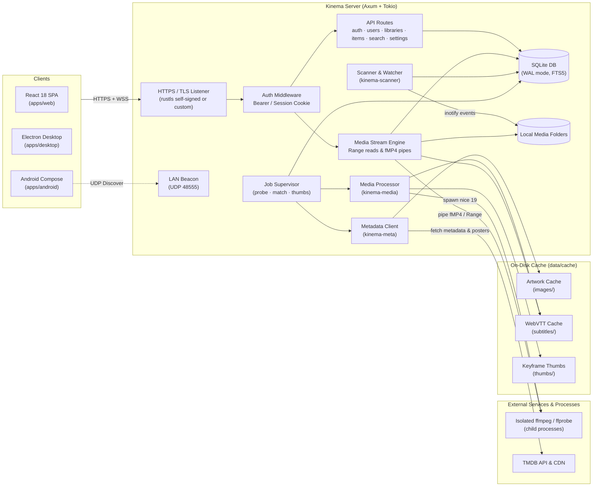
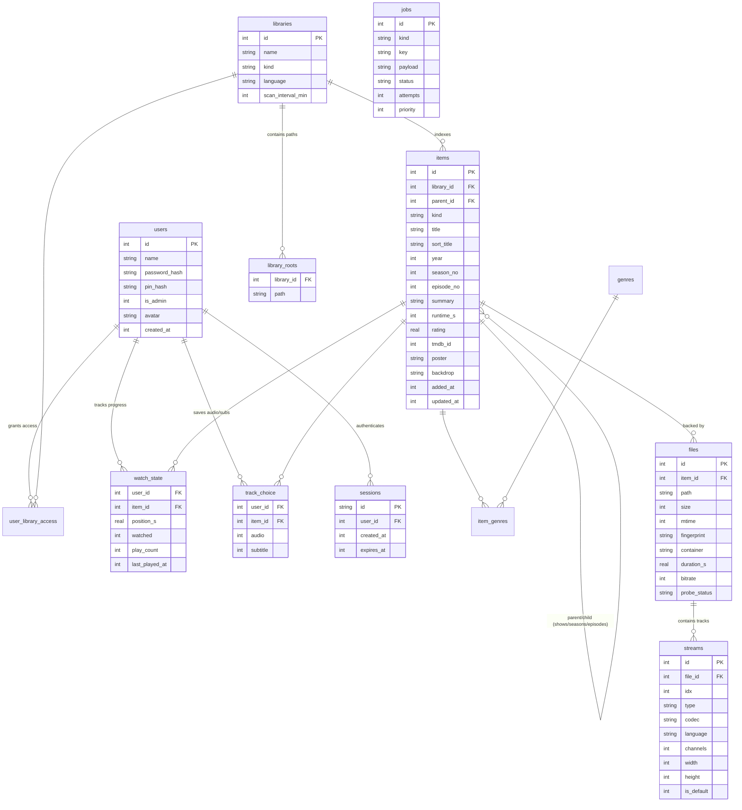
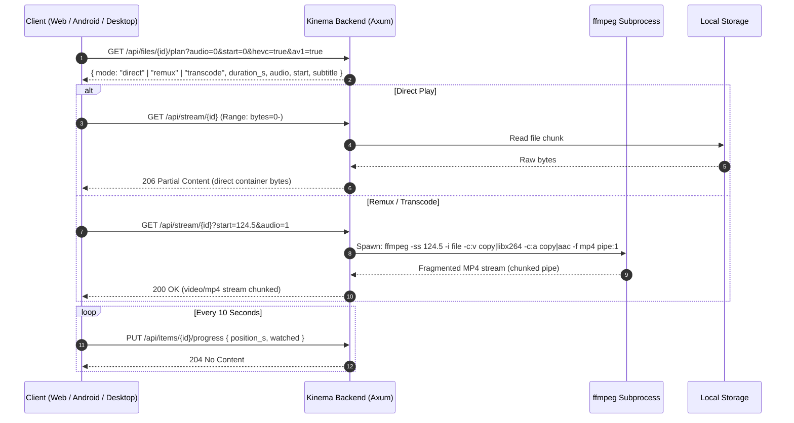

# Kinema

[](LICENSE)


```bash
# Home Server (Linux x86_64 / aarch64) - standalone bundle with backend, web UI, bundled FFmpeg 8.1 & systemd service
curl -fsSL https://raw.githubusercontent.com/aiyu-ayaan/Kinema/master/scripts/install-server.sh | sudo sh

# Desktop App (Linux x86_64) - AppImage, application menu launcher with icon & 'kinema' command
curl -fsSL https://raw.githubusercontent.com/aiyu-ayaan/Kinema/master/scripts/install-desktop.sh | sh
```

Kinema is a fast, self-hosted personal media server written in Rust, in the spirit of Plex Media Server. It scans local storage, organizes movies and TV shows with rich artwork and metadata from TMDB, and streams seamlessly across web browsers, desktop apps, and mobile devices.

Priorities: **near-zero idle CPU**, support for any media container and codec, a small dependency-light binary, **direct-play first**, and rock-solid privacy.

- **Zero-polling background monitoring**: Filesystem events (`notify` / inotify with debouncing) trigger scans instantly without burning idle CPU cycles.
- **Smart release parser**: Automatically groups episodes (`S01E02`, `1x02`, date patterns), collapses multi-part series, and identifies movies and shows even in mixed folders.
- **Direct play first**: Serves original streams directly via ranged HTTP reads. Remuxes container/audio formats on-the-fly without touching video streams. Re-encodes only when strictly necessary.
- **Never do work twice**: Probed media streams, extracted WebVTT subtitles, video keyframe grabs, and TMDB posters/backdrops are aggressively cached and keyed by file fingerprints (`size + mtime + content hash`).
- **Rich metadata**: Automatic lookup via TMDB API with local fallback (filename parsing + ffmpeg frame grabs). In-app Fix Match interface for corrections.
- **Family profiles**: Multi-user support with PIN or password protection, independent watch progress, and sticky per-profile audio and subtitle track memory across devices.
- **Native Android app**: Pure Jetpack Compose UI with Material 3 Expressive motion, Navigation 3 back-stack, Media3 ExoPlayer, and predictive back gestures.
- **Zero-conf LAN discovery**: Automatic UDP beacon discovery (port `48555`) with seamless roaming between home LAN and public reverse-proxy addresses.
- **HTTPS by default**: Generates an isolated self-signed TLS certificate on first boot; clients pin the certificate fingerprint to prevent MITM attacks on local networks.

---

## Quick Install

### Home Server (Linux x86_64 / aarch64)

Installs the standalone server bundle (backend, web UI, bundled FFmpeg 8.1, systemd service in `/opt/kinema`, data in `/var/lib/kinema`):

```bash
curl -fsSL https://raw.githubusercontent.com/aiyu-ayaan/Kinema/master/scripts/install-server.sh | sudo sh
# ... | sudo sh -s -- --port 32400       custom port (default 3000; auto-falls back if taken)
# ... | sudo sh -s -- --channel beta     beta builds (or alpha)
# ... | sudo sh -s -- --check            show installed and newest version, change nothing
# ... | sudo sh -s -- --force            reinstall even when up to date
# ... | sudo sh -s -- --uninstall        remove service (database & libraries kept in /var/lib/kinema)
```

### Desktop App (Linux x86_64)

Installs the desktop player for the current user (AppImage in `~/.local/share/kinema`, desktop menu entry with icon, and `kinema` command):

```bash
curl -fsSL https://raw.githubusercontent.com/aiyu-ayaan/Kinema/master/scripts/install-desktop.sh | sh
# ... | sh -s -- --channel beta          beta builds (or alpha)
# ... | sh -s -- --check                show installed and newest version, change nothing
# ... | sh -s -- --uninstall             remove app (settings kept in ~/.config/Kinema)
```

### Updating

Run the same install command again. Automatic updates are planned for later.

- **Server**: `curl -fsSL https://raw.githubusercontent.com/aiyu-ayaan/Kinema/master/scripts/install-server.sh | sudo sh`. It does nothing when already up to date. Otherwise it stops the service, backs up the database to `/var/lib/kinema/backup-<old version>`, swaps `/opt/kinema` in one step and restarts. If the new version does not start, it puts back the previous version and the database backup. The port, settings, library, the service's user and a `--channel` chosen earlier are kept.
- **Desktop (Linux)**: `curl -fsSL https://raw.githubusercontent.com/aiyu-ayaan/Kinema/master/scripts/install-desktop.sh | sh`, then restart the app if it was open. Settings and the saved server are kept.
- **Desktop (Windows)**: run the newer installer from the releases page over the installed one; settings in `%APPDATA%Kinema` are kept.
- **Docker**: `docker compose pull && docker compose up -d`.
- **Android**: install the newer APK over the installed one.

### Docker Compose

```bash
wget https://raw.githubusercontent.com/aiyu-ayaan/Kinema/master/docker-compose.yml
MEDIA_DIR=/path/to/media docker compose up -d
```

---

## Documentation

Full design documents, architectural decisions, and roadmaps are tracked in [`development/docs`](development/docs):

- [`development/docs/architecture.md`](development/docs/architecture.md) — Process model, crates, concurrency, and streaming paths.
- [`development/docs/data-model.md`](development/docs/data-model.md) — SQLite schema, indexes, and relations.
- [`development/docs/media-pipeline.md`](development/docs/media-pipeline.md) — Scanning, probing, seek offsets, and transcoding decisions.
- [`development/docs/metadata-and-artwork.md`](development/docs/metadata-and-artwork.md) — Filename parsing, TMDB matching, and thumbnail pipeline.
- [`development/docs/android.md`](development/docs/android.md) — Android Jetpack Compose client architecture, TLS pinning, and address roaming.
- [`development/docs/web-ui.md`](development/docs/web-ui.md) — React SPA structure, design tokens, and player implementation.
- [`development/docs/api.md`](development/docs/api.md) — REST API and WebSocket specification.
- [`development/docs/mvp.md`](development/docs/mvp.md) — MVP capabilities and verification.
- [`development/docs/security.md`](development/docs/security.md) — Threat model, sandboxing, and security mitigations.
- [`development/docs/packaging.md`](development/docs/packaging.md) — Linux AppImage, Windows packaging, and Docker containers.
- [`design-system/MASTER.md`](design-system/MASTER.md) — Color tokens (Ember palette), typography, and component specifications.

---

## How It Fits Together



Clients communicate strictly over HTTPS with the Axum backend. Background tasks (probing streams, pulling TMDB artwork, extracting subtitles, generating keyframe grabs) execute as isolated, lower-priority workers through `kinema-media` and `kinema-meta`, storing persistent cached artifacts under `data/cache/`.

---

## Data Model

Kinema persists all metadata, file inventory, streams, profiles, and watch history in a single SQLite database running in WAL mode with normal synchronization.



### Key Data Invariants
- **Content Fingerprinting**: Files are tracked by `fingerprint` (file size + head/tail content hash), allowing files to be renamed or reorganized across drives without losing watch state, metadata, or library placement.
- **Per-Profile State**: Progress (`position_s`, `watched`, `last_played_at`) and preferred audio/subtitle track choices are tracked strictly per user profile.
- **FTS5 Search**: An indexed virtual table (`items_fts`) provides full-text search across titles, series names, and plot overviews.

---

## Streaming & Media Pipeline

Kinema evaluates media containers, video/audio codecs, and client capabilities to select the most efficient streaming strategy:



### Playback Decision Matrix

| File Container & Codecs | Client Capabilities | Selected Mode | Cost |
|---|---|---|---|
| MP4 / M4V / WebM with browser-supported video & audio | Client supports container and codecs natively | **Direct Play** | Zero CPU; served directly via ranged reads |
| MKV / TS container, or secondary audio track | Video codec supported (e.g. H.264, HEVC, VP9); container or audio needs conversion | **Remux** | Very low CPU; video stream is copied without re-encoding, audio converted to AAC stereo in a fragmented MP4 container |
| Unsupported video codec (e.g. MPEG-2, VC-1, 10-bit H.264) | Client cannot decode stream | **Transcode** | Bounded CPU; transcoded to H.264/AAC with fast presets and resolution capping |
| Unprobed file or probe error | Any client | **Direct Play** | Fallback raw download; never hides unplayable files |

### Accurate Seek Offsets
Stream copy can only begin at a keyframe (or Matroska cue point). When a user seeks into a remuxed stream, Kinema calculates the exact prior keyframe time, launches `ffmpeg` at that boundary, and returns the keyframe timestamp as `start` in the plan. The client player offsets its playback time accordingly, ensuring seek bars and subtitles stay in exact synchronization.

### Subtitle Extraction
Sidecar files (`.srt`, `.vtt`) and embedded text subtitle streams (SRT, SSA/ASS, WebVTT) are converted on demand into WebVTT and cached in `data/cache/subtitles/`. The player overlays the cues client-side, allowing subtitle switching with zero interruption to video playback.

---

## Workspace Layout

Kinema is organized as a Cargo workspace with decoupled Rust crates alongside modern web, desktop, and mobile applications:

```
Kinema/
├── Cargo.toml                  # Cargo workspace definition
├── package.json                # Root pnpm scripts & build orchestration
├── pnpm-workspace.yaml         # Node packages: apps/*
├── backend/                    # Axum server binary crate: HTTP API, streaming, auth, worker supervisor
│   └── src/
│       ├── auth.rs             # Argon2 password/PIN hashing & 256-bit token sessions
│       ├── discovery.rs        # UDP broadcast responder (port 48555)
│       ├── state.rs            # AppState: DB connection pool, config, in-memory rate-limiters
│       ├── thumbs.rs           # Background video keyframe generation worker
│       ├── tls.rs              # Rustls self-signed TLS manager & certificate generator
│       └── routes/             # HTTP route modules (auth, libraries, items, media, settings)
├── crates/
│   ├── kinema-core/            # Domain models, configuration loaders, error types, platform abstractions
│   ├── kinema-db/              # SQLx database connection pool, migrations, and queries
│   ├── kinema-scanner/         # Walkdir filesystem walker, notify event debounce, and release name parser
│   ├── kinema-media/           # ffprobe metadata parser, ffmpeg command builders, seek calculators
│   └── kinema-meta/            # TMDB API client, rate limiting, artwork caching, and local fallback
├── apps/
│   ├── web/                    # React 18 + TypeScript + Vite + Tailwind CSS frontend
│   ├── desktop/                # Electron desktop wrapper with server switcher and LAN discovery
│   └── android/                # Native Android application (Jetpack Compose, Media3, Navigation 3)
│       ├── app/                # Compose screens, Material 3 expressive themes, player views
│       └── core/               # OkHttp client, TLS certificate pinning, Keystore AES-GCM secure store
├── design-system/              # Design specifications, Ember color tokens, component master docs
└── development/                # Architectural diagrams, specifications, and task tracking
    └── docs/                   # Authoritative design documentation
```

---

## Multi-Platform Clients

### 1. Web SPA (`apps/web`)
- Built with React 18, TypeScript, Tailwind CSS, TanStack Query, and Lucide icons.
- Dual theme support (Dark and Light) based on the **Ember** palette (`#E8553A`).
- Fully keyboard-accessible video player with Plex-style shortcuts (`Space` to toggle playback, `S` / `X` / `Escape` to stop, `F` for full screen, `M` to mute, arrows for 10s seeking and volume).

### 2. Desktop App (`apps/desktop`)
- Lightweight Electron shell bundling LAN discovery and server switcher.
- Configurable for Linux (`.AppImage`, `.deb`) and Windows (`.exe` installer).

### 3. Android App (`apps/android`)
- Designed exclusively for browsing and watching media on phones and tablets.
- **Predictive back gesture**: Screens fluidly scale down while revealing underlying pages.
- **Certificate Pinning**: Reads and pins the server's self-signed TLS fingerprint on first connection.
- **Home/Public Address Roaming**: Automatically checks whether the local server or public reverse proxy answers and switches transparently on network changes.

---

## Security Model

| Threat | Kinema Defense |
|---|---|
| **Path Traversal** | Clients never pass file paths to the server. Files are referenced solely by integer IDs; paths are resolved from the database and validated to ensure they reside within library roots. |
| **Media File Exploits** | `ffmpeg` and `ffprobe` run as sandboxed child processes with restricted environments, strict timeouts, and limited network access (`-protocol_whitelist file,pipe`). |
| **Credential Theft** | Passwords and PINs are hashed using Argon2id. Sessions use 256-bit cryptographically secure tokens whose SHA-256 hashes are stored in SQLite. |
| **Brute Force Attacks** | Authentication endpoints automatically lock out accounts for 60 seconds after 5 failed attempts. |
| **Eavesdropping on LAN** | HTTPS is enabled by default using an automatically generated TLS certificate. The Android app pins the certificate SHA-256 fingerprint. |
| **Cross-Profile Leakage** | All queries filtering watch history, playlists, and library permissions enforce user authorization boundaries at the database layer. |

---

## Getting Started

### Prerequisites
- **Rust**: 1.80+ (edition 2024)
- **Node.js**: 18+ and `pnpm`
- **FFmpeg & FFprobe**: Must be available on your system `PATH` (or specified via `KINEMA_FFMPEG` environment variable).

### Running in Development

Install workspace dependencies:
```bash
pnpm install
```

Start both the backend server and web frontend simultaneously:
```bash
pnpm dev
```
Open **http://localhost:5173** in your browser. On the first run, Kinema prompts you to create the administrator account and choose your media libraries.

### Dedicated Component Commands

```bash
pnpm dev:backend        # Run backend with auto-restart on .rs / .toml / .sql changes
pnpm start:backend      # Run backend once (cargo run)
pnpm dev:web            # Run Vite dev server for web UI only
pnpm dev:desktop        # Run Electron desktop client
pnpm android:dev        # Build, deploy, and launch Android dev build on connected device/emulator
```

### Verification & Testing

```bash
pnpm lint               # Run ESLint on web/desktop and Cargo Clippy on all Rust crates
pnpm test               # Run Rust workspace tests, web unit tests, and desktop tests
pnpm android:test       # Run Android core unit tests
```

### Production Build

```bash
pnpm build              # Compiles web distribution, then builds release backend binary
```

Run the compiled server:
```bash
APP_ENV=production ./target/release/kinema-server
```

---

## Clean-Room Engineering

Kinema is developed strictly following clean-room software design principles. No proprietary code, assets, or decompiled binaries from Plex or other closed-source media solutions are used. All behaviors, protocols, and database designs are derived entirely from public media specifications, open standard APIs (TMDB, WebVTT, HLS, Matroska, MP4), and original design choices.

---

## License

Kinema is released under the [MIT License](LICENSE).
