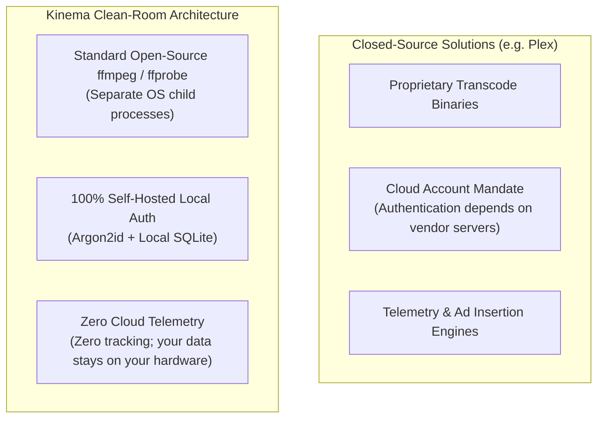

# Clean-Room Engineering & Compliance

Kinema is developed in strict accordance with **Clean-Room Software Engineering** standards to ensure complete copyright compliance, maintainable architectural independence, and freedom from proprietary lock-in.

---

## Clean-Room Principles

1. **No Proprietary Code or Binaries**:
   - Kinema contains no reverse-compiled, decompiled, or disassembled code from Plex Media Server, Jellyfin, Emby, or any proprietary streaming products.
   - Proprietary assets, logos, and closed client packages are strictly forbidden in the codebase.
2. **Open Standards Alignment**:
   - Media parsing adheres exclusively to publicly documented ISO and RFC standards:
     - ISO/IEC 14496-12 (ISO base media file format / MP4 / fMP4)
     - Matroska Specification (MKV/MKA)
     - RFC 8216 (HTTP Live Streaming / HLS)
     - W3C WebVTT (Web Video Text Tracks)
3. **Open Metadata APIs**:
   - Metadata is retrieved from public community-governed endpoints:
     - [The Movie Database (TMDB)](https://www.themoviedb.org) v3/v4 REST APIs
     - [TVmaze](https://www.tvmaze.com) CC BY-SA 4.0 endpoints for keyless fallback
4. **Isolated Scratch Workspace**:
   - The `research/` directory is isolated from all build pipelines and package outputs. It is permanently ignored in `.gitignore` and never committed or compiled into release binaries.

---

## Clean-Room vs. Conventional Media Servers

---

## Licensing Architecture

- **Kinema Backend & Clients**: Released under the permissive **MIT License**.
- **FFmpeg & Media Binaries**:
  - Kinema does **not** link statically or dynamically against `libavcodec`, `libavformat`, or `libavutil`.
  - Instead, Kinema interacts with `ffmpeg` and `ffprobe` exclusively as external child processes via OS pipes (`stdin`, `stdout`, `stderr`).
  - This architecture cleanly adheres to GNU General Public License (GPL) requirements while preserving the permissive MIT license of the core Kinema application.
