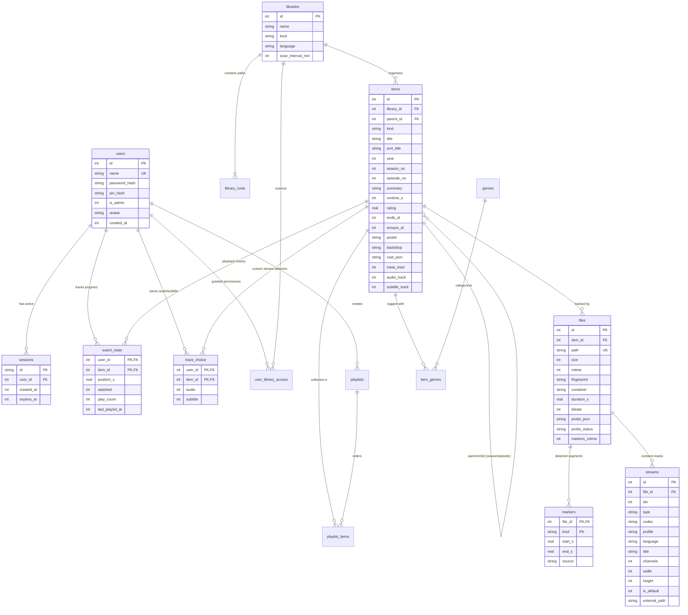

# Data Model & Storage Architecture

Kinema uses an embedded SQLite database configured in **WAL (Write-Ahead Logging)** mode. This design delivers millisecond query response times, zero external database daemon dependencies, and robust crash resilience.

---

## Entity-Relationship Diagram

The complete database schema across all 7 migrations is modeled below:



---

## Schema Migration History

Migrations are strictly append-only SQL files located in `crates/kinema-db/migrations/`:

| Migration | Version Tag | Description |
|---|---|---|
| `20261019000001` | Initial Schema | Creates `users`, `libraries`, `items`, `files`, `streams`, `genres`, `watch_state`, `sessions`, `jobs`, and `items_fts`. |
| `20261019000002` | MVP Updates | Adds `settings` key-value table, `items.meta_tried` flag, and stream metadata (`title`, `external_path`). |
| `20261019000003` | Cast Members | Adds `items.cast_json` for actor, director, and character billing. |
| `20261019000004` | TVmaze Support | Adds `items.tvmaze_id` column for keyless TV show metadata fallback. |
| `20261019000005` | Series Track Defaults | Adds `items.audio_track` and `items.subtitle_track` to series items for show-level defaults. |
| `20261019000006` | User Track Preferences | Adds `track_choice` table for per-user, per-show audio and subtitle stream stickiness. |
| `20261020000007` | Intro & Credit Markers | Adds `markers` table (`file_id`, `kind`, `start_s`, `end_s`, `source`) and `files.markers_mtime`. |

---

## Performance Optimizations

1. **WAL Mode**:
   ```sql
   PRAGMA journal_mode = WAL;
   PRAGMA synchronous = NORMAL;
   PRAGMA foreign_keys = ON;
   ```
   Readers never block writers, and writers never block readers.
2. **Compound Indexes**:
   - `CREATE INDEX idx_items_parent ON items(parent_id);` — Accelerates fetching season and episode lists.
   - `CREATE INDEX idx_watch_state_user ON watch_state(user_id, last_played_at DESC);` — Instant home shelf generation for "Continue Watching".
   - `CREATE INDEX idx_files_path ON files(path);` — Speeds up delta checks during directory rescans.
3. **Full-Text Search (FTS5)**:
   - Backed by an SQLite virtual table:
     ```sql
     CREATE VIRTUAL TABLE items_fts USING fts5(title, summary, content='items', content_rowid='id');
     ```
   - Automatic triggers sync inserts, updates, and deletes from `items` into `items_fts`.
