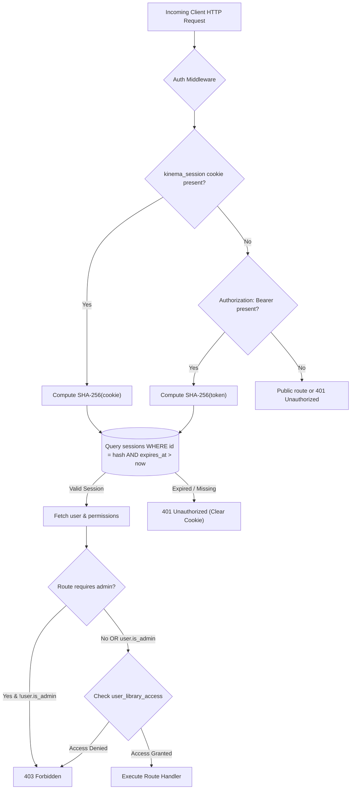

# Security & Authentication Architecture

Kinema is designed to operate securely both on private local networks and exposed to the public Internet via reverse proxies or direct TLS port forwarding.



---

## Threat Model & Security Controls

| Threat Scenario | Mitigating Control in Kinema |
|---|---|
| **Path Traversal / Unauthorized File Access** | Absolute paths are strictly resolved through verified library roots. Client requests never accept raw file paths—only internal integer `item_id` and `file_id` identifiers. |
| **Media File Exploitation** | `ffmpeg` and `ffprobe` execute as non-shell sandboxed child processes with restricted environments (`-protocol_whitelist file,pipe`). |
| **Credential Theft** | Passwords and PINs are hashed using salted **Argon2id**. Raw session tokens are never stored; only their SHA-256 hashes reside in the database. |
| **Brute-Force Password / PIN Guessing** | In-memory tracking enforces a strict lockout: 5 consecutive failed attempts trigger a 60-second lockout (`429 Too Many Requests`). |
| **LAN Eavesdropping** | HTTPS is enabled by default with self-signed TLS certificates generated via `rcgen`. Desktop and Android clients pin the SHA-256 certificate fingerprint. |
| **Cross-Profile Data Leaks** | Watch history, bookmarks, and per-profile audio/subtitle preferences are strictly partitioned at the database layer with user foreign keys. |

---

## Authentication Primitives

### 1. Argon2id Password Hashing
Kinema uses `argon2::Argon2::default()` with random cryptographic salts from `rand::rngs::OsRng`. This ensures protection against GPU and ASIC cracking attacks.

### 2. Dual-Token Session Delivery
To support both modern REST client architectures and native browser media streaming tags (`<video>`, ``, and WebVTT tracks), Kinema provides two simultaneous authentication vectors:

1. **Authorization Header**:
   ```http
   Authorization: Bearer 7a4e8d3c129...0b
   ```
   Used by JSON API calls from Web, Desktop, and Android clients.
2. **HttpOnly Session Cookie**:
   ```http
   Set-Cookie: kinema_session=7a4e8d3c...; Path=/api; HttpOnly; SameSite=Strict; Max-Age=2592000; Secure
   ```
   Ensures that streaming video chunks, image posters, and subtitles can be loaded natively without exposing credentials to malicious scripts.

### 3. TLS Certificate Pinning
On first startup, Kinema automatically generates an X.509 self-signed TLS certificate (`tls/cert.pem` and `tls/key.pem`).
- The SHA-256 fingerprint of the certificate is exposed via `/api/server/info`.
- Both the **Electron Desktop** shell and **Android Compose** application pin this fingerprint:

```kotlin
// Android PinnedTrustManager implementation
class PinnedTrustManager(private val expectedFingerprint: String) : X509TrustManager {
    override fun checkServerTrusted(chain: Array<X509Certificate>, authType: String) {
        val cert = chain[0]
        val digest = MessageDigest.getInstance("SHA-256")
        val fingerprint = digest.digest(cert.encoded).toHex()
        if (!fingerprint.equals(expectedFingerprint, ignoreCase = true)) {
            throw CertificateException("TLS Pinning Failed: Untrusted certificate fingerprint")
        }
    }
}
```

This prevents Man-in-the-Middle (MitM) attacks on public Wi-Fi networks without requiring expensive third-party domain and CA setup for local LAN usage.
