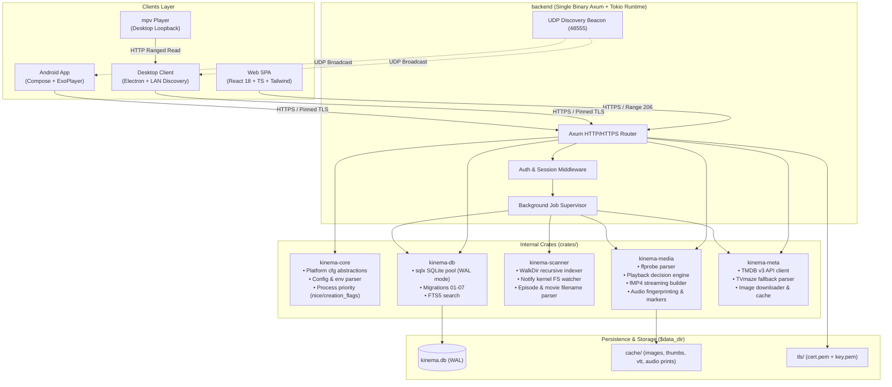
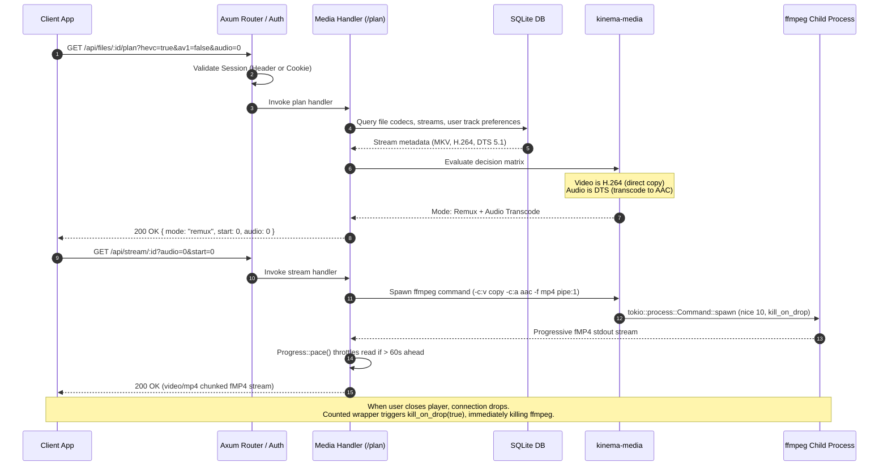

# System Architecture & Crates Overview

Kinema is organized as a Cargo workspace with distinct, single-responsibility Rust crates designed to maximize testability, keep dependencies minimal, and ensure strict platform independence.

---

## Workspace Crates Breakdown

### 1. `backend` (`backend/`)
The primary Rust binary crate.
- **Axum Web Server**: Exposes REST endpoints, validates authentication, handles HTTP range requests, and manages progressive fMP4 chunked streaming.
- **TLS Management**: Automatically generates self-signed TLS certificates on first boot using `rcgen`, computes a SHA-256 fingerprint for client pinning, and binds via `rustls`.
- **Job Supervisor**: Asynchronous scheduler executing folder rescans, missing thumbnail generation, and audio fingerprint theme matching without blocking request workers.
- **Discovery Service**: Listens and responds to `KINEMA_DISCOVER` broadcasts over UDP port `48555`.

### 2. `kinema-core` (`crates/kinema-core/`)
Cross-platform primitives and configuration:
- **Platform Independence**: OS-specific logic lives exclusively behind `cfg(unix)` and `cfg(windows)`.
  - Unix: Configures child process priorities via `libc::nice(10)` (playback) and `libc::nice(19)` (background jobs).
  - Windows: Uses `BELOW_NORMAL_PRIORITY_CLASS` and `IDLE_PRIORITY_CLASS`.
- **Virtual Filesystem Checks**: Detects network drives or virtual filesystems (e.g., FUSE, SMB, NFS) to disable inotify and tune read buffers accordingly.

### 3. `kinema-db` (`crates/kinema-db/`)
Persistent storage and relational queries:
- **Connection Management**: Configures SQLite with `PRAGMA journal_mode = WAL;`, `PRAGMA synchronous = NORMAL;`, and `PRAGMA foreign_keys = ON;`.
- **Append-Only Migrations**: 7 standard SQL migrations managing users, libraries, files, streams, track choices, and markers.
- **FTS5 Full-Text Search**: Instant search over movie, show, and episode titles and summaries.

### 4. `kinema-media` (`crates/kinema-media/`)
Audio, video, and subtitle pipeline:
- **Resolver**: Locates `ffmpeg` and `ffprobe` binaries across system paths, environment overrides, and bundled directories.
- **Decision Engine**: Calculates playback mode (`Direct Play`, `Remux`, `Transcode`) based on container, video codec, audio codec, and client capabilities.
- **Progress Throttling**: Monitors real-time ffmpeg progress via stderr; pauses stdout reads when transcoding exceeds 60 seconds ahead of playback.
- **Audio Fingerprint Theme Detection**: Computes Haitsma & Kalker 33-band spectrogram hashes to identify shared theme music across season episodes.

### 5. `kinema-meta` (`crates/kinema-meta/`)
Metadata scraping and caching:
- **TMDB API Client**: Scrapes posters, backdrops, overviews, ratings, and cast members.
- **TVmaze Fallback**: Zero-credential fallback for TV show hierarchies and artwork when no TMDB key is provided.
- **Artwork Cache**: Hashes images and writes them to disk with immutable HTTP caching headers.

### 6. `kinema-scanner` (`crates/kinema-scanner/`)
Filesystem discovery and monitoring:
- **WalkDir Indexer**: High-speed traversal of media folders, resolving multi-part movies and sidecar subtitles (`.srt`, `.vtt`, `.ass`).
- **Filename Parser**: Heuristic regex parser identifying release years, standard `S01E02` patterns, anime numbering, and special feature tags.
- **Change Watcher**: `notify`-based kernel filesystem watcher that registers new or modified media without periodic disk scanning.

---

## Detailed Request Lifecycle

The diagram below traces an incoming playback session request from a client to the underlying media process:

