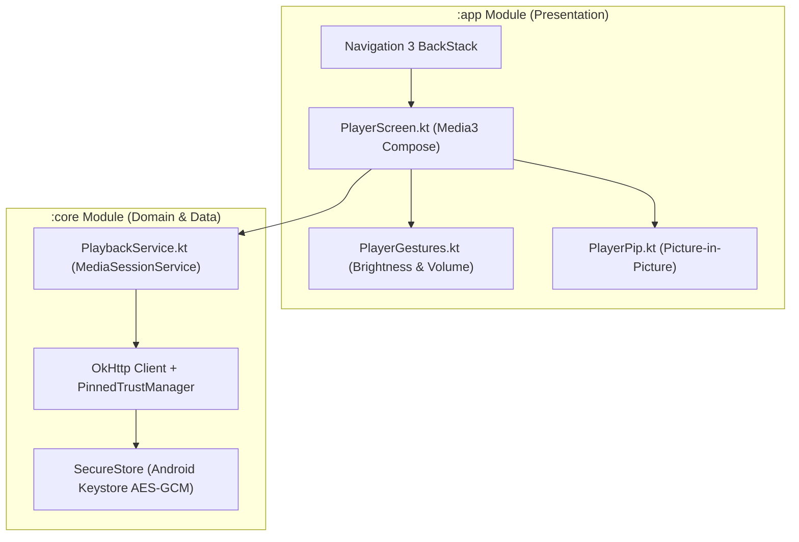

# Android Jetpack Compose App

The Kinema Android client (`apps/android`) is a watch-optimized native application built with **Jetpack Compose**, **Material 3 Expressive**, and **AndroidX Media3 ExoPlayer**.

---

## Architectural Separation

The Android project is strictly partitioned into two Gradle modules:
1. `:core`: Non-UI platform library containing OkHttp networking, `PinnedTrustManager`, encrypted `SecureStore` (AES-256-GCM via Android Keystore), and SQLite offline repositories.
2. `:app`: Presentation layer containing Compose UI screens, Android 12+ predictive back gesture animations, Picture-in-Picture (PiP) controllers, and ExoPlayer integration.

---

## Key Android Features

### 1. Foreground Playback & MediaSessionService
Playback is managed by an Android `MediaSessionService` (`PlaybackService.kt`). When the user locks their screen or switches apps:
- Playback continues seamlessly in the background without being killed by the Android low-memory killer.
- Lock screen displays rich media artwork, playback controls, and interactive seekbars.

### 2. Picture-in-Picture (PiP)
- Automatically enters Picture-in-Picture mode when the user swipes up to return home while a video is playing.
- Seamlessly transitions aspect ratios to match the video dimensions (e.g. 16:9 widescreen or 2.39:1 anamorphic cinema).

### 3. Vertical Swipe Touch Gestures
- **Left Edge Swipe**: Adjusts screen brightness from 0% to 100%.
- **Right Edge Swipe**: Adjusts audio volume. Once standard system volume hits 100%, continuing the swipe activates Android's hardware `LoudnessEnhancer` audio effect, boosting volume up to **200%** for quiet dialogue.

### 4. Dual-Network Roaming
The app registers network callbacks with Android's `ConnectivityManager`. When moving from home Wi-Fi to cellular data, the app automatically switches connection URLs from the local LAN address (`https://192.168.1.50:3000`) to the public server URL without interrupting the active playback buffer.
