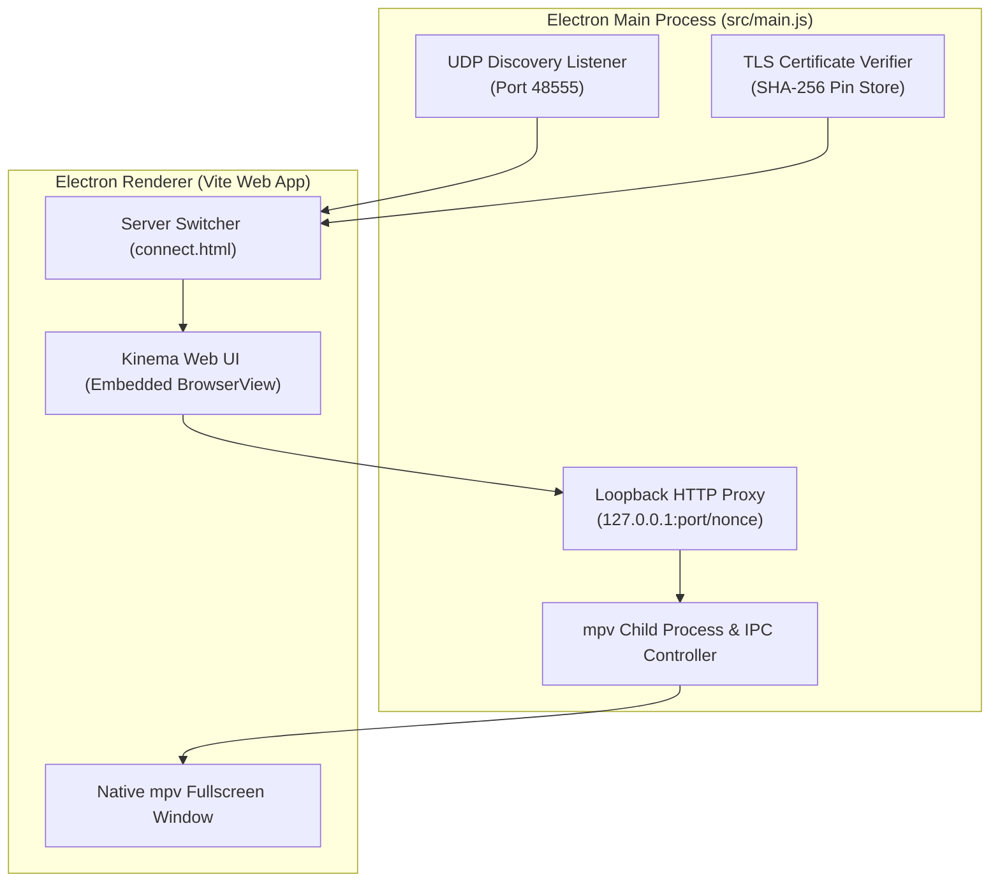

# Electron Desktop Client

The **Kinema Desktop App** (`apps/desktop`) provides a dedicated desktop shell for Linux and Windows workstations. It bridges the gap between web simplicity and native desktop media capabilities.

---

## Architecture & Responsibilities



---

## 1. UDP LAN Discovery & Server Switcher

When the desktop app opens, it checks for saved servers in `userData/kinema.json`. If no server is configured or the current server is offline:
- The main process broadcasts a UDP discovery datagram:
  ```
  KINEMA_DISCOVER
  ```
  to `255.255.255.255:48555`.
- Any Kinema server on the local subnet responds with its server name, version, and local HTTPS port.
- The user is presented with a zero-configuration server switcher displaying all discovered servers with latency indicators.

---

## 2. Desktop mpv Integration

While the embedded web view is ideal for standard browsing, playing 4K 10-bit anime or lossless audio often triggers video transcoding on web engines.

- When "Play in mpv" is clicked, Electron launches `mpv` as a separate child process.
- The stream is routed through a local HTTP loopback proxy with cryptographic nonces (see [Desktop MPV Loopback Proxy](../media-pipeline/mpv-proxy.md)).
- Full bi-directional playback synchronization ensures watch state and progress stay accurate.

---

## 3. Platform Packaging

- **Linux**: Distributed as a standalone x86_64 / aarch64 AppImage and portable tarball.
- **Windows**: Packaged as an Inno Setup installer executable (`Kinema-Setup.exe`) and portable `.zip`.
