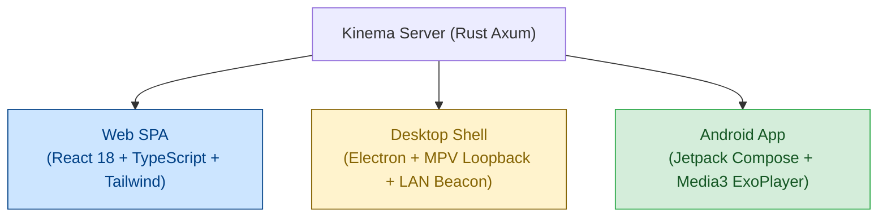

# Multi-Platform Clients Overview

Kinema provides first-class native client applications designed to deliver a smooth, high-fidelity playback experience across web browsers, desktop workstations, and mobile devices.

---

## Client Capabilities Matrix

| Feature | Web App (`apps/web`) | Desktop App (`apps/desktop`) | Android App (`apps/android`) |
|---|---|---|---|
| **Primary Engine** | HTML5 `<video>` / fMP4 | HTML5 `<video>` or Native `mpv` | AndroidX Media3 ExoPlayer |
| **Direct Play Codecs** | H.264, VP9, HEVC/AV1 (browser dependent) | Any codec supported by `mpv` (10-bit, VC-1, ProRes) | H.264, VP9, HEVC, AV1 (device decoders) |
| **Max Audio Volume** | **200%** (Web Audio Limiter) | **200%** (mpv volume boost) | **200%** (Android `LoudnessEnhancer`) |
| **LAN Auto-Discovery** | Manual URL / Saved session | UDP 48555 Beacon scan | UDP 48555 Beacon scan |
| **Self-Signed TLS** | Browser Trust Prompt / CA | Pinned SHA-256 fingerprint | `PinnedTrustManager` (SHA-256) |
| **Seek Frame Hold** | Offscreen `<canvas>` poster hold | Native mpv pause hold | ExoPlayer surface buffer |
| **Intro / Credit Skip** | Interactive pill button | Interactive pill button | Touch button + PiP controls |
| **Picture-in-Picture** | Native Browser PiP API | Windowed mini-player | Android System PiP (Auto-enter on Home) |
| **Touch Gestures** | Click & drag seek bar | Keyboard shortcuts | Vertical swipe brightness & volume |

---

## Next Steps

- Explore the [Web Player Architecture](./web-player.md) to understand the Web Audio booster and offscreen frame hold.
- Learn how the [Electron Desktop Shell](./desktop-app.md) discovers local servers and integrates mpv.
- Read about the [Android Jetpack Compose App](./android-app.md) and its MediaSession foreground service.
