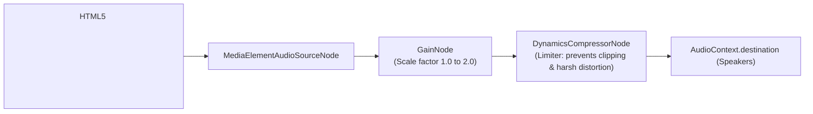

# Web Player SPA Architecture

The Kinema Web Application (`apps/web`) is a high-performance Single Page Application built with **React 18**, **TypeScript**, **Vite**, and **Tailwind CSS 3**.

---

## Key Playback Innovations

### 1. Web Audio API 200% Booster (`AudioContext`)
Media files often have quiet audio tracks (especially 5.1 surround mixes downmixed into stereo laptop speakers). While the standard HTML5 `<video>` element caps volume at `1.0` (100%), Kinema implements a transparent Web Audio API boost node:



When the volume slider moves beyond 100%:
- Volume up to 100%: Scaled natively via `video.volume`.
- Volume over 100%: The `GainNode` scales amplification up to 2.0x, and the `DynamicsCompressorNode` smoothly tamps down loud peaks to prevent speaker crackle and distortion.

---

### 2. Offscreen Canvas Video Frame Hold
On remux and transcode streams, seeking to a new timestamp requires the browser to buffer a new fMP4 fragment, typically resulting in an ugly black flash.

Kinema eliminates this visual glitch using an offscreen canvas:
1. Immediately before sending a seek request, the player captures the active `<video>` frame:
   ```typescript
   const canvas = document.createElement('canvas');
   canvas.width = video.videoWidth;
   canvas.height = video.videoHeight;
   const ctx = canvas.getContext('2d');
   ctx.drawImage(video, 0, 0);
   video.poster = canvas.toDataURL();
   ```
2. The user sees the frozen last-known frame rather than a blank black box.
3. The instant the new fragment fires its first `canplay` or `timeupdate` event, the temporary poster is cleared.

---

### 3. Dynamic Subtitle Cues Renderer
Rather than relying on browser-native subtitle rendering (which lacks customizable positioning and shadow styling), Kinema fetches WebVTT streams via `/api/subtitles/:stream_id` and parses cues using `lib/vtt.ts`:
- Text is rendered over a translucent contrast plate.
- Applies `.text-over-media` dual-layer text shadows to ensure subtitles remain legible across high-contrast, pure-white backgrounds (e.g. anime skies or snowy landscapes).
