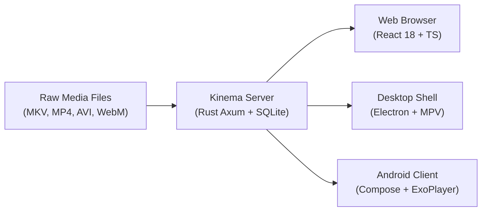

# Kinema Overview & Philosophy

**Kinema** is a self-hosted personal media server written in Rust, built in the spirit of Plex Media Server, but engineered from scratch to operate with near-zero idle resource consumption, instant startup, and strict adherence to clean-room open-source engineering.

---

## Core Priorities

### 1. Direct Play First, Transcode Last
Other media servers often default to heavy transcode pipelines when minor container incompatibilities arise. Kinema implements a three-tier decision engine:
1. **Direct Play**: If the client can decode the stream and the container is native (e.g. MP4, WebM), files are served directly with range requests and zero-copy kernel `sendfile`. CPU usage remains at ~0%.
2. **Remuxing (Stream Copy)**: If the client can decode the video and audio codecs but the container is unsupported (e.g., MKV containing H.264 + AAC), Kinema repackages the video packets into fragmented MP4 (`fMP4`) without re-encoding video frames.
3. **Re-Encoding (Transcode)**: Only when client decoders lack hardware or software support (e.g., 10-bit H.264, VC-1, or unsupported HEVC/AV1) does Kinema spawn an ffmpeg encoder.

### 2. Zero Runtime Bloat & Idle Efficiency
- **Filesystem Event Driven**: Kinema uses kernel filesystem watches (`notify`) instead of polling disks every few seconds. When no clients are streaming and no new files are dropped into libraries, the server consumes 0% CPU.
- **Single Native Binary**: Static musl backend on Linux with `mimalloc`, bundling the axum server, SQLite connection manager, metadata scrapers, and web UI.
- **Sandboxed Worker Priority**: Background jobs (indexing, thumbnail generation, intro detection) execute at `nice 19` (idle priority on Windows). Live transcodes execute at `nice 10` and are strictly throttled to stay at most 60 seconds ahead of playback.

### 3. Pure Clean-Room Development
Kinema is developed entirely using clean-room reverse engineering standards. No proprietary code, assets, decompiled binaries, or undocumented internal APIs from Plex or other closed-source media solutions are used. All behaviors, protocols, and database designs are derived entirely from public media specifications (Matroska, MP4, WebVTT, HLS) and public REST APIs (TMDB, TVmaze).

---

## Feature Matrix

| Feature | Kinema | Legacy Media Servers |
|---|---|---|
| **Language & Engine** | Rust 2024 (Axum + Tokio) | C# (.NET) / C++ / Java |
| **Idle CPU Usage** | ~0.0% (FS event driven) | 1–5% (periodic background polling) |
| **Database** | SQLite WAL (Embedded, zero-config) | SQLite or External DB (PostgreSQL/MySQL) |
| **Transcode Pacing** | Real-time throttle (60s ahead) | Often buffers entire files into temp storage |
| **Audio Desync Fix** | Unified PTS audio re-encode | Frequent AV seek drift on low-end clients |
| **Hardware Decoding** | V4L2 DRM (Raspberry Pi 5) + VAAPI | Proprietary/closed driver integrations |
| **Audio Boost** | Web Audio Limiter + LoudnessEnhancer (200%) | Flat software volume amplification |
| **Desktop Playback** | Native mpv loopback proxy | Web-view wrapper transcode |
| **Cloud Dependency** | None (100% local auth & tokens) | Requires vendor cloud sign-in |

---

## Next Steps

- Jump into the [Quick Start Guide](./quick-start.md) to launch Kinema via Docker or native binary.
- Explore the [Configuration Reference](./configuration.md) for environment variables and tuning.
- Learn about the [System Architecture](../architecture/system-overview.md).
