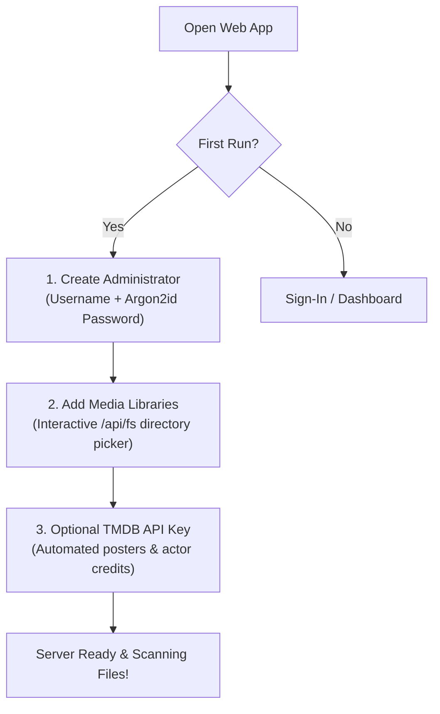

# Quick Install & Setup

Kinema can be installed via an automated standalone script (recommended), run with Docker Compose, or compiled from source.

---

## Method 1: One-Line Install Script (Recommended)

The installation scripts download the pre-compiled, self-contained release bundle with the static Rust backend, web frontend distribution, and pinned **FFmpeg 8.1** binaries.

### Home Server (Linux x86_64 / aarch64)

Installs the standalone server bundle into `/opt/kinema`, creates a dedicated systemd service, and sets up persistent storage in `/var/lib/kinema`:

```bash
curl -fsSL https://raw.githubusercontent.com/aiyu-ayaan/Kinema/master/scripts/install-server.sh | sudo sh
```

#### Optional Command-Line Flags

```bash
# Custom port (default 3000; auto-falls back if taken)
curl -fsSL https://raw.githubusercontent.com/aiyu-ayaan/Kinema/master/scripts/install-server.sh | sudo sh -s -- --port 32400

# Install beta or alpha builds
curl -fsSL https://raw.githubusercontent.com/aiyu-ayaan/Kinema/master/scripts/install-server.sh | sudo sh -s -- --channel beta

# Check installed vs newest upstream version without making changes
curl -fsSL https://raw.githubusercontent.com/aiyu-ayaan/Kinema/master/scripts/install-server.sh | sudo sh -s -- --check

# Force re-installation even if already up to date
curl -fsSL https://raw.githubusercontent.com/aiyu-ayaan/Kinema/master/scripts/install-server.sh | sudo sh -s -- --force

# Remove the systemd service (database and media library remain safe in /var/lib/kinema)
curl -fsSL https://raw.githubusercontent.com/aiyu-ayaan/Kinema/master/scripts/install-server.sh | sudo sh -s -- --uninstall
```

---

### Desktop App (Linux x86_64)

Installs the native desktop player for the current user into `~/.local/share/kinema`, installs an application launcher menu entry with desktop icon, and creates a symlink for the `kinema` terminal command:

```bash
curl -fsSL https://raw.githubusercontent.com/aiyu-ayaan/Kinema/master/scripts/install-desktop.sh | sh
```

#### Desktop Flags

```bash
# Check installed and latest version
curl -fsSL https://raw.githubusercontent.com/aiyu-ayaan/Kinema/master/scripts/install-desktop.sh | sh -s -- --check

# Install beta builds
curl -fsSL https://raw.githubusercontent.com/aiyu-ayaan/Kinema/master/scripts/install-desktop.sh | sh -s -- --channel beta

# Remove desktop app (settings kept in ~/.config/Kinema)
curl -fsSL https://raw.githubusercontent.com/aiyu-ayaan/Kinema/master/scripts/install-desktop.sh | sh -s -- --uninstall
```

---

## Updating & Zero-Downtime Rollback

Kinema includes automated update and rollback protection:

- **Server Updates**: Run the install script again:
  ```bash
  curl -fsSL https://raw.githubusercontent.com/aiyu-ayaan/Kinema/master/scripts/install-server.sh | sudo sh
  ```
  - If the server is already on the newest release, the script exits immediately without downtime.
  - When an update is detected, it stops the service, creates an automated database snapshot in `/var/lib/kinema/backup-<old version>`, atomically replaces `/opt/kinema`, and restarts the service.
  - **Self-Healing Rollback**: If the new binary fails healthchecks on startup, the script automatically restores the previous binary and database backup. Your port, settings, and library choices are strictly preserved.
- **Desktop Updates**: The desktop client checks GitHub releases on launch and offers self-updating AppImage replacement. Running the install script again also updates the binary cleanly.

---

## Method 2: Docker Compose (Alternative)

For containerized environments:

```bash
wget https://raw.githubusercontent.com/aiyu-ayaan/Kinema/master/docker-compose.yml
MEDIA_DIR=/path/to/media docker compose up -d
```

### `docker-compose.yml` Configuration

```yaml
services:
  kinema:
    image: ghcr.io/aiyu-ayaan/kinema:latest
    container_name: kinema
    network_mode: host # Enables UDP port 48555 LAN discovery
    restart: unless-stopped
    volumes:
      - ./data:/app/data
      - /mnt/storage/movies:/media/movies:ro
      - /mnt/storage/tv:/media/tv:ro
    environment:
      - KINEMA_DATA_DIR=/app/data
      - TZ=UTC
```

---

## Method 3: Running from Source (Development)

### Prerequisites

- **Rust**: 1.80+ (edition 2024).
- **Node.js**: 18+ and `pnpm`.
- **FFmpeg & FFprobe**: Available on `PATH` (or via `KINEMA_FFMPEG`).
- **mpv** *(optional)*: For Desktop client's native zero-transcode player.

### Clone & Run

```bash
git clone https://github.com/aiyu-ayaan/Kinema.git
cd Kinema

# Install workspace dependencies
pnpm install

# Start backend and web UI concurrently with Vite HMR
pnpm dev
```

Open `http://localhost:5173` in your browser.

---

## First-Run Setup Wizard

When you open Kinema for the first time on `http://localhost:3000`:



1. **Admin Account**: Set your master username and password (hashed with Argon2id).
2. **Library Setup**: Add folder paths using the interactive server filesystem browser.
3. **Metadata Matching**: Enter your free TMDB API key (or let Kinema fall back to TVmaze and local ffmpeg frame grabs).
