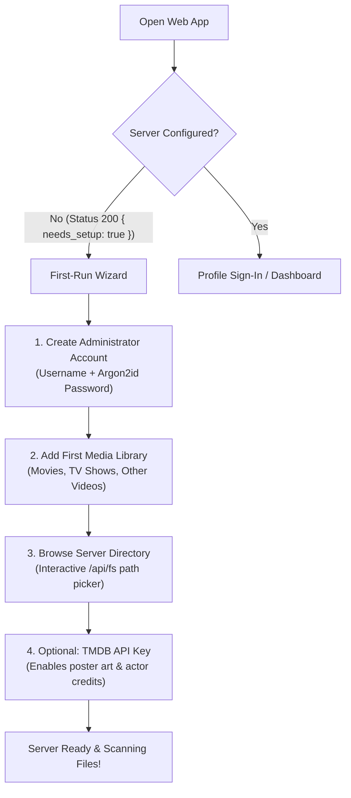

# Quick Start Guide

Get your Kinema media server up and running in minutes. You can run Kinema using Docker (recommended for production servers) or compile and run natively on Linux, macOS, or Windows.

---

## Method 1: Docker (Recommended)

Kinema provides multi-arch Docker images (`linux/amd64` and `linux/arm64`) that bundle the Rust backend, pre-compiled web distribution, and pinned `ffmpeg` and `ffprobe` binaries.

### Using Docker Compose

Create a `docker-compose.yml` file:

```yaml
services:
  kinema:
    image: ghcr.io/aiyu-ayaan/kinema:latest
    container_name: kinema
    network_mode: host # Highly recommended for LAN discovery (UDP 48555)
    restart: unless-stopped
    volumes:
      - ./data:/app/data
      - /mnt/storage/movies:/media/movies:ro
      - /mnt/storage/tv:/media/tv:ro
    environment:
      - KINEMA_DATA_DIR=/app/data
      - TZ=UTC
```

Start the container in the background:

```bash
docker compose up -d
```

### Using Docker CLI

```bash
docker run -d \
  --name kinema \
  --network host \
  --restart unless-stopped \
  -v $(pwd)/data:/app/data \
  -v /mnt/storage/movies:/media/movies:ro \
  -v /mnt/storage/tv:/media/tv:ro \
  -e KINEMA_DATA_DIR=/app/data \
  ghcr.io/aiyu-ayaan/kinema:latest
```

:::note Host Networking
Using `network_mode: host` is essential if you want automatic local server discovery via UDP port `48555` on Android and Desktop clients. If running with bridged bridge ports (`-p 3000:3000`), clients will need to enter the server IP manually.
:::

---

## Method 2: Running from Source (Development)

### Prerequisites

1. **Rust**: 1.80+ (edition 2024). Install via [rustup.rs](https://rustup.rs).
2. **Node.js**: v18+ and `pnpm` (v9+).
3. **FFmpeg & FFprobe**: Must be installed and accessible on your `PATH`.
4. *(Optional)* **mpv**: Required for the Desktop client's "Play in mpv" mode.

### Setup & Run

1. **Clone the repository:**

```bash
git clone https://github.com/aiyu-ayaan/Kinema.git
cd Kinema
```

2. **Install JavaScript workspace dependencies:**

```bash
pnpm install
```

3. **Start the backend and web client simultaneously:**

```bash
pnpm dev
```

The Vite development server will open on `http://localhost:5173` with full Hot Module Replacement (HMR) and proxy all `/api/*` and stream requests to the Axum backend on `http://localhost:3000`.

### Dedicated Component Commands

```bash
pnpm dev:backend    # Runs Rust backend with hot-reload on .rs, .toml, and .sql changes
pnpm dev:web        # Runs only the Vite React 18 web UI
pnpm dev:desktop    # Launches Electron desktop client
pnpm android:dev    # Compiles and runs Android app on connected device or emulator
pnpm build          # Builds production web assets, then compiles release Rust binary
```

---

## First-Run Admin Wizard

Once Kinema is running, navigate to `http://localhost:3000` (or `http://localhost:5173` in development mode):



1. **Create Administrator Account**: Enter your username and master password. Passwords are automatically hashed with salted Argon2id.
2. **Select Media Libraries**: Choose your library type:
   - **Movies**: Single-title directory structure with optional year.
   - **TV Shows**: Season/episode hierarchical folder structure.
   - **Other Videos**: Home videos, music clips, or unconventionally named files.
3. **Directory Picker**: Use the built-in server path browser to pick folders mounted on your filesystem.
4. **Metadata Scraper**: Enter a free [The Movie Database (TMDB)](https://www.themoviedb.org) API key for automated posters, backdrops, cast profiles, and summaries. If omitted, Kinema falls back to TVmaze for television and local ffmpeg frame grabbing for artwork.

---

## Verifying Health & Telemetry

Check server information directly from your terminal:

```bash
curl -k https://localhost:3000/api/server/info
```

Example response:

```json
{
  "name": "Kinema Media Server",
  "version": "0.0.1-alpha.5",
  "public_url": "https://192.168.1.120:3000",
  "tls_fingerprint": "a4f89d3c71e2...58",
  "transcoding_count": 0,
  "hevc_drm": true
}
```
