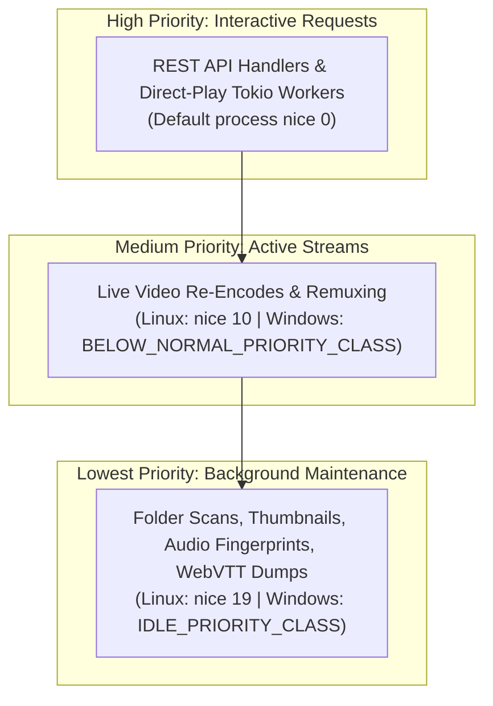

# Process Execution & Real-Time Throttling

A common pain point with self-hosted media servers is that a single user initiating a transcode can completely peg all CPU cores at 100%, causing device fans to scream, throttling other services, and draining laptop or SBC batteries.

Kinema solves this problem with an active **Real-Time Throttling Engine** and OS-level **Process Sandboxing**.

```mermaid
sequenceDiagram
    autonumber
    participant Kinema as Kinema Transcode Handler
    participant Progress as Progress Watcher (stderr)
    participant Pipe as OS Stdout Pipe Buffer
    participant FF as ffmpeg Process (nice 10)
    participant Client as Web / Android Client

    Kinema->>FF: Spawn with -progress pipe:2 -nostats
    loop Continuous Stream Loop
        FF->>Pipe: Write encoded fMP4 video chunks
        FF->>Progress: Write out_time_us=65000000 (65.0s)
        Progress->>Kinema: Atomic out_time_us update
        Kinema->>Kinema: Compute delta: transcode_time - wall_time
        alt Delta exceeds 60s (Too far ahead)
            Note over Kinema,Pipe: Kinema pauses reading from Pipe for 500ms
            Note over Pipe,FF: OS Pipe buffer fills up (~64KB); ffmpeg write() blocks!
            Note over FF: ffmpeg sleeps in kernel wait; CPU drops to 0%
        else Delta within 60s
            Kinema->>Pipe: Read chunk
            Kinema->>Client: Send chunk to client (HTTP 200)
        end
    end
```

---

## 1. The 60-Second Adaptive Throttle

Instead of transcoding an entire 2-hour movie into gigabytes of temporary disk storage, Kinema keeps ffmpeg running live, maintaining an optimal buffer window of exactly **60 seconds ahead of current playback**:

1. **Progress Monitoring**:
   - ffmpeg is spawned with `-progress pipe:2 -nostats`.
   - `Progress::watch` asynchronously scans stderr for lines matching `out_time_us=...`.
2. **Backpressure via Pipe Stalling**:
   - Kinema checks lead time:
     `lead_seconds = (out_time_us / 1_000_000) - elapsed_wall_time`
   - If `lead_seconds > 60.0`, the Tokio stream reader sleeps in 500ms increments (`Progress::pace()`).
   - Because the stdout pipe buffer is finite (typically 64 KB on Linux), ffmpeg's subsequent `write()` call blocks in the kernel.
   - ffmpeg automatically transitions to a sleeping state, dropping CPU usage to the exact real-time playback consumption (1.0x).

---

## 2. Process Priorities (`nice` & Windows Classes)

Background tasks must never degrade real-time video playback. Kinema enforces strict platform scheduling priorities:



Implementation in `crates/kinema-core/src/platform/unix.rs`:
```rust
pub fn configure_playback_process(cmd: &mut tokio::process::Command) {
    unsafe {
        cmd.pre_exec(|| {
            libc::nice(10);
            Ok(())
        });
    }
}

pub fn configure_low_priority_process(cmd: &mut tokio::process::Command) {
    unsafe {
        cmd.pre_exec(|| {
            libc::nice(19);
            Ok(())
        });
    }
}
```

---

## 3. Immediate Resource Reclaim (`kill_on_drop`)

When a user closes their browser tab or navigates away, lingering ffmpeg transcode processes must not remain orphaned in the background.

- Every `tokio::process::Command` spawned by Kinema sets `.kill_on_drop(true)`.
- The child process handle is wrapped in an RAII `Counted` guard.
- The moment the client drops the HTTP connection, Axum drops the stream body, triggering the `Counted` destructor, which instantly delivers `SIGKILL` to ffmpeg and decrements the server's active concurrency counter.
