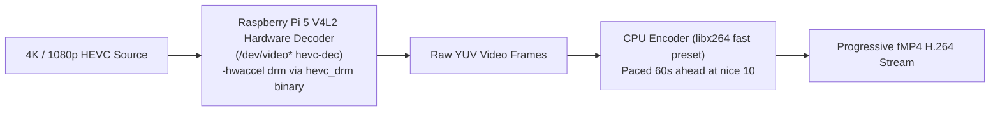

# Hardware Acceleration & Raspberry Pi 5

Kinema supports hardware-accelerated video decoding to reduce CPU load and power consumption on small, low-power single-board computers (SBCs) and servers.

---

## Raspberry Pi 5 V4L2 HEVC DRM Acceleration

The Raspberry Pi 5 (Broadcom BCM2712 SoC) features a dedicated hardware stateless HEVC decoder exposed through Video4Linux2 (`v4l2-request` / DRM), but lacks a hardware video encoder:



### Automatic Detection Mechanics

In `crates/kinema-core/src/platform/unix.rs`:
```rust
pub fn has_v4l2_hevc_decoder() -> bool {
    if let Ok(entries) = std::fs::read_dir("/sys/class/video4linux") {
        for entry in entries.flatten() {
            if let Ok(name) = std::fs::read_to_string(entry.path().join("name")) {
                if name.trim().ends_with("hevc-dec") {
                    return true;
                }
            }
        }
    }
    false
}
```

When `has_v4l2_hevc_decoder()` returns true:
1. Kinema's binary resolver probes the system's distribution ffmpeg (`/usr/bin/ffmpeg`) for DRM device capabilities (`decoder=hevc` with device `drm`).
2. While standard tasks use Kinema's bundled static ffmpeg binary, HEVC decoding tasks automatically switch to `bins.hevc_drm` with flags:
   ```bash
   /usr/bin/ffmpeg -hwaccel drm -hwaccel_device /dev/dri/renderD128 -c:v hevc_v4l2request -i input.mkv ...
   ```
3. This eliminates ~35% of the total CPU load on Raspberry Pi 5 boards, preventing thermal throttling during playback.

---

## Intel QuickSync & VAAPI (Linux x86_64)

On Intel and AMD systems with `/dev/dri/renderD128` available:
- Kinema can pass `-hwaccel vaapi -hwaccel_output_format vaapi` when VAAPI drivers are detected.
- In Docker environments, ensure the render device is passed:
  ```yaml
  devices:
    - /dev/dri:/dev/dri
  ```

---

## NVIDIA NVENC / NVDEC

On Linux and Windows systems equipped with NVIDIA graphics cards:
- Kinema can invoke `-hwaccel cuda` for hardware-accelerated video decoding.
- Set `prefer_hardware_accel = true` in `kinema.toml`.
