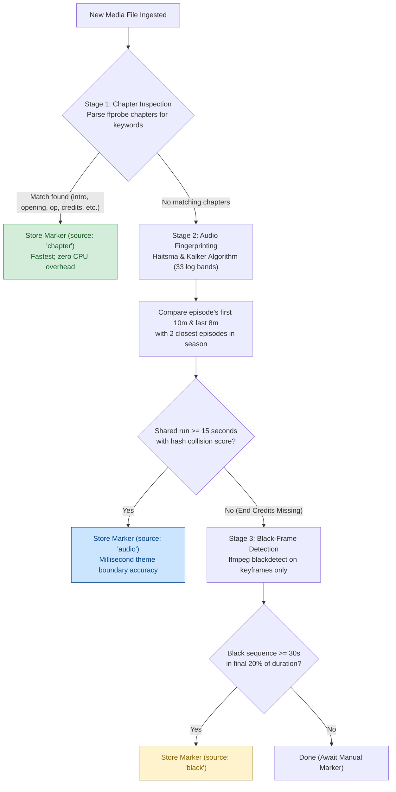

# Intro & Credit Marker Detection

Kinema automatically detects episode intro sequences (opening themes) and end credits using a multi-stage analysis pipeline (`crates/kinema-media/src/markers.rs`).



---

## 1. Chapter Inspection (Instant)

During initial file probe, Kinema checks all embedded chapter titles. If chapters contain names such as:
- `intro`, `opening`, `op`, `title sequence` $\rightarrow$ Intro marker
- `credits`, `ending`, `outro`, `ed` $\rightarrow$ Credits marker

The chapter boundaries are saved with `source = 'chapter'`, requiring zero audio processing.

---

## 2. Audio Fingerprinting (Haitsma & Kalker Algorithm)

For television series where files lack chapter markers, Kinema implements the **Haitsma & Kalker (2002)** acoustic fingerprinting algorithm:

1. **Downmixing & Framing**:
   - Audio is extracted at 8 kHz mono.
   - Framed into 2048-sample windows with 256-sample hop sizes (32 ms per frame).
2. **Log-Spaced Filterbank**:
   - Computes energy across 33 logarithmically spaced frequency bands between 300 Hz and 2000 Hz (the dominant range of television theme vocals and brass).
3. **Bit Vector Hashing**:
   - For adjacent bands `m` and time frames `n`:
     `H(n, m) = 1 if ((E(n, m) - E(n, m+1)) - (E(n-1, m) - E(n-1, m+1)) > 0) else 0`
   - Generates one 32-bit `u32` integer per 32 ms. Silence (below -50 dBFS) hashes to `0`.
4. **Cross-Episode Voting**:
   - The fingerprints of an episode's first 10 minutes and last 8 minutes are compared against the two nearest episodes in the same season.
   - Identical hash matches vote on a time delta offset. A continuous cluster of matching hashes spanning 15 seconds or greater establishes the exact start and end timestamps of the theme.

---

## 3. Black-Frame Detection

If audio fingerprinting detects the intro but credits remain unidentified (common when credits feature dialogue or varying background music):
- ffmpeg is spawned with `blackdetect=d=2:pic_th=0.92:pix_th=0.12`.
- Processing is restricted strictly to keyframes via `-skip_frame nokey`.
- Black segments lasting 30 seconds or longer in the final 20% of the episode duration are tagged as end credits.

---

## 4. Manual Overrides

Administrators can override markers at any time:
```http
PUT /api/items/105/markers/intro
Content-Type: application/json

{
  "start_s": 94.5,
  "end_s": 184.0
}
```

Manual markers persist with `source = 'manual'`. Automatic analysis jobs respect manual markers and will never overwrite them.
