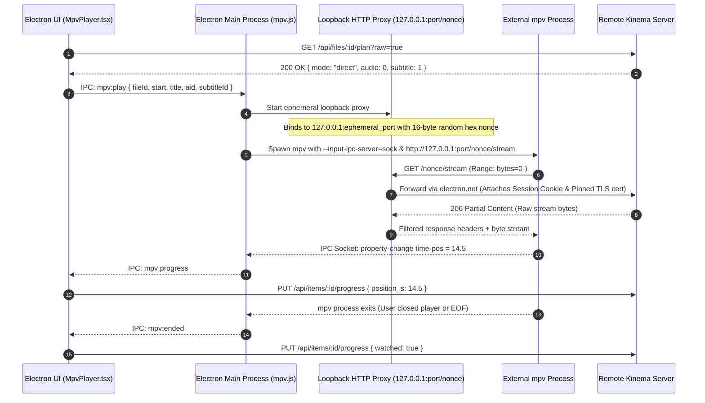

# Desktop MPV Loopback Proxy

The **Electron Desktop Client** features a dedicated "Play in mpv" integration (`apps/desktop/src/mpv.js`). This enables desktop users to play raw files in a native `mpv` player window, allowing hardware-accelerated playback of high-bitrate 10-bit anime, ASS/SSA stylized karaoke subtitles, and unusual codecs with 0% server CPU transcode.

---

## Security Architecture: Ephemeral Nonces & TLS Pinning

Why not pass the raw Kinema URL directly to `mpv`?
1. **Self-Signed TLS Pinning**: mpv does not support custom SHA-256 certificate fingerprint pinning without tampering with system certificate stores.
2. **Credential Protection**: Passing raw bearer tokens or passwords on process command lines exposes credentials in system task managers (`ps aux`, Windows Process Explorer).

### Kinema's Solution
- **Ephemeral Port & Cryptographic Nonce**: The Electron main process spins up a local Node.js HTTP server bound exclusively to `127.0.0.1` on a random ephemeral port. Requests are accepted *only* if the URL begins with a 16-byte cryptographically random hex nonce.
- **Electron.net Request Forwarding**: The loopback proxy forwards HTTP range requests to the remote Kinema server using `electron.net.request()`, automatically attaching the user's session cookie and verifying the server's pinned TLS certificate.
- **Zero Credentials on CLI**: The `mpv` command line only sees `http://127.0.0.1:53214/e8a3c.../api/stream/123`.

---

## Bi-Directional JSON IPC Progress Synchronization

Kinema connects to `mpv` via a local Unix domain socket (or named pipe on Windows) using `--input-ipc-server`:
- Observes `time-pos` changes and syncs playback progress back to the Kinema database every 10 seconds.
- Automatically marks the item as watched when playback crosses 92% of the runtime.
- Injects external WebVTT or sidecar subtitles into mpv on the fly with `--sub-file`.
