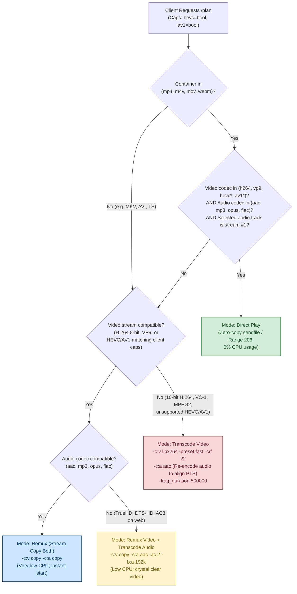

# Playback Engine & Decision Tree

The Kinema Playback Engine (`crates/kinema-media/src/playback.rs`) is engineered around a single core mandate: **never re-encode video unless the client hardware genuinely cannot display it.**

---

## Playback Mode Decision Tree

When a client requests a playback plan (`GET /api/files/:id/plan`), Kinema inspects the container, video stream, audio stream, and client decoder capabilities (`hevc`, `av1`, `audio_channels`) to pick the optimal mode:



---

## Detailed Playback Modes

### 1. Direct Play (`direct`)
- **Transport**: Standard HTTP range requests (`206 Partial Content`) via Tokio `sendfile`.
- **Latency**: Instantaneous (0–50 ms).
- **CPU Footprint**: Effectively 0.0% CPU.
- **Criteria**:
  - Container must be natively seekable in browsers: `mp4`, `m4v`, `mov`, or `webm`.
  - Video stream must be compatible H.264 (8-bit), VP9, or device-supported HEVC/AV1.
  - Selected audio stream must be AAC, MP3, Opus, or FLAC.
  - Selected audio stream must be the first audio track in the container (HTML5 `<video>` default behavior).

### 2. Remuxing / Stream Copy (`remux`)
- **Transport**: Fragmented MP4 (`fMP4`) streamed progressive over HTTP chunked transfer.
- **Latency**: 100–300 ms.
- **CPU Footprint**: Under 1.0% CPU (I/O bounded packet copying).
- **Criteria**:
  - Video codec is compatible with client decoders, but container is incompatible (e.g. MKV) or an alternate audio track is selected.
  - Uses ffmpeg with `-c:v copy`. Video frames are passed directly from demuxer to muxer without touching the CPU or GPU encoder.
  - If audio is unsupported (e.g., DTS, Dolby TrueHD), video remains stream-copied while audio is downmixed and re-encoded to 192 kbps stereo AAC (`-c:a aac -ac 2 -b:a 192k`).

### 3. Full Transcode (`transcode`)
- **Transport**: Progressive fragmented MP4 (`fMP4`) with half-second fragment durations (`-frag_duration 500000`).
- **Latency**: 1.5–2.5 s.
- **CPU Footprint**: Paced at 1.0x playback rate (see [FFmpeg Execution & Throttling](./ffmpeg-execution.md)).
- **Criteria**:
  - Video codec cannot be decoded in hardware by the client (e.g., 10-bit H.264 anime files, legacy VC-1/MPEG-2, or high-bitrate 4K HEVC on clients lacking hardware decoders).
  - Encoded to H.264 via `libx264` (or hardware DRM on Raspberry Pi 5).

---

## Eliminating Audio/Video Seek Desync

In conventional media servers, transcoding video while stream-copying audio often introduces up to **5.6 seconds of audio drift or freezing** following a seek operation. 

### Why This Happens
Audio packets in containers like MKV often have keyframe intervals and packet boundaries that do not align with video keyframes. When seeking to a non-keyframe position:
- Stream-copied audio packets are sliced from the closest preceding packet boundary.
- Video decoders must wait for the next keyframe.
- The player begins playing audio while the video picture freezes until the timestamps intersect.

### Kinema's Solution
In `crates/kinema-media/src/playback.rs`:
> **Whenever video is re-encoded, audio is always re-encoded to AAC stereo.**

By re-encoding both streams simultaneously, Kinema forces ffmpeg to synthesize a unified Presentation Timestamp (PTS) from sample zero:
```bash
ffmpeg -ss 120.5 -i input.mkv \
  -c:v libx264 -preset fast -crf 22 \
  -c:a aac -ac 2 -b:a 192k \
  -frag_duration 500000 \
  -avoid_negative_ts make_zero \
  -movflags frag_keyframe+empty_moov+default_base_moof \
  -f mp4 pipe:1
```
Seeks immediately display video and audio in lockstep with zero freeze.
