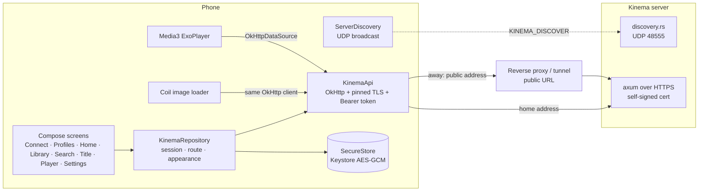
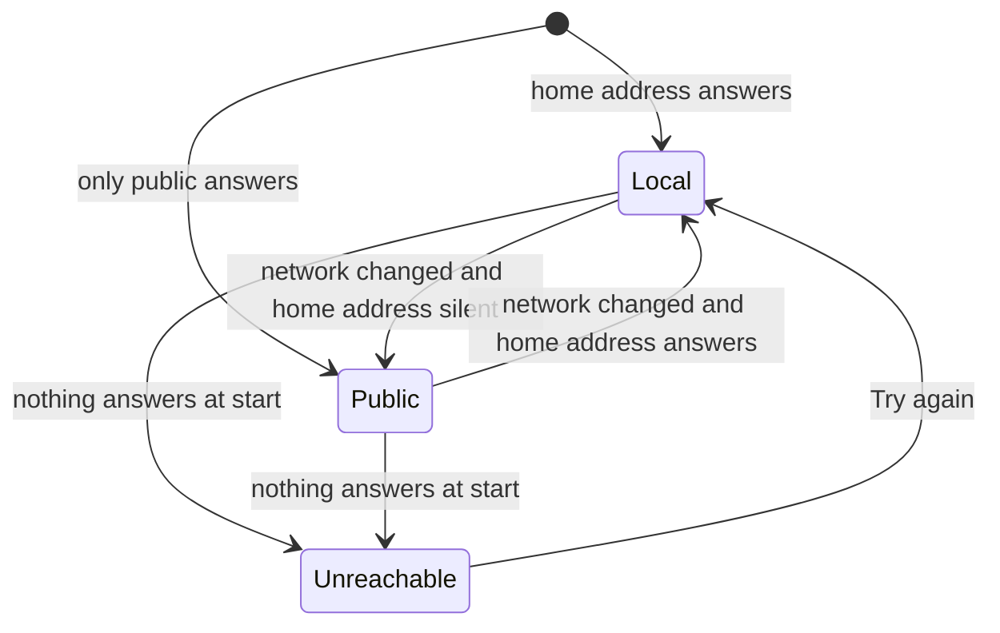
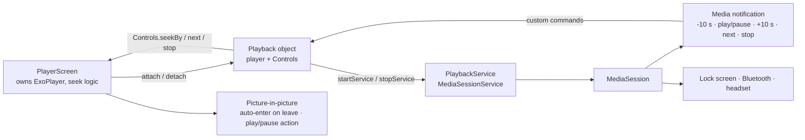

# Android app

`apps/android`: a Jetpack Compose client for **watching only**. It finds the server, signs a profile in, browses and plays. Adding libraries, matching titles, users and server settings stay in the web app.

Run it: `pnpm android:dev` (builds the dev flavor, installs it on a phone or the first emulator, forwards `localhost:3000` over adb and opens it). Unit tests: `pnpm android:test`. Release build: `pnpm android:build:prod`.

## Modules

```
apps/android
├── core   no UI. KinemaApi (OkHttp), KinemaRepository (session, addresses), ServerDiscovery,
│          Tls (pinned self-signed certificates), SecureStore (Keystore AES-GCM), Vtt parser
└── app    Compose UI. Navigation 3 back stack, Material 3 Expressive theme, Media3 player, Coil artwork
```

Versions follow `../domus/apps/android` (AGP, Kotlin, Compose BOM, Material 3 `1.5.0-alpha` for the expressive APIs). Flavors: `dev` (`com.aiyu.kinema.dev`, "Kinema Dev") and `prod`.

## Architecture



One OkHttp client per address carries the certificate pin and the session header, so API calls, artwork and video streams all trust and authenticate the same way.

## Finding the server

1. `ServerDiscovery.scan` broadcasts `KINEMA_DISCOVER` to UDP 48555 on every interface's broadcast address and `255.255.255.255`, and collects replies for 1.8 s (`{"service":"kinema","name","port","tls","version"}`).
2. Broadcasts do not cross an emulator's NAT or USB, so with no reply it tries `localhost:3000` (forwarded by `pnpm android:dev`) and `10.0.2.2:3000`.
3. Or the user types an address: no scheme means `https`; a LAN host without a port gets `:3000` (`normalizeServerUrl`).

## Trust

The server speaks HTTPS with a certificate it made itself (`backend/src/tls.rs`). On first connect the TLS handshake fails, the app reads the certificate without trusting it (`Tls.fetchFingerprint`) and shows its SHA-256 fingerprint; the web app shows the same code under Settings › Network. After the user approves, `PinnedTrustManager` accepts exactly that certificate, plus anything a public authority signed (a reverse proxy on the public address). Hostname checks are skipped only for the pinned certificate, because a home server's IP can change while its certificate cannot. Cleartext HTTP is off in the manifest.

## Home and public address



- **Home address**: the URL the app connected with. When that was a public address, the app finds the home one itself: `/server/info` (read over the verified public connection) names the server's own certificate (`tls_fingerprint`), the app broadcasts a LAN discovery probe and takes the answering server whose certificate has that fingerprint, pinning it without asking. An existing different pin is never replaced. The desktop app does the same (`findHome` in `apps/desktop/src/main.js`) and also adds the server's public address when it connected at home, so both apps roam.
- **Public address**: the app's own (Settings › Connection), else the one the admin set on the server (web Settings › General › Public address, read from `/server/info`).
- At start and on every default-network change (`ConnectivityManager.registerDefaultNetworkCallback`, debounced 1.5 s) the repository probes the home address, then the public one, with a 2 s connect timeout and switches the client. The session token works on both, so nobody signs in again. Settings shows which one is in use.

## Navigation and motion

- Navigation 3 back stack (`TabsKey`, `ItemKey(id)`, `PlayerKey(id, start)`), saved across process death.
- Forward: shared-axis X slide. Back button: the reverse. **Predictive back gesture**, after Android's own animation between activities: while the finger drags, the page shrinks to 90 % with rounded corners and drifts about 8 % toward the far edge, and the page beneath slides in from the near side, dimmed. Letting go slides the page off the screen; cancel springs back. NavDisplay seeks one transition with the gesture progress, so the drag is the first half of the timeline and the slide-off the second (piecewise-linear easings in `predictivePop`, `Navigation.kt`). The page never fades: an earlier version faded it out at 90 % over the page beneath, which left a ghost that read as stuck. Inside the tab host, back from a non-home tab previews the scale and rounded corners before returning home.
- `MotionScheme.expressive()` springs everywhere: card press scale, nav pill growth and icon pop, staggered entry, hero pager parallax, the player's play button morphing from a cookie (paused) to a circle (playing), the double-tap seek bubble.
- Reduced motion (animator scale 0) stops decorative motion: the morphing brand mark, the drifting backdrop, staggered entries, hero auto-advance.

## Player

Same contract as the web player (`apps/web/src/features/player/PlayerPage.tsx`):

1. `GET /files/{id}/plan` with `hevc` / `av1` from `MediaCodecList` decoders.
2. `direct`: stream the file with Range from 0 and seek locally. `remux` / `transcode`: stream from the requested time; `plan.start` is where the output really begins, so the title time is `start + player position`. Seeks outside the stream restart it.
3. Text subtitles come as WebVTT from `/subtitles/{id}` and are drawn over the video at the title time; picture subtitles are listed but disabled.
4. Progress every 10 s and on leaving; watched at 92 %; the end opens the next episode. **Skip intro** shows while a detected intro plays (media-pipeline.md §7). The **Up next** card (next episode's still, a countdown shade, Play now, hide) slides in from the credits start, or for the last 60 s without credits; a movie shows **Skip credits** instead.
5. Phones: landscape, immersive, screen kept on while open; restored on close. Only the last player to close restores the window, because "next episode" opens the new player before the old one leaves.
6. **Tablets and open foldables** (smallest width 600 dp or more) get a YouTube-style watch page (`WatchScreen.kt`): the video with its title, links and story under it and the up-next list beside it (840 dp or wider, landscape) or under it. The list is the season's episodes with pinned season chips and the playing one marked, or for a movie more titles of its kind from the library (in progress and unwatched first, then rating). A full screen button hides the page; phones are always full screen and open the same list as a side panel from the top bar. Controls shrink inside a short video.
7. Stop button (bottom bar): pauses, saves progress and leaves, like the web player's stop.
8. Swipe gestures: a vertical swipe on the left half sets this window's brightness, on the right half the media volume. Volume goes to 200 %: above 100 % a `LoudnessEnhancer` on the player's audio session adds up to +12 dB (MX Player style). The player gets a fixed audio session id at creation because ExoPlayer leaves it unset. Swipes starting in the top or bottom 8 % are left to the system bars. Brightness goes back to the system level when the player closes; the volume stays.
9. Background and picture-in-picture: see below.

### Playback service, notification and picture-in-picture



- The player screen creates the ExoPlayer (audio focus, pause on headphones unplugged) and hands it to `Playback` (`playback/PlaybackService.kt`), which starts `PlaybackService`. The service wraps it in a `MediaSession`; Media3 then runs the service in the foreground (`mediaPlayback` type) while something plays and posts the system media notification. Its buttons are Media3 `CommandButton`s: back and forward 10 s in the compact view, next episode and stop when expanded. They are custom session commands that call back into the screen, so a seek in a remuxed stream restarts it the same way the on-screen buttons do.
- The next episode's screen attaches before the previous one detaches; `detach` ignores a player that is no longer current, and the service swaps the session's player (`MediaSession.setPlayer`).
- The notification and lock screen show the title and the poster (fetched once through the server client, so pin and session apply).
- Picture-in-picture (Settings › Playback, on by default): leaving the app while a video plays shrinks it into a window (auto-enter on Android 12+, `onUserLeaveHint` before). The window shows only video and subtitles, with a play/pause action. Closing the window pauses playback (the activity is stopped when it leaves picture-in-picture). With the setting off, leaving the app keeps the sound playing with the notification.
- Swiping the app away from recents pauses and stops the service.
- Known limit: Compose does not recompose while the activity is stopped, so "next episode" or the end of an episode pressed from the notification with the app fully in the background (not in picture-in-picture) takes effect when the app comes back. Stop pauses right away.

## Sync with the web app

Nothing playback-related is stored on the phone; the server keeps it per profile, so every client sees the same state.

```mermaid
sequenceDiagram
  participant A as Android player
  participant S as Server (per profile)
  participant W as Web app
  A->>S: PUT /items/{id}/progress every 10 s, on leave, watched at 92 %
  A->>S: PUT /items/{id}/track-choice when audio or subtitles change
  W->>S: GET /home, /items/{id} (refetch on tab focus)
  W->>S: GET /files/{id}/plan → audio + subtitle from the saved pick
  W->>S: PUT /items/{id}/track-choice when changed on the web
  A->>S: reload on app resume; plan applies the pick
```

- Resume position, watched state and continue watching: `watch_state`, shared by every device of the profile.
- Audio and subtitle pick: `track_choice`, kept on the movie or on the show (all its episodes), applied by `/plan` before the show's admin choice and the server's Languages settings.
- The app reloads lists when it returns to the foreground; the web app refetches when its tab regains focus.

## App updates

`update/AppUpdates.kt`, with the version rules in `core/Releases.kt` (tested in `ReleasesTest`). On launch (signed in) the app asks GitHub's releases API for the newest release with an `.apk` that is newer than its own version, on the chosen channel (default: the installed build's; alpha takes alpha, beta and stable; beta takes beta and stable; stable takes stable). A dialog offers it with its release notes; "Later" is remembered for that version.

Settings › Kinema has two rows, each opening its own screen (`ui/AboutScreens.kt`, nav keys `UpdatesKey`, `AboutKey`, `AcknowledgementsKey`):

- Updates: the state (up to date, available, checking, failed, development build), Download and install with progress, the channel (Stable / Beta / Alpha, saved on the phone) and the release notes in Markdown (`multiplatform-markdown-renderer`): the update's, or the installed version's when there is none.
- About Kinema: version and build, privacy, source code, the developer, and Acknowledgements, which lists only what the Android app is built on (the web app keeps its own list).

Update downloads the APK into the cache with a plain OkHttp client (the app's own client pins the Kinema server's certificate) and commits it to a `PackageInstaller` session. Android's confirmation screen always shows; `InstallReceiver` starts it and reports a refusal, such as an APK signed with another key. Without "Install unknown apps" for Kinema, the app opens that setting first. `-dev` builds never parse as a version, so they are never offered an update.

## Strings

Every user-facing string is in `app/src/main/res/values/strings.xml` (English). A translation is a `values-<lang>/strings.xml`.

## Shortcuts

- shortcut: no picture-in-picture or background audio session; add a `MediaSessionService` when lock-screen controls are wanted.
- shortcut: remux/transcode seeks always restart the stream, even inside the buffer.
- shortcut: no offline downloads.
