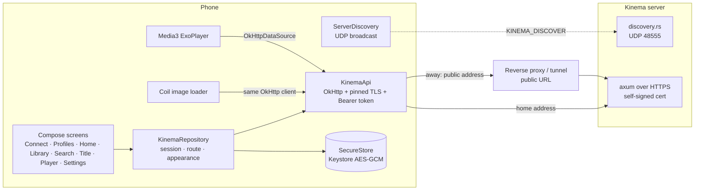
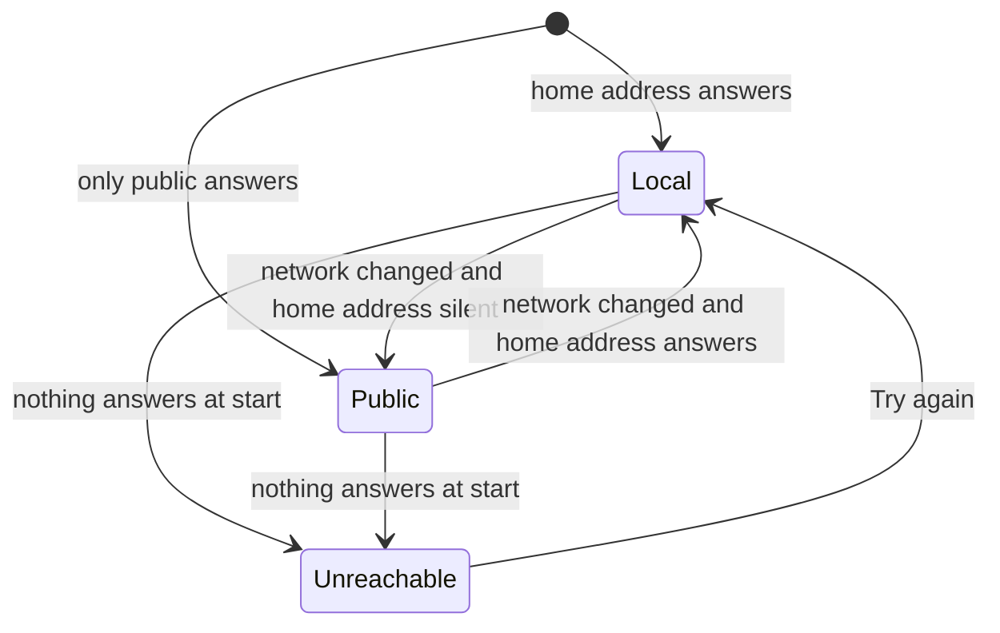

# Android app

`apps/android`: a Jetpack Compose client for **watching only**. It finds the server, signs a profile in, browses and plays. Adding libraries, matching titles, users and server settings stay in the web app.

Run it: `pnpm android:dev` (builds the dev flavor, installs it on a phone or the first emulator, forwards `localhost:3000` over adb and opens it). Unit tests: `pnpm android:test`. Release build: `pnpm android:build:prod`.

## Modules

```
apps/android
├── core   no UI. KinemaApi (OkHttp), KinemaRepository (session, addresses), ServerDiscovery,
│          Tls (pinned self-signed certificates), SecureStore (Keystore AES-GCM), Vtt parser
└── app    Compose UI. Navigation 3 back stack, Material 3 Expressive theme, Media3 player, Coil artwork
```

Versions follow `../domus/apps/android` (AGP, Kotlin, Compose BOM, Material 3 `1.5.0-alpha` for the expressive APIs). Flavors: `dev` (`com.aiyu.kinema.dev`, "Kinema Dev") and `prod`.

## Architecture



One OkHttp client per address carries the certificate pin and the session header, so API calls, artwork and video streams all trust and authenticate the same way.

## Finding the server

1. `ServerDiscovery.scan` broadcasts `KINEMA_DISCOVER` to UDP 48555 on every interface's broadcast address and `255.255.255.255`, and collects replies for 1.8 s (`{"service":"kinema","name","port","tls","version"}`).
2. Broadcasts do not cross an emulator's NAT or USB, so with no reply it tries `localhost:3000` (forwarded by `pnpm android:dev`) and `10.0.2.2:3000`.
3. Or the user types an address: no scheme means `https`; a LAN host without a port gets `:3000` (`normalizeServerUrl`).

## Trust

The server speaks HTTPS with a certificate it made itself (`backend/src/tls.rs`). On first connect the TLS handshake fails, the app reads the certificate without trusting it (`Tls.fetchFingerprint`) and shows its SHA-256 fingerprint; the web app shows the same code under Settings › Network. After the user approves, `PinnedTrustManager` accepts exactly that certificate, plus anything a public authority signed (a reverse proxy on the public address). Hostname checks are skipped only for the pinned certificate, because a home server's IP can change while its certificate cannot. Cleartext HTTP is off in the manifest.

## Home and public address



- **Home address**: the URL the app connected with. When that was a public address, the app finds the home one itself: `/server/info` (read over the verified public connection) names the server's own certificate (`tls_fingerprint`), the app broadcasts a LAN discovery probe and takes the answering server whose certificate has that fingerprint, pinning it without asking. An existing different pin is never replaced. The desktop app does the same (`findHome` in `apps/desktop/src/main.js`) and also adds the server's public address when it connected at home, so both apps roam.
- **Public address**: the app's own (Settings › Connection), else the one the admin set on the server (web Settings › General › Public address, read from `/server/info`).
- At start and on every default-network change (`ConnectivityManager.registerDefaultNetworkCallback`, debounced 1.5 s) the repository probes the home address, then the public one, with a 2 s connect timeout and switches the client. The session token works on both, so nobody signs in again. Settings shows which one is in use.

## Navigation and motion

- Navigation 3 back stack (`TabsKey`, `ItemKey(id)`, `PlayerKey(id, start)`), saved across process death.
- Forward: shared-axis X slide. Back button: the reverse. **Predictive back gesture**: the page shrinks to 90 % toward the swiped edge while the page beneath rises from 95 % and fades in, tracking the finger; cancel springs back. Inside the tab host, back from a non-home tab previews the scale and rounded corners before returning home.
- `MotionScheme.expressive()` springs everywhere: card press scale, nav pill growth and icon pop, staggered entry, hero pager parallax, the player's play button morphing from a cookie (paused) to a circle (playing), the double-tap seek bubble.
- Reduced motion (animator scale 0) stops decorative motion: the morphing brand mark, the drifting backdrop, staggered entries, hero auto-advance.

## Player

Same contract as the web player (`apps/web/src/features/player/PlayerPage.tsx`):

1. `GET /files/{id}/plan` with `hevc` / `av1` from `MediaCodecList` decoders.
2. `direct`: stream the file with Range from 0 and seek locally. `remux` / `transcode`: stream from the requested time; `plan.start` is where the output really begins, so the title time is `start + player position`. Seeks outside the stream restart it.
3. Text subtitles come as WebVTT from `/subtitles/{id}` and are drawn over the video at the title time; picture subtitles are listed but disabled.
4. Progress every 10 s and on leaving; watched at 92 %; the end opens the next episode.
5. Landscape, immersive, screen kept on while open; restored on close.

## Sync with the web app

Nothing playback-related is stored on the phone; the server keeps it per profile, so every client sees the same state.

```mermaid
sequenceDiagram
  participant A as Android player
  participant S as Server (per profile)
  participant W as Web app
  A->>S: PUT /items/{id}/progress every 10 s, on leave, watched at 92 %
  A->>S: PUT /items/{id}/track-choice when audio or subtitles change
  W->>S: GET /home, /items/{id} (refetch on tab focus)
  W->>S: GET /files/{id}/plan → audio + subtitle from the saved pick
  W->>S: PUT /items/{id}/track-choice when changed on the web
  A->>S: reload on app resume; plan applies the pick
```

- Resume position, watched state and continue watching: `watch_state`, shared by every device of the profile.
- Audio and subtitle pick: `track_choice`, kept on the movie or on the show (all its episodes), applied by `/plan` before the show's admin choice and the server's Languages settings.
- The app reloads lists when it returns to the foreground; the web app refetches when its tab regains focus.

## Strings

Every user-facing string is in `app/src/main/res/values/strings.xml` (English). A translation is a `values-<lang>/strings.xml`.

## Shortcuts

- shortcut: no picture-in-picture or background audio session; add a `MediaSessionService` when lock-screen controls are wanted.
- shortcut: remux/transcode seeks always restart the stream, even inside the buffer.
- shortcut: no offline downloads.
