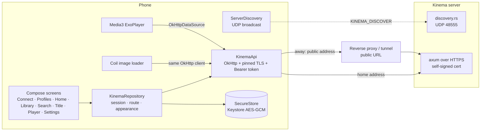
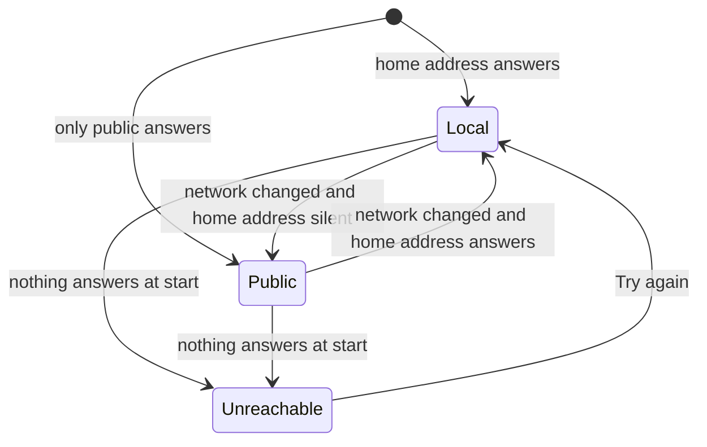
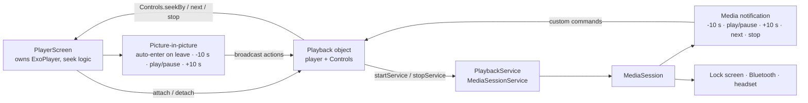

# Android app

`apps/android`: a Jetpack Compose client for **watching only**. It finds the server, signs a profile in, browses and plays. Adding libraries, matching titles, users and server settings stay in the web app.

Run it: `pnpm android:dev` (builds the dev flavor, installs it on a phone or the first emulator, forwards `localhost:3000` over adb and opens it). Unit tests: `pnpm android:test`. Release build: `pnpm android:build:prod`.

## Modules

```
apps/android
├── baselineprofile  test module, not shipped: generates the baseline + startup profile, startup benchmark
├── core   no UI. KinemaApi (OkHttp), KinemaRepository (session, addresses), ServerDiscovery,
│          Tls (pinned self-signed certificates), SecureStore (Keystore AES-GCM), Vtt parser
└── app    Compose UI. Navigation 3 back stack, Material 3 Expressive theme, Media3 player, Coil artwork
```

Versions follow `../domus/apps/android` (AGP, Kotlin, Compose BOM, Material 3 `1.5.0-alpha` for the expressive APIs). Flavors: `dev` (`com.aiyu.kinema.dev`, "Kinema Dev") and `prod`.

## Performance: baseline profile

`app/src/main/generated/baselineProfiles/` holds `baseline-prof.txt` and `startup-prof.txt`, committed. The release build packs them as `assets/dexopt/baseline.prof`, and `androidx.profileinstaller` installs them on first run, so the startup and scroll paths are compiled ahead of time instead of interpreted/JIT'd. Without a profile a fresh install (or update) starts slowest.

- Regenerate after UI or navigation changes: `pnpm android:profile` (needs an emulator or phone with the dev or prod app's flavor; API 28+). The journey is `baselineprofile/.../BaselineProfileGenerator.kt`: cold start, then fling the first scrollable list. Signed out it only covers the Connect screen; sign in on the device first to cover the library grid.
- Measure: `pnpm android:bench` runs `StartupBenchmark` (cold start with no compilation vs. with the profile). Macrobenchmark skips on emulators; use a phone. Run the `Dev` variant on a phone that has the real app installed (`connectedDevBenchmarkReleaseAndroidTest`): the prod one cannot replace a release-signed install.
- Result (2026-10-24, XT2575-1, Android 16, signed-out profile): cold start to first frame, median 1053 ms with no compilation, 976 ms with the profile (-7%); worst run 1259 ms vs 988 ms. A profile recorded signed in should help more.
- Flavors: the profile is generated against one flavor and merged into `src/main`, so dev and prod share it (class names are the same).

## Architecture



One OkHttp client per address carries the certificate pin and the session header, so API calls, artwork and video streams all trust and authenticate the same way.

## Finding the server

1. `ServerDiscovery.scan` broadcasts `KINEMA_DISCOVER` to UDP 48555 on every interface's broadcast address and `255.255.255.255`, and collects replies for 1.8 s (`{"service":"kinema","name","port","tls","version"}`).
2. Broadcasts do not cross an emulator's NAT or USB, so with no reply it tries `localhost:3000` (forwarded by `pnpm android:dev`) and `10.0.2.2:3000`.
3. Or the user types an address: no scheme means `https`; a LAN host without a port gets `:3000` (`normalizeServerUrl`).

## Trust

The server speaks HTTPS with a certificate it made itself (`backend/src/tls.rs`). On first connect the TLS handshake fails, the app reads the certificate without trusting it (`Tls.fetchFingerprint`) and shows its SHA-256 fingerprint; the web app shows the same code under Settings › Network. After the user approves, `PinnedTrustManager` accepts exactly that certificate, plus anything a public authority signed (a reverse proxy on the public address). Hostname checks are skipped only for the pinned certificate, because a home server's IP can change while its certificate cannot. Cleartext HTTP is off in the manifest.

## Home and public address



- **Home address**: the URL the app connected with. When that was a public address, the app finds the home one itself: `/server/info` (read over the verified public connection) names the server's own certificate (`tls_fingerprint`), the app broadcasts a LAN discovery probe and takes the answering server whose certificate has that fingerprint, pinning it without asking. An existing different pin is never replaced. The desktop app does the same (`findHome` in `apps/desktop/src/main.js`) and also adds the server's public address when it connected at home, so both apps roam.
- **Public address**: the app's own (Settings › Connection), else the one the admin set on the server (web Settings › General › Public address, read from `/server/info`).
- At start and on every default-network change (`ConnectivityManager.registerDefaultNetworkCallback`, debounced 1.5 s) the repository probes the home address, then the public one, with a 2 s connect timeout and switches the client. The session token works on both, so nobody signs in again. Settings shows which one is in use.

## Navigation and motion

- Navigation 3 back stack (`TabsKey`, `ItemKey(id)`, `PlayerKey(id, start)`), saved across process death.
- Forward: shared-axis X slide. Back button: the reverse. **Predictive back gesture**, after Android's own animation between activities: while the finger drags, the page shrinks to 90 % with rounded corners and drifts about 8 % toward the far edge, and the page beneath slides in from the near side, dimmed. Letting go slides the page off the screen; cancel springs back. NavDisplay seeks one transition with the gesture progress, so the drag is the first half of the timeline and the slide-off the second (piecewise-linear easings in `predictivePop`, `Navigation.kt`). The page never fades: an earlier version faded it out at 90 % over the page beneath, which left a ghost that read as stuck. Inside the tab host, back from a non-home tab previews the scale and rounded corners before returning home.
- `MotionScheme.expressive()` springs everywhere: card press scale, nav pill growth and icon pop, staggered entry, hero pager parallax, the player's play button morphing from a cookie (paused) to a circle (playing), the double-tap seek bubble.
- Reduced motion (animator scale 0) stops decorative motion: the morphing brand mark, the drifting backdrop, staggered entries, hero auto-advance.

## Player

Same contract as the web player (`apps/web/src/features/player/PlayerPage.tsx`):

1. `GET /files/{id}/plan` with `hevc` / `av1` from `MediaCodecList` decoders.
2. `direct`: stream the file with Range from 0 and seek locally. `remux` / `transcode`: stream from the requested time; `plan.start` is where the output really begins, so the title time is `start + player position`. A seek inside the part the stream already buffered jumps locally and leaves the server's ffmpeg running (`StreamSeek.bufferedTargetMs`, tested in `StreamSeekTest`); outside it, or while a stream loads, the stream restarts. ExoPlayer maps every seek in a stream it reports as unseekable to t=0, and the piped fragmented MP4 (`empty_moov`, no `sidx`) is such a stream, so the local jump only applies when the player says the stream is seekable (`isCurrentMediaItemSeekable`); otherwise it restarts as before. Not yet confirmed on a device.
3. Text subtitles come as WebVTT from `/subtitles/{id}` and are drawn over the video at the title time; picture subtitles are listed but disabled.
4. Progress every 10 s and on leaving; watched at 92 %; the end opens the next episode. **Skip intro** shows while a detected intro plays (media-pipeline.md §7). The **Up next** card (next episode's still, a countdown shade, Play now, hide) slides in from the credits start, or for the last 60 s without credits; a movie shows **Skip credits** instead.
5. **YouTube-style watch page on phones and tablets**: titles open in the portrait watch page (`WatchScreen.kt` / `WatchLayout`): video on top (16:9), title, metadata, actions and summary below, followed by episodes/up-next list (stacked on phones, side-by-side on wide tablets >= 840 dp).
6. **Fullscreen & orientation**: swiping up on the video or tapping fullscreen transitions to immersive landscape fullscreen (`ActivityInfo.SCREEN_ORIENTATION_SENSOR_LANDSCAPE`); swiping down on the video in fullscreen or tapping back returns to the portrait watch page.
7. **In-app PiP miniplayer**: swiping down on the video in the watch page or tapping the chevron-down top bar button smoothly pulls down and minimizes playback into a floating in-app 16:9 PiP card at bottom-right (`MiniPlayer`). Swiping up or tapping the miniplayer expands it back; swiping down or tapping 'X' dismisses it.
8. Stop button (bottom bar): pauses, saves progress and leaves, like the web player's stop.
9. Swipe gestures: in fullscreen, vertical drag on left adjusts brightness, right adjusts volume (up to 200% with `LoudnessEnhancer`). In portrait watch page, swipe up toggles fullscreen and pull-down minimizes to miniplayer.
10. Background and picture-in-picture: see below.
11. **Keyboard** (a hardware keyboard on a tablet or Chromebook; `onPreviewKeyEvent` on the player, focus taken on open and again after the track sheet closes): space or `k` play / pause, left / right seek 10 s, `f` or `t` toggle full screen. Same keys as the web player; `m`, up / down volume and `s` / `x` stop are not mapped. Ctrl, Alt and Meta combinations are left to the system, and holding a key repeats only the arrows.

### Playback service, notification and picture-in-picture



- The player screen creates the ExoPlayer (audio focus, pause on headphones unplugged) and hands it to `Playback` (`playback/PlaybackService.kt`), which starts `PlaybackService`. The service wraps it in a `PlaybackSessionPlayer` (overriding timeline, duration, position, and seek) for `MediaSession`; Media3 then runs the service in the foreground (`mediaPlayback` type) while something plays and posts the system media notification with full seekbar support, real stream duration, and position syncing across direct play, remux, and transcode. Its buttons are Media3 `CommandButton`s: back and forward 10 s in the compact view, next episode and stop when expanded.
- The next episode's screen attaches before the previous one detaches; `detach` ignores a player that is no longer current, and the service swaps the session's player (`MediaSession.setPlayer`).
- The notification and lock screen show the title, poster, and interactive scrubbable seekbar.
- Picture-in-picture (Settings › Playback, on by default): leaving the app while a video plays shrinks it into a window (auto-enter on Android 12+, `onUserLeaveHint` before). Users can also enter PiP directly via the dedicated PiP button on the player top bar or by swiping down from the upper area of the video. The window shows video and subtitles with back 10 s, play/pause and forward 10 s actions (only play/pause where the system allows one action); the skips go through the screen's seek logic like the notification's. The activity declares `keyboard|navigation` in `configChanges` so attaching a tablet keyboard does not recreate it and restart the stream. Closing the window pauses playback. With the setting off, leaving the app keeps the sound playing with the notification and seekbar.
- Swiping the app away from recents pauses and stops the service.
- Known limit: Compose does not recompose while the activity is stopped, so "next episode" or the end of an episode pressed from the notification with the app fully in the background (not in picture-in-picture) takes effect when the app comes back. Stop pauses right away.

## Sync with the web app

Nothing playback-related is stored on the phone; the server keeps it per profile, so every client sees the same state.

```mermaid
sequenceDiagram
  participant A as Android player
  participant S as Server (per profile)
  participant W as Web app
  A->>S: PUT /items/{id}/progress every 10 s, on leave, watched at 92 %
  A->>S: PUT /items/{id}/track-choice when audio or subtitles change
  W->>S: GET /home, /items/{id} (refetch on tab focus)
  W->>S: GET /files/{id}/plan → audio + subtitle from the saved pick
  W->>S: PUT /items/{id}/track-choice when changed on the web
  A->>S: reload on app resume; plan applies the pick
```

- Resume position, watched state and continue watching: `watch_state`, shared by every device of the profile.
- Audio and subtitle pick: `track_choice`, kept on the movie or on the show (all its episodes), applied by `/plan` before the show's admin choice and the server's Languages settings.
- The app reloads lists when it returns to the foreground; the web app refetches when its tab regains focus.

## App updates

`update/AppUpdates.kt`, with the version rules in `core/Releases.kt` (tested in `ReleasesTest`). On launch (signed in) the app asks GitHub's releases API for the newest release with an `.apk` that is newer than its own version, on the chosen channel (default: the installed build's; alpha takes alpha, beta and stable; beta takes beta and stable; stable takes stable). A dialog offers it with its release notes; "Later" is remembered for that version.

Settings › Kinema has two rows, each opening its own screen (`ui/AboutScreens.kt`, nav keys `UpdatesKey`, `AboutKey`, `AcknowledgementsKey`):

- Updates: the state (up to date, available, checking, failed, development build), Download and install with progress, the channel (Stable / Beta / Alpha, saved on the phone) and the release notes in Markdown (`multiplatform-markdown-renderer`): the update's, or the installed version's when there is none.
- About Kinema: version and build, privacy, source code, the developer, and Acknowledgements, which lists only what the Android app is built on (the web app keeps its own list).

Update downloads the APK into the cache with a plain OkHttp client (the app's own client pins the Kinema server's certificate) and commits it to a `PackageInstaller` session. Android's confirmation screen always shows; `InstallReceiver` starts it and reports a refusal, such as an APK signed with another key. Without "Install unknown apps" for Kinema, the app opens that setting first. `-dev` builds never parse as a version, so they are never offered an update.

## Strings

Every user-facing string is in `app/src/main/res/values/strings.xml` (English). A translation is a `values-<lang>/strings.xml`.

Audit (2026-10-22): no user-facing literal is left in the Kotlin code. What remains is deliberate: animation `label`s (debug names), the example address placeholder `192.168.1.10:3000`, proper nouns and library names in the About screens, `error("No repository")`-style programmer errors, and the messages the server sends (`ApiException`, shown as received; the server's own i18n is separate). The two update HTTP errors moved to `update_github_status` and `update_download_status`.

Translations: `values-es`, `values-fr`, `values-de`, `values-hi`, each with the same 51 strings (actions, errors, tabs, sign-in, search, title actions, player controls and messages, appearance and playback settings). **Machine-quality drafts, needs review by a native speaker** (Hindi most of all) before any release counts on them. Everything not translated (plurals, Connect, Trust, Settings › Connection, Updates, About, watch page) falls back to English; `tools:ignore="MissingTranslation"` on the default file keeps lint quiet about that until a language is complete. To add a language: copy a `values-<lang>/strings.xml`, keep the `name`s and the `%1$s` placeholders, use typographic apostrophes (`’`) so nothing needs escaping, and add plurals with the language's own categories.

## Shortcuts

- shortcut: remux/transcode seeks still restart the stream in practice, because ExoPlayer sees the piped fragmented MP4 as unseekable. Fix: a custom `SeekMap` (seekable inside the buffer, with the duration from the plan, plus a back buffer in `DefaultLoadControl`), or a `sidx`/HLS output from the server.
- shortcut: no offline downloads.
