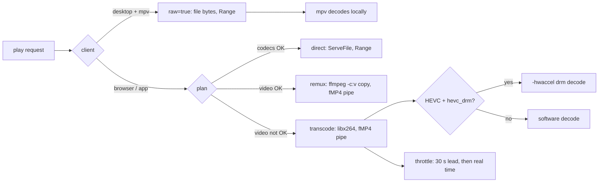

# Architecture

## Overview

One process, one async runtime. External `ffmpeg`/`ffprobe` child processes do all media work.

```
clients (web SPA, Android app, desktop app; desktop may hand a title to a local mpv)
      |  HTTPS, range requests          apps find servers by UDP broadcast (port 48555)
+-----v------------------------------+
| backend (axum)                     |
|  auth | routes | stream | images   |
+---+---------+----------+-----------+
    |         |          |
 kinema-db  kinema-media  kinema-meta
 (sqlx)     (ffmpeg jobs) (TMDB, art cache)
    ^            ^            ^
    +------ kinema-scanner ---+
            (walk + watch)
```

## ffmpeg resolution

`kinema-media` owns one resolver for `ffmpeg` and `ffprobe`: `KINEMA_FFMPEG` env, then the user-updated copy in `$XDG_DATA_HOME/kinema/ffmpeg/`, then the bundled `$APPDIR/usr/bin`, then `PATH`. Where the kernel has a V4L2 HEVC decoder (Raspberry Pi 5) it also finds an ffmpeg that can use it (`hevc_drm`) for HEVC re-encodes. See `packaging.md`.

## Workspace layout

`backend/` is the binary crate (routes, auth, streaming, job supervisor, `main`). Library crates live in `crates/`. The React UI lives in `apps/web` and is served as static files by the backend. See `web-ui.md`. The Android app lives in `apps/android` (Gradle, not part of the pnpm workspace). See `android.md`.

## Crates

- `kinema-core`: config (TOML + env), ID types, error types, shared enums.
- `kinema-db`: migrations, typed queries, connection pool. SQLite in WAL mode, `synchronous=NORMAL`, one writer connection plus a read pool.
- `kinema-scanner`: initial walk with `walkdir`, live changes with `notify` (inotify on Linux). Debounces events, hands new or changed paths to the job queue.
- `kinema-media`: ffprobe JSON parsing, codec compatibility rules, ffmpeg command builders for thumbnails, remux, HLS.
- `kinema-meta`: filename parser, TMDB client with rate limiting, image downloader and resizer, local fallback.
- `backend` (binary, formerly `kinema-server`): routes, auth middleware, streaming handlers, job supervisor, `main`.

## Job queue

A persistent table `jobs` plus an in-memory channel. Job kinds: `probe`, `match`, `artwork`, `thumbnail`, `sprite`, `subtitle_extract`. Worker pool size defaults to `max(1, cores/4)`. Spawned ffmpeg runs with `nice 19` and `ionice -c3`. Jobs are idempotent and keyed by content fingerprint, so a crash replays safely.

Priority order: user-triggered > newly added > refresh.

## Streaming path

MVP (built): `GET /api/files/{id}/plan` picks the mode; remux and transcode pipe fragmented MP4 from ffmpeg straight into the response, with no session or segment files. A re-encode is throttled to 30 s ahead of real time. The desktop app can skip all of it and play the raw file in mpv. See `mvp.md` and `media-pipeline.md` § 3–4.



The HLS design below is the M4 target.

1. Client asks `POST /api/playback/decide` with its capabilities.
2. Server picks direct play, remux or transcode.
3. Direct play: `GET /api/stream/{id}` serves the file with `Range` support, using `tokio::fs` and `tokio_util::io::ReaderStream`.
4. Remux/transcode: ffmpeg writes HLS segments to a session cache dir. Server serves `.m3u8` and `.ts`/`.m4s`. Idle sessions are killed after 60 s without a segment request.

## Concurrency rules

- No blocking calls on the async runtime. Filesystem scans and image resizing use `spawn_blocking`.
- Per-session ffmpeg process cap (default 2 concurrent transcodes).
- Backpressure: job queue bounded; scanner pauses when full.

## Configuration

`kinema.toml`: data dir, library roots, bind address, TMDB key, worker count, transcode limits, TLS. Environment overrides with `KINEMA_` prefix.

## Data directory

```
data/
  kinema.db
  cache/images/       TMDB art as fetched, keyed by size + TMDB path (MVP)
  cache/subtitles/    WebVTT per file version + stream (sidecars: path hash + size-mtime); .fail markers
  cache/thumbs/       frame grabs and sprites
  cache/hls/          live transcode sessions, purged on start
  logs/
```
