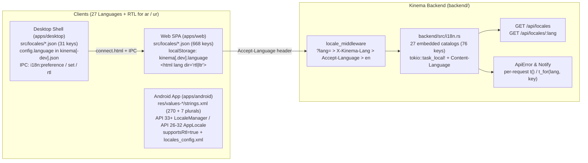

# Internationalization (i18n)

Kinema supports **27 languages** across all four surfaces — Backend (`backend/`), Web (`apps/web/`), Desktop (`apps/desktop/`), and Android (`apps/android/`) — including full **Right-to-Left (RTL)** layout support for Arabic (`ar`) and Urdu (`ur`).

## Architecture

## Supported Languages (27)

| # | BCP-47 / ISO (Backend, Web, Desktop) | Android `res/` qualifier | Android `localeFilters` | Native display name | RTL |
|---|---|---|---|---|---|
| 1 | `en` | `values` | `en` | English | No |
| 2 | `hi` | `values-hi` | `hi` | हिन्दी | No |
| 3 | `es` | `values-es` | `es` | Español | No |
| 4 | `pt-BR` | `values-pt-rBR` | `pt` | Português (Brasil) | No |
| 5 | `id` | `values-in` | `in` | Bahasa Indonesia | No |
| 6 | `ar` | `values-ar` | `ar` | العربية | **Yes** |
| 7 | `fr` | `values-fr` | `fr` | Français | No |
| 8 | `ru` | `values-ru` | `ru` | Русский | No |
| 9 | `de` | `values-de` | `de` | Deutsch | No |
| 10 | `tr` | `values-tr` | `tr` | Türkçe | No |
| 11 | `ja` | `values-ja` | `ja` | 日本語 | No |
| 12 | `ko` | `values-ko` | `ko` | 한국어 | No |
| 13 | `it` | `values-it` | `it` | Italiano | No |
| 14 | `vi` | `values-vi` | `vi` | Tiếng Việt | No |
| 15 | `th` | `values-th` | `th` | ไทย | No |
| 16 | `zh-CN` | `values-zh-rCN` | `zh` | 中文 (简体) | No |
| 17 | `zh-TW` | `values-zh-rTW` | `zh` | 中文 (繁體) | No |
| 18 | `pl` | `values-pl` | `pl` | Polski | No |
| 19 | `bn` | `values-bn` | `bn` | বাংলা | No |
| 20 | `ta` | `values-ta` | `ta` | தமிழ் | No |
| 21 | `te` | `values-te` | `te` | తెలుగు | No |
| 22 | `mr` | `values-mr` | `mr` | मराठी | No |
| 23 | `gu` | `values-gu` | `gu` | ગુજરાતી | No |
| 24 | `kn` | `values-kn` | `kn` | ಕನ್ನಡ | No |
| 25 | `ml` | `values-ml` | `ml` | മലയാളം | No |
| 26 | `pa` | `values-pa` | `pa` | ਪੰਜਾਬੀ | No |
| 27 | `ur` | `values-ur` | `ur` | اردو | **Yes** |

## Platform Implementations

### 1. Backend (`backend/`)

- **Catalogs**: 27 JSON files in `backend/locales/<lang>.json` (76 keys each, preserving placeholders such as `{user}`, `{kind}`, `{device}`, and `{title}`).
- **Embedding & Metadata**: `backend/src/i18n.rs` embeds all 27 catalogs at compile time via `include_str!` and exposes `SUPPORTED_LOCALES` (`code`, `name`, `rtl`).
- **Locale Resolution**: `resolve_locale()` normalizes tags (case-insensitive, `_` → `-`, `in` → `id`, `zh-Hans`/`zh-Hant`/`zh-HK` → `zh-CN`/`zh-TW`, `pt-*` → `pt-BR`), parses `Accept-Language` with `q`-value sorting, and falls back to `en`.
- **Per-Request Context**: `locale_middleware` checks `?lang=` / `?locale=` → `X-Kinema-Lang` / `X-Locale` → `Accept-Language` → `en`, binds the resolved locale to a `tokio::task_local!`, and sets the `Content-Language` response header. `ApiError` (`backend/src/error.rs`) and admin notifications (`notify.rs`, `routes/settings.rs`) resolve messages automatically via `t()` / `t_for(lang, key)`.
- **API Endpoints**: `GET /api/locales` lists all 27 supported locales; `GET /api/locales/:lang` returns the catalog for a requested locale.

### 2. Web (`apps/web/`)

- **Catalogs**: 27 JSON files in `apps/web/src/locales/<lang>.json` (668 keys each, preserving `{placeholder}` tokens).
- **Loading & Resolution**: `apps/web/src/lib/languages.ts` defines `SUPPORTED_LANGUAGES`, `RTL_LANGUAGES` (`ar`, `ur`), `isRtl`, `resolveLanguage`, and `formatMessage`. `apps/web/src/lib/i18n.ts` keeps `en` bundled and lazy-loads non-English locale chunks on demand via `import.meta.glob`, falling back to `en` for missing keys.
- **Persistence & RTL**: The selected language is persisted in `localStorage` under `storageKeys.language` (`kinema.language` in prod, `kinema.dev.language` in dev). Changing languages updates `document.documentElement.lang` and `document.documentElement.dir` (`rtl` for `ar` and `ur`, `ltr` otherwise) and triggers a React re-render via `useLanguage()` in `App.tsx` after `await initLanguage()` in `main.tsx`.
- **API & Formatting**: `lib/api.ts` sends the active locale in the `Accept-Language` header; `lib/format.ts` (`Intl.DisplayNames`), `lib/credits.ts` (`getCredits()`), and date formatters follow the active locale.
- **UI**: Language `<Select>` pickers are available in `AuthScreen.tsx` and `ProfilePage.tsx`.

### 3. Desktop (`apps/desktop/`)

- **Catalogs**: 27 JSON files in `apps/desktop/src/locales/<lang>.json` (31 keys each for the Electron shell, server switcher, menus, dialogs, and error messages).
- **Resolution & RTL**: `apps/desktop/src/i18n.js` embeds all 27 catalogs and provides `SUPPORTED_LANGUAGES`, `isRtl` / `getDirection` (`ar`, `ur` → `rtl`), and region/script-aware `resolveLanguage` (`pt-BR`, `zh-CN`, `zh-TW`, `zh-Hans`/`zh-Hant`, `in` → `id`, `'system'` skip, `en` fallback).
- **IPC & Persistence**: `main.js` and `preload.js` expose `i18n:preference`, `i18n:languages`, `i18n:rtl`, and `i18n:set`, persisting `config.language` in `kinema.json` (or `kinema-dev.json` in dev) and clearing it when set to `'system'`.
- **UI**: `connect.html` includes a language selector and applies `document.documentElement.lang` and `dir='rtl'` dynamically.

### 4. Android (`apps/android/`)

- **Resources**: 27 resource directories (`values/` + 26 `values-<qual>/strings.xml`), each containing 270 `<string>` and 7 `<plurals>` entries with CLDR plural categories (e.g., `pl`, `ru`, `ar`). `app_name` stays `Kinema`.
- **Manifest & Gradle**: `res/xml/locales_config.xml` declares all 27 locales and is referenced by `android:localeConfig="@xml/locales_config"` alongside `android:supportsRtl="true"` in `AndroidManifest.xml`. `app/build.gradle.kts` sets `androidResources { localeFilters += ... }` using Android's resource qualifiers (including `"in"` for Indonesian, `"pt"`, `"zh"`).
- **In-App Picker**: `AppLocale.kt` uses the platform `LocaleManager` on Android 13+ (API 33+) and `SharedPreferences` + `Configuration` wrapping in `MainActivity.attachBaseContext` on API 26–32. Users can switch languages in `SettingsTab.kt` (`AppearanceSection`).

## Testing & Parity

Every platform includes automated tests verifying that all 27 locale files parse cleanly, match the English source key set 1:1, preserve all interpolation placeholders/format specifiers, and resolve RTL flags and region/script variants accurately:

- **Backend**: `cargo test --workspace` (unit & HTTP integration tests in `backend/src/i18n.rs`).
- **Web**: `pnpm --filter @kinema/web test` (`apps/web/src/lib/i18n.test.ts`).
- **Desktop**: `pnpm --filter @kinema/desktop test` (27-language key/placeholder parity, resolution, and RTL checks).
- **Android**: `pnpm android:test` (`AppLocaleTest.kt`, plus XML/specifier validation across all 27 `values*` directories).
