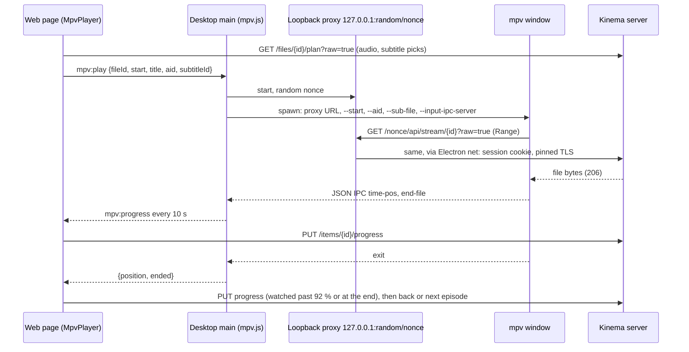
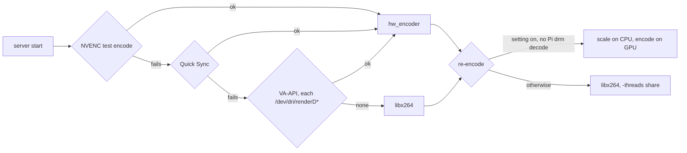
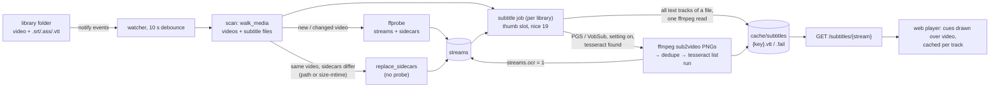
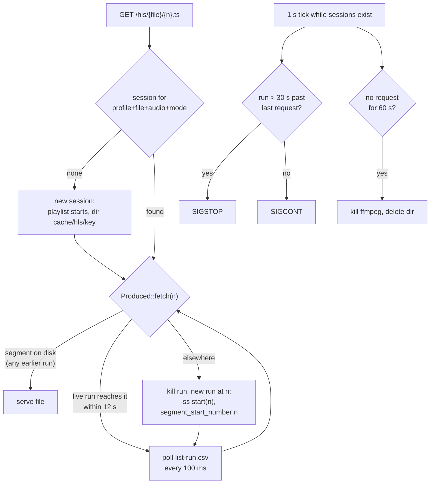
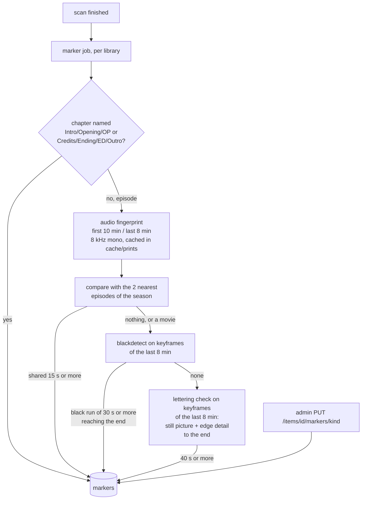

# Media Pipeline

## 1. Discovery

- Initial walk of each library root with `walkdir`. Ignore hidden dirs, `@eaDir`, `.DS_Store`, sample files under 20 MB named `sample`.
- Live updates with `notify`. Events are debounced 2 s and coalesced per path. A file still growing (size changes between two checks 5 s apart) is deferred.
- No periodic full rescan by default. Optional per library schedule.

## 2. Identify "any file"

Extension is a hint only. Order:

1. Run `ffprobe -v quiet -print_format json -show_format -show_streams -show_chapters`.
2. If probe succeeds: classify by streams (video, audio-only, image).
3. If it fails: record `probe_status=failed`, still create an item of kind `other` with filename as title, serve as a raw download.

Probe output is stored as JSON in `files.probe_json`. Probe is skipped when the fingerprint is unchanged.

Fingerprint: `size` + xxh3 of first 64 KiB + last 64 KiB. Cheap on spinning disks and network mounts.

## 3. Playback decision

MVP: implemented in `kinema-media::playback` with progressive fragmented MP4 instead of HLS; see `mvp.md` for the rules, the seek offset and the shortcuts.

Client sends supported containers, video codecs (with profile/level), audio codecs, max bitrate, max resolution.

| Condition | Mode | CPU cost |
|---|---|---|
| Container, video, audio all supported | Direct play | Near zero |
| Video supported, audio or container not | Remux to HLS fMP4, transcode audio only if needed | Very low |
| Video unsupported or over bitrate limit | Transcode video | High |
| Subtitles are image-based (PGS) and client cannot render | Burn in (transcode) | High |

Text subtitles never force a transcode: convert to WebVTT and send as a side track.

### Codec claims that fail

A browser can claim HEVC or AV1 (`MediaSource.isTypeSupported`, `canPlayType`) and still fail to decode it: Chromium on Linux with GPU switches forced but no working VAAPI HEVC decoder does exactly that. When the `<video>` element reports `MEDIA_ERR_DECODE` or `MEDIA_ERR_SRC_NOT_SUPPORTED` on a direct or remux stream, the web player drops HEVC and AV1 from its caps and plans again at the same time, so the server transcodes. The Android app does the same on a decoder error.

The desktop app once forced Chromium's VAAPI and HEVC switches on Linux (`VaapiIgnoreDriverChecks`, `PlatformHEVCDecoderSupport`). Reverted: without a working driver Chromium claimed HEVC and playback stopped. HEVC in the desktop app goes through a transcode, or through mpv.

### Desktop app: play in mpv

When mpv is available (`KINEMA_MPV`, the copy bundled with the app, or `mpv` on PATH; order and bundling in `packaging.md`), the desktop app offers **Play in mpv** on the title page, and **Open in mpv** in the player while it transcodes. mpv decodes every codec on the viewer's computer, so the server only serves bytes (`raw=true`, ranged reads): no remux, no transcode, whatever the file holds.



- The proxy keeps the session out of mpv's command line (visible to every local user in `ps`) and lets the app's own network stack check the server's pinned certificate, instead of mpv skipping TLS checks. Only `GET`/`HEAD` under `/<nonce>/api/` are forwarded, and only the headers ranged reads need come back.
- Tracks: the server's picks (this profile's choice, then Languages settings) become `--aid` and, for a text subtitle, `--sub-file` pointing at the WebVTT endpoint. mpv's own menus switch tracks after that.
- `--ytdl=no`: a URL never reaches youtube-dl. The user's own `mpv.conf` and scripts still apply.
- One mpv at a time; a new title closes the previous one, and quitting the app closes it too.
- mpv ships inside the desktop installers once `scripts/mpv.lock` is pinned (`packaging.md`). When it is missing or fails to start, the page offers **Play in the app instead** (in-page player, same position).

## 4. Transcode

- Hardware first: at startup `MediaBinaries::resolve` tries NVENC, then Quick Sync, then VA-API on each render node (`kinema_core::platform::render_nodes`, Linux only) by encoding 0.2 s of black with the exact arguments a stream uses (`playback::HwEncoder`), 10 s timeout each. The first that succeeds is `MediaBinaries::hw_encoder`; the log names it and the Transcoder settings page shows it, with a switch (`transcode_hardware`, on by default). Only the encode moves to the GPU: decoding, scaling and the audio stay on the CPU, and a Raspberry Pi HEVC re-encode through `hevc_drm` keeps libx264, since that ffmpeg build was not the one tested. Quality maps onto each encoder's own constant-quality knob: NVENC `-cq` (with the same peak rate as x264), Quick Sync `-global_quality`, VA-API `-qp`. Measured 2026-10-22 on the i5-10200H laptop with BtbN's ffmpeg 8.1 and a 20 s synthetic 1080p clip: libx264 veryfast with 4 threads 13.6 CPU-seconds, NVENC (GTX 1650) 2.2, output valid H.264 Main yuv420p. Quick Sync (rejected: rate control and format unsupported by the QSV runtime without an explicit `-init_hw_device`) and VA-API (the bundled ffmpeg aborts in libva, `vaMapBuffer2` missing from the host libva) failed their test encode on the same machine and are skipped, which is the fallback working; both are untested on a working setup. Shortcut: a GPU that fails after startup (driver reset, NVENC session limit) fails the stream instead of falling back to x264.


- Software fallback: `libx264` with the admin's preset, CRF and max height (Transcoder settings). Threads: see the Threads entry below.
- Output: HLS, 4 s segments, started at the requested position (`-ss` before `-i`).
- Session limits: default 2 concurrent. A third request gets HTTP 503 with a retry hint.
- HEVC decode on the GPU where only that exists (Raspberry Pi 5): `-hwaccel drm` through the distribution's ffmpeg, see `packaging.md` § Hardware transcoding.
- Priority: live remux and transcode run at `nice 10` (Windows `BELOW_NORMAL_PRIORITY_CLASS`), background ffmpeg (probe, thumbnails, markers, subtitles) at `nice 19` (`IDLE_PRIORITY_CLASS`). Both live in `kinema-core::platform` (`configure_playback_process`, `configure_low_priority_process`).
- Audio in a transcode is always re-encoded (AAC stereo), never copied. With `-ss` before `-i`, ffmpeg cuts decoded streams at the exact time but keeps copied packets from the keyframe before it, then `make_zero` lines the start up on the audio: the video began with one frame and a hole up to a keyframe interval long (0.5-5.6 s on F1, measured), and browsers held that frame while the audio clock ran. Re-encoding the audio costs a sliver of x264's CPU and cuts both at the same point. Remux keeps copying both with `-noaccurate_seek`, which starts both at the keyframe.
- Fragments: a re-encode writes `-frag_duration 500000` fragments. With only `frag_keyframe`, ffmpeg holds output until the next keyframe (x264 places one up to 250 frames apart), so on a Pi the first two fragments took 6.6 s (GPU decode) or 8.9 s (CPU) after play or a seek; with half-second fragments, 2.5 s. Chrome plays and seeks the result the same as before. Remux keeps keyframe fragments: copying is fast enough.
- Seek picture: before a new remux/transcode stream loads, the web player draws the current frame into the `<video>` poster, so the picture holds instead of flashing black.
- Throttle: a re-encode may run at most 30 s (`THROTTLE_AHEAD_S`) ahead of the wall clock since it started. The lead is encoded at full speed after every play and seek, so it is the length of the CPU spike; it was 60 s until 2026-10-22, and 30 s still covers a short seek back or forward without a restart. ffmpeg reports `out_time_us` through `-progress pipe:2`; past the lead, the server stops reading its stdout, the pipe fills and ffmpeg blocks until playback catches up. CPU drops from "as fast as the cores allow" to "real time" (measured on an i5-10200H: 470 % to 230 %). Done in Rust, not with ffmpeg's `-readrate_initial_burst`, because that option needs ffmpeg 6.1 and the Raspberry Pi build with HEVC hardware decode is 5.1. Remux is not throttled: it costs little CPU and a deep buffer helps slow networks.
- Rate control: libx264 runs CRF (the Quality setting) with a peak of `-maxrate` 2/4/8/12/20 Mbit/s for 480p/720p/1080p/1440p/2160p or Original and `-bufsize` twice that (`playback::max_kbps`). Without a cap a grainy or fast scene took several times the average bitrate. Presets slower than `veryfast` also get `-rc-lookahead 10`, veryfast's own value, instead of 20-40 frames analysed ahead.
- Threads: a re-encode passes `-threads N` to both the decoder and libx264. N is the server setting `transcode_threads`, or with Auto (0) the logical cores divided by `max_transcodes`, never fewer than 4 (`playback::transcode_threads`): a Raspberry Pi 5 encodes 1080p at only about 1.4x real time on all four cores, so machines with 4 cores or fewer are not capped. Without it ffmpeg starts a thread per core for each, so the full-speed lead after every play or seek took the whole machine, and two conversions fought over the same cores. The cap does not slow a throttled stream: past the lead it only has to keep real time.
- HLS segments are kept within 10 min of the playhead, so a seek back reuses them; session dir purged on idle timeout (60 s) and at startup (§ 6a).

## 5. Thumbnails

- Poster fallback: single frame at 10% of duration, scaled to 400 px wide, WebP. `-skip_frame nokey` and input seeking keep it to roughly one keyframe decode.
- Scrub sprites (`kinema-media/src/sprites.rs`, `backend/src/sprites.rs`): one frame every 10 s (wider on files over 5.5 h, so at most 2000 tiles), 160x90 px tiles (letterboxed), 10x10 tiles per JPEG sheet, plus a WebVTT index with `#xywh=` cues. Made on the first request for a title, not for the whole library. One ffmpeg run with `-skip_frame nokey` (keyframes only, then `fps` repeats the nearest keyframe to fill the 10 s grid), at `nice 19` while holding the shared background slot (`thumb_slots`); a title is never made twice at once. Cached in `cache/sprites/{file id}-{mtime}-{size}/` (`sheet-N.jpg`, `index.vtt` written last, directory renamed into place); a changed file drops its old directory, a failure leaves `{key}.fail` so it is not retried. "Clear thumbnails" clears sprites too. Until they exist the endpoints answer 202 (`Retry-After: 15`); the player polls and shows the preview once ready. Tile times are keyframe-accurate only: with a long GOP, neighbouring tiles can show the same picture.
- Audio files: embedded cover art via ffmpeg `-an -vcodec copy`.

## 6. Subtitles

Built 2026-10-22 (`kinema-media::subtitles`, `kinema-media::ocr`, `backend/src/subtitles.rs`).



- Sidecars: `name.srt|ass|ssa|vtt`, `name.lang.srt`, `name.lang.forced.srt` matched by basename. The scan walks subtitle files together with videos, so a subtitle added, edited or removed next to an unchanged video updates that file's sidecar streams (`items::replace_sidecars`) without probing the video. Each sidecar stream stores its own `size-mtime` (`streams.external_fingerprint`).
- Cache key (`subtitles::CacheKey`): embedded `{file}-{size}-{mtime}-{stream idx}`, sidecar `{file}-s{fnv64(path)}-{size-mtime}`. A changed video or sidecar gets a new name, so nothing stale is served and nothing unchanged is redone. A failure leaves `{key}.fail`, so it is not retried until the file changes. Entries of old versions stay until the cache is cleared in Troubleshooting.
- Extraction runs in a background job after every scan (`Jobs "subtitles"`), one file at a time through the shared thumbnail slot at `nice 19`. All text tracks of a video are written in one ffmpeg run (one `-map`/output pair per track), so a 20 GB file is read once, not once per language. If that run fails, each track is retried alone so one broken track does not block the others.
- `GET /subtitles/{id}` serves the cached WebVTT; a text track the job has not reached yet is extracted once on request. `ass` styling becomes WebVTT `<i>`/`<b>` or is dropped by ffmpeg, and the player strips tags.
- Switching a text track is client-side only: the player fetches the WebVTT once per track (kept in memory, so switching back is instant) and draws cues over the video at the absolute play time. No server session restart, no ffmpeg run, no video reload.
- Picture tracks (PGS, VobSub, DVB) are read by OCR when the admin turns on Settings › Languages › Read picture subtitles (`subtitle_ocr`, off by default) and `tesseract` was found at startup (`KINEMA_TESSERACT`, then PATH; `tesseract --list-langs` must list a model). Flow: ffmpeg renders only the subtitle stream (sub2video, no video decode) as grayscale PNGs named by their time in ms (`-filter_complex [0:N]format=gray -fps_mode passthrough -enc_time_base 1/1000 -frame_pts 1`); byte-identical consecutive frames are dropped; one `tesseract` run reads all frames from a list file (`--psm 6`, `OMP_THREAD_LIMIT=1`: with OpenMP threads it took 6.4 s per caption on a busy 4-core box, 0.13 s with one); each frame's text lasts until the next frame. The track language picks the model (`fre` → `fra`), else English, else the track is skipped. Success sets `streams.ocr = 1`, and players then list the track like a text track. Without OCR, picture tracks stay listed but disabled.
- Clearing the subtitle cache resets `streams.ocr` and starts the job again for every library.

## 6a. Fast start and seek on large files

Goal: no Plex-style stall on multi-GB files, on seek, or on caption change.

```
 play request
      |
      v
 cached probe + keyframe index  (size+mtime+fingerprint key; miss => ffprobe once)
      |
      +-- direct play ---> ranged read / sendfile  (seek = byte-range jump, no server session)
      |
      +-- remux ---------> ffmpeg -c copy -> HLS fMP4, started at -ss, seek inside cut segments
      |
      +-- transcode -----> HLS, session kept alive across seeks; reuse segments already cut
```

- Probe and keyframe index are stored in the DB at scan time, never computed on the play path.
- Direct play uses `Range` with no read-ahead cap and `sendfile`; no transcode session is created.
- A seek inside an active HLS session first checks for existing segments; only a seek outside the cut range restarts ffmpeg, and it uses input seeking (`-ss` before `-i`) to the nearest keyframe.
- Idle sessions are kept 60 s so a quick seek back does not pay startup again.

### Keyframe index (done 2026-10-22)

A background job (`backend/src/keyframes.rs`, after every scan, before thumbnails, sharing the one background media slot) indexes each probed video once per file version into `keyframe_index` (`data-model.md`), keyed by `files.fingerprint`. Builder: `kinema-media::keyframes`.

| Container | Source | Cost |
|---|---|---|
| Matroska / WebM | Cues of the first video track, found through the SeekHead (Cues usually sit at the end) | a few KB read, milliseconds on any size |
| MP4 / MOV | `stss` of the video `trak`, times from `stts` + `ctts` − first edit | the `moov` box only, `mdat` is skipped |
| anything else ≤ 4 GiB | `ffprobe -select_streams v:0 -show_entries packet=pts_time,flags` (demux, no decode), nice 19, 120 s cap | reads the whole file once |
| bigger, or timed out | none (`source = 'none'`, not retried for that version) | — |

Cues and `stss` are exactly the points ffmpeg's Matroska and MP4 demuxers seek to, so a lookup gives the same landing ffmpeg will. Checked on ffmpeg-made files with irregular keyframes: the Matroska reader matches ffprobe exactly, the MP4 reader within 21 ms (ffmpeg's own edit-list shift). More than 50 000 keyframes (intra-only) stores none: any time is a keyframe there.

Uses:
- `GET /files/{id}/plan` for a remux: the start offset is `KeyframeIndex::landing(t)` (keyframe at or before `t`, `t − 3/23 s` with B-frames, as ffmpeg aims), a binary search instead of two ffprobe runs. Without an index it still asks ffprobe. The landing is the video keyframe; copied audio can begin up to one audio frame earlier (≈ 20 ms), below what subtitles show.
- HLS remux segments start on indexed keyframes (below).

### HLS sessions (done 2026-10-22, server side)

`GET /api/hls/{file}/index.m3u8` returns a VOD playlist of the whole title; `GET /api/hls/{file}/{n}.ts` returns segment `n`. Segments are MPEG-TS cut by ffmpeg's segment muxer. Copied video: segments start at indexed keyframes, at least 4 s apart (`hls::copy_segments`; needs the index, else 409 `media.hls_unavailable`). Re-encode: a 4 s grid with forced keyframes (`hls::grid_segments`). Audio other than AAC/MP3 is re-encoded to AAC (TS carries those two as is).



- Every run's segments line up with the playlist and with each other's: copied video keeps source timestamps (`-copyts -avoid_negative_ts disabled`) and cuts at `-segment_times` just under each keyframe; a re-encode shifts its output with `-output_ts_offset start`. Checked with ffmpeg 6.1: a run restarted at segment 3 produced segment 4 with the same PTS as a run from 0 (copy), within 21 ms (re-encode).
- Files are `{run}-{n}.ts`, so a new run never rewrites a segment being served; the first complete copy of a segment wins. Segments from an earlier run stay usable after a restart (seek to 160 s, back to 4 s: served from run 1 in 13 ms, measured).
- A segment more than 10 min (`KEEP_S`) from the one asked for is deleted, which bounds a session on disk.
- Throttle: past 30 s (`THROTTLE_AHEAD_S`) beyond the last requested segment, the run is stopped with SIGSTOP (`kinema_core::platform::suspend_process`) and continued when the player nears. Remux is throttled too here: it writes to disk, not into a socket. Windows has no implementation yet, so runs there are not paused.
- A profile has one session per file: asking with another audio track drops the old one. A re-encode run holds a transcode slot (503 `media.transcode_busy` past `max_transcodes`) while it exists, including the 60 s idle time.
- `cache/hls` is purged at startup.
- Shortcuts: no player uses HLS yet (the web player and Android still use the progressive stream; Safari needs it). HEVC copied into TS needs a player that decodes HEVC in MPEG-TS (untested), so for HEVC an HLS client should ask without `hevc=true` and get a re-encode. No fMP4 segments.

## 7. Intro and credits markers (skip intro, up next)

A background job (`backend/src/markers.rs`, detection in `kinema-media/src/markers.rs`) runs after every scan, after thumbnails, and looks at each movie, episode and video once per file version (`files.markers_mtime`). Every ffmpeg run shares the one background media slot (`thumb_slots`) at low priority. Results go to the `markers` table and out with each file in `GET /items/{id}` as `markers: [{kind, start_s, end_s, source}]`.



- **Chapters** first: free and exact when the release has them. "Opening Credits" counts as the intro.
- **Audio** for episodes: the theme song and the end song repeat across a season while the story does not. Our own fingerprint (no chromaprint needed): 33 log-spaced bands from 300 Hz to 2 kHz over 256 ms frames every 32 ms, one bit per band-energy change, silence hashed as 0 and never matched. Two prints are aligned by voting on exact hash hits, then the best alignments are walked for the longest run of near-equal hashes (8 bits or fewer differ, gaps up to 1 s, starting and ending on a near-exact hit). Intros are 15 to 200 s; credits must start after the episode's midpoint. Prints are cached per file version, so a new episode decodes only itself.
- **Black frames** for credits still missing: white text on black reads as black at 92 % (`pic_th`), and decoding keyframes only keeps a 4K file to a few hundred frames. The run must last 30 s and reach the last 20 s.
- **Lettering over lit footage** (`source = "text"`) for credits still missing after that. One more keyframe-only ffmpeg run over the same tail window, each keyframe scaled to 480 px and measured twice: `signalstats` YDIF (mean luma change since the previous keyframe) and the mean of an `edgedetect` map. A keyframe is credit-like when YDIF <= 15 (a still or slowly moving backdrop) and edge mean >= 1.5 (something is written on it). Walking back from the end, the credits start at the earliest credit-like keyframe that keeps at least 85 % of the keyframes since then credit-like, forgiving at most 2 odd keyframes in a row; the last keyframe must lie within 45 s of the end, at least 8 keyframes and 40 s must be covered, and the start must be past the midpoint (`credits_from_looks`, pure and unit-tested). Loudness is not used. Limits: credits over a busy moving picture look like story and are missed (the player falls back to the last minute); a long still, lettered last scene can be taken for credits. The thresholds are a first guess tuned on synthetic footage only (see Validation below); `KINEMA_CREDITS_FILE=<file> cargo test -p kinema-media look_at_a_file -- --ignored --nocapture` prints the per-keyframe values of a real file for tuning. Migration `20261022400001` re-queues files that had no credits marker so existing libraries get the new check once.
- **Validation of the lettering check**: no real footage was available. Tested on ffmpeg-generated 960x540 files (4 min of story made of 5 s clips with hard cuts over moving sources, then 2 min of rolling `drawtext` credits): over a static lit colour and over a slowly moving gradient the start was found at 246 s (true 240 s: the first lines are still entering at the bottom); over a moving Mandelbrot backdrop and on the story without credits it returned nothing, as intended. The pure decision logic has unit tests over synthetic keyframe series. How it behaves on real films and episodes (grain, letterboxing, film titles over live action) is unknown.
- **Manual**: an admin's marker wins and is kept; deleting it looks for the marker again.

Players: **Skip intro** shows while the intro plays and seeks to its end. From the credits start (or the last 60 s without credits) the up-next card offers the next episode; a movie shows **Skip credits**, which leaves the player.
