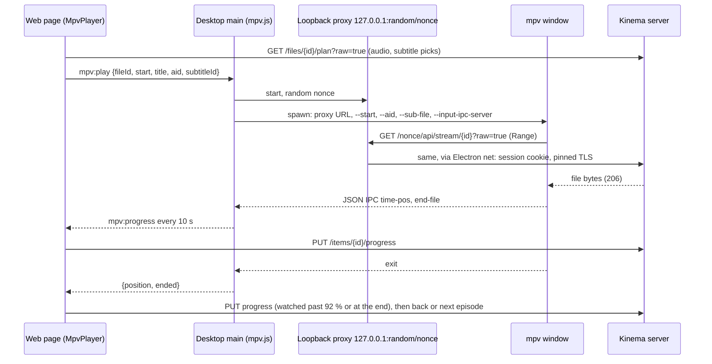
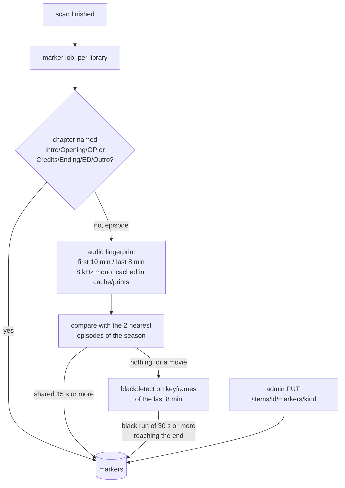

# Media Pipeline

## 1. Discovery

- Initial walk of each library root with `walkdir`. Ignore hidden dirs, `@eaDir`, `.DS_Store`, sample files under 20 MB named `sample`.
- Live updates with `notify`. Events are debounced 2 s and coalesced per path. A file still growing (size changes between two checks 5 s apart) is deferred.
- No periodic full rescan by default. Optional per library schedule.

## 2. Identify "any file"

Extension is a hint only. Order:

1. Run `ffprobe -v quiet -print_format json -show_format -show_streams -show_chapters`.
2. If probe succeeds: classify by streams (video, audio-only, image).
3. If it fails: record `probe_status=failed`, still create an item of kind `other` with filename as title, serve as a raw download.

Probe output is stored as JSON in `files.probe_json`. Probe is skipped when the fingerprint is unchanged.

Fingerprint: `size` + xxh3 of first 64 KiB + last 64 KiB. Cheap on spinning disks and network mounts.

## 3. Playback decision

MVP: implemented in `kinema-media::playback` with progressive fragmented MP4 instead of HLS; see `mvp.md` for the rules, the seek offset and the shortcuts.

Client sends supported containers, video codecs (with profile/level), audio codecs, max bitrate, max resolution.

| Condition | Mode | CPU cost |
|---|---|---|
| Container, video, audio all supported | Direct play | Near zero |
| Video supported, audio or container not | Remux to HLS fMP4, transcode audio only if needed | Very low |
| Video unsupported or over bitrate limit | Transcode video | High |
| Subtitles are image-based (PGS) and client cannot render | Burn in (transcode) | High |

Text subtitles never force a transcode: convert to WebVTT and send as a side track.

### Codec claims that fail

A browser can claim HEVC or AV1 (`MediaSource.isTypeSupported`, `canPlayType`) and still fail to decode it: Chromium on Linux with GPU switches forced but no working VAAPI HEVC decoder does exactly that. When the `<video>` element reports `MEDIA_ERR_DECODE` or `MEDIA_ERR_SRC_NOT_SUPPORTED` on a direct or remux stream, the web player drops HEVC and AV1 from its caps and plans again at the same time, so the server transcodes. The Android app does the same on a decoder error.

The desktop app once forced Chromium's VAAPI and HEVC switches on Linux (`VaapiIgnoreDriverChecks`, `PlatformHEVCDecoderSupport`). Reverted: without a working driver Chromium claimed HEVC and playback stopped. HEVC in the desktop app goes through a transcode, or through mpv.

### Desktop app: play in mpv

When mpv is installed (`mpv` on PATH, or `KINEMA_MPV`), the desktop app offers **Play in mpv** on the title page, and **Open in mpv** in the player while it transcodes. mpv decodes every codec on the viewer's computer, so the server only serves bytes (`raw=true`, ranged reads): no remux, no transcode, whatever the file holds.



- The proxy keeps the session out of mpv's command line (visible to every local user in `ps`) and lets the app's own network stack check the server's pinned certificate, instead of mpv skipping TLS checks. Only `GET`/`HEAD` under `/<nonce>/api/` are forwarded, and only the headers ranged reads need come back.
- Tracks: the server's picks (this profile's choice, then Languages settings) become `--aid` and, for a text subtitle, `--sub-file` pointing at the WebVTT endpoint. mpv's own menus switch tracks after that.
- `--ytdl=no`: a URL never reaches youtube-dl. The user's own `mpv.conf` and scripts still apply.
- One mpv at a time; a new title closes the previous one, and quitting the app closes it too.
- Shortcut: mpv is not bundled. Bundle it (Windows `mpv.exe`, Linux AppImage) when installs show people miss it.

## 4. Transcode

- Hardware first: VAAPI (Intel/AMD), NVENC, QSV, VideoToolbox, detected at startup by test-encoding a short clip.
- Software fallback: `libx264` with the admin's preset, CRF and max height (Transcoder settings). Threads: see the Threads entry below.
- Output: HLS, 4 s segments, started at the requested position (`-ss` before `-i`).
- Session limits: default 2 concurrent. A third request gets HTTP 503 with a retry hint.
- HEVC decode on the GPU where only that exists (Raspberry Pi 5): `-hwaccel drm` through the distribution's ffmpeg, see `packaging.md` § Hardware transcoding.
- Priority: live remux and transcode run at `nice 10` (Windows `BELOW_NORMAL_PRIORITY_CLASS`), background ffmpeg (probe, thumbnails, markers, subtitles) at `nice 19` (`IDLE_PRIORITY_CLASS`). Both live in `kinema-core::platform` (`configure_playback_process`, `configure_low_priority_process`).
- Audio in a transcode is always re-encoded (AAC stereo), never copied. With `-ss` before `-i`, ffmpeg cuts decoded streams at the exact time but keeps copied packets from the keyframe before it, then `make_zero` lines the start up on the audio: the video began with one frame and a hole up to a keyframe interval long (0.5-5.6 s on F1, measured), and browsers held that frame while the audio clock ran. Re-encoding the audio costs a sliver of x264's CPU and cuts both at the same point. Remux keeps copying both with `-noaccurate_seek`, which starts both at the keyframe.
- Fragments: a re-encode writes `-frag_duration 500000` fragments. With only `frag_keyframe`, ffmpeg holds output until the next keyframe (x264 places one up to 250 frames apart), so on a Pi the first two fragments took 6.6 s (GPU decode) or 8.9 s (CPU) after play or a seek; with half-second fragments, 2.5 s. Chrome plays and seeks the result the same as before. Remux keeps keyframe fragments: copying is fast enough.
- Seek picture: before a new remux/transcode stream loads, the web player draws the current frame into the `<video>` poster, so the picture holds instead of flashing black.
- Throttle: a re-encode may run at most 30 s (`THROTTLE_AHEAD_S`) ahead of the wall clock since it started. The lead is encoded at full speed after every play and seek, so it is the length of the CPU spike; it was 60 s until 2026-10-22, and 30 s still covers a short seek back or forward without a restart. ffmpeg reports `out_time_us` through `-progress pipe:2`; past the lead, the server stops reading its stdout, the pipe fills and ffmpeg blocks until playback catches up. CPU drops from "as fast as the cores allow" to "real time" (measured on an i5-10200H: 470 % to 230 %). Done in Rust, not with ffmpeg's `-readrate_initial_burst`, because that option needs ffmpeg 6.1 and the Raspberry Pi build with HEVC hardware decode is 5.1. Remux is not throttled: it costs little CPU and a deep buffer helps slow networks.
- Rate control: libx264 runs CRF (the Quality setting) with a peak of `-maxrate` 2/4/8/12/20 Mbit/s for 480p/720p/1080p/1440p/2160p or Original and `-bufsize` twice that (`playback::max_kbps`). Without a cap a grainy or fast scene took several times the average bitrate. Presets slower than `veryfast` also get `-rc-lookahead 10`, veryfast's own value, instead of 20-40 frames analysed ahead.
- Threads: a re-encode passes `-threads N` to both the decoder and libx264. N is the server setting `transcode_threads`, or with Auto (0) the logical cores divided by `max_transcodes`, never fewer than 4 (`playback::transcode_threads`): a Raspberry Pi 5 encodes 1080p at only about 1.4x real time on all four cores, so machines with 4 cores or fewer are not capped. Without it ffmpeg starts a thread per core for each, so the full-speed lead after every play or seek took the whole machine, and two conversions fought over the same cores. The cap does not slow a throttled stream: past the lead it only has to keep real time.
- Segments are deleted as the client moves past them. Session dir purged on idle timeout (60 s) and at startup.

## 5. Thumbnails

- Poster fallback: single frame at 10% of duration, scaled to 400 px wide, WebP. `-skip_frame nokey` and input seeking keep it to roughly one keyframe decode.
- Scrub sprites: one frame every 10 s, 160 px wide, tiled into a sprite JPEG plus a WebVTT map. Generated lazily on first request, low priority.
- Audio files: embedded cover art via ffmpeg `-an -vcodec copy`.

## 6. Subtitles

- External files `name.lang.srt|ass|vtt` matched by basename.
- Embedded text tracks extracted on demand and cached.
- `ass` converted to WebVTT with styling stripped by default.
- Extraction runs at scan time (low priority), not at play time, so the first track switch is a cache hit.
- Switching a text track is client-side only: the player swaps the `<track>` source. No server session restart, no ffmpeg run, no video reload.
- Image tracks (PGS, VobSub) are OCRed at scan time to WebVTT (optional, off by default, runs after probe at lowest priority). Without OCR they fall back to burn-in, which restarts the transcode on each change. Burn-in is the only case where a caption change costs a restart.

## 6a. Fast start and seek on large files

Goal: no Plex-style stall on multi-GB files, on seek, or on caption change.

```
 play request
      |
      v
 cached probe + keyframe index  (size+mtime+fingerprint key; miss => ffprobe once)
      |
      +-- direct play ---> ranged read / sendfile  (seek = byte-range jump, no server session)
      |
      +-- remux ---------> ffmpeg -c copy -> HLS fMP4, started at -ss, seek inside cut segments
      |
      +-- transcode -----> HLS, session kept alive across seeks; reuse segments already cut
```

- Probe and keyframe index are stored in the DB at scan time, never computed on the play path.
- MKV with Cues at the end: read the Cues once at scan time and store the offsets, so the first seek does not scan the file.
- Direct play uses `Range` with no read-ahead cap and `sendfile`; no transcode session is created.
- A seek inside an active HLS session first checks for existing segments; only a seek outside the cut range restarts ffmpeg, and it uses input seeking (`-ss` before `-i`) to the nearest keyframe.
- Idle sessions are kept 60 s so a quick seek back does not pay startup again.

## 7. Intro and credits markers (skip intro, up next)

A background job (`backend/src/markers.rs`, detection in `kinema-media/src/markers.rs`) runs after every scan, after thumbnails, and looks at each movie, episode and video once per file version (`files.markers_mtime`). Every ffmpeg run shares the one background media slot (`thumb_slots`) at low priority. Results go to the `markers` table and out with each file in `GET /items/{id}` as `markers: [{kind, start_s, end_s, source}]`.



- **Chapters** first: free and exact when the release has them. "Opening Credits" counts as the intro.
- **Audio** for episodes: the theme song and the end song repeat across a season while the story does not. Our own fingerprint (no chromaprint needed): 33 log-spaced bands from 300 Hz to 2 kHz over 256 ms frames every 32 ms, one bit per band-energy change, silence hashed as 0 and never matched. Two prints are aligned by voting on exact hash hits, then the best alignments are walked for the longest run of near-equal hashes (8 bits or fewer differ, gaps up to 1 s, starting and ending on a near-exact hit). Intros are 15 to 200 s; credits must start after the episode's midpoint. Prints are cached per file version, so a new episode decodes only itself.
- **Black frames** for credits still missing: white text on black reads as black at 92 % (`pic_th`), and decoding keyframes only keeps a 4K file to a few hundred frames. The run must last 30 s and reach the last 20 s. Credits over lit footage are not found; the player then falls back to the last minute.
- **Manual**: an admin's marker wins and is kept; deleting it looks for the marker again.

Players: **Skip intro** shows while the intro plays and seeks to its end. From the credits start (or the last 60 s without credits) the up-next card offers the next episode; a movie shows **Skip credits**, which leaves the player.
