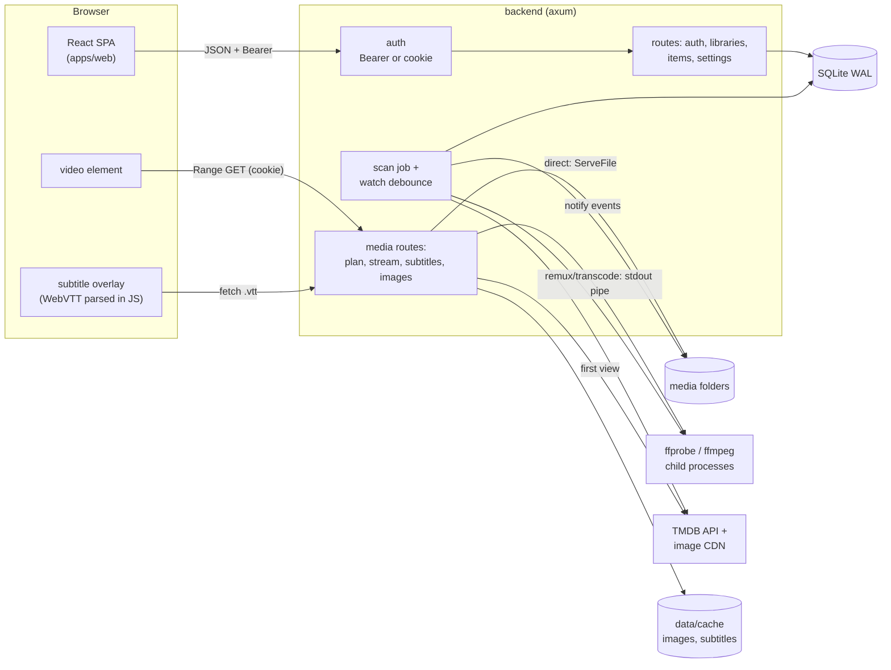
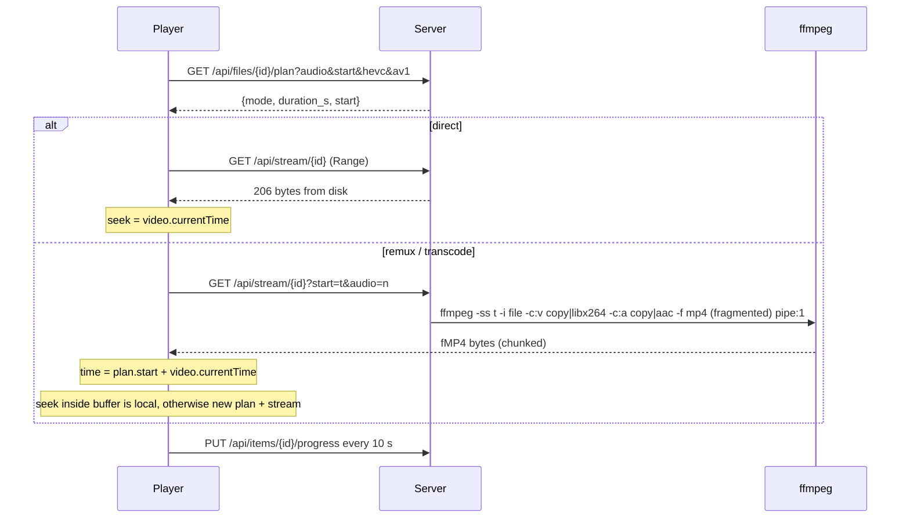

# MVP

What the first working build does, how it is wired, and the shortcuts it takes. Later milestones in `roadmap.md` replace the shortcuts.

## Scope

- First-run setup: the first account becomes the administrator. Afterwards a sign-in screen.
- Libraries: the admin adds any server folder as Movies, TV Shows or Other videos, from a folder browser or by typing a path. Several folders per library.
- Scanning: walk on create and at startup, then filesystem events (no polling), debounced 10 s. Missing files are removed, unless a root is unreachable (an unmounted drive never wipes a library).
- Identification: release-name parser (`kinema-scanner::parse`). Movies and TV Shows libraries both detect episodes (`S01E02`, `1x02`), so a series inside a movies folder groups into Show, Season, Episode. The show name is the longer of the top folder name and the name in the file, since either can be an abbreviation (`DCM` vs `Devil.May.Cry`); a trailing `S01` is dropped. Folders where 3 or more files read `<folder name> <number>` become a one-season show. Files filed by an older parser are moved on the next scan.
- Fix match: admins search TMDB from a movie or show page and pick the right result. The old metadata is cleared; for a show, seasons and episodes are looked up again.
- Mixed libraries: a library that holds movies and shows gets Movies and TV Shows sub-entries in the sidebar (`/library/{id}?type=movie|show`).
- Probe: `ffprobe` once per file, 2 at a time, re-run only when size or mtime changes. Sidecar subtitles (`Movie.en.srt`, `.forced`, `.sdh`) are stored as extra subtitle streams.
- Metadata: TMDB (v3 key or v4 token, set in Settings). Movies, shows, seasons and episodes get titles, summaries, ratings, genres and art. A lookup that finds nothing is not repeated; saving a new key retries every unmatched item.
- Artwork: fetched from TMDB on first view, cached under `data/cache/images/<size>/`, served `immutable`.
- Browse: home (Continue Watching, Recently Added per library), library grid with sort, show, season and episode pages, title search.
- Playback: direct play, remux or transcode chosen per file and browser. Audio track switch, subtitle switch, resume, progress every 10 s, watched at 92 %, next episode on end.

Not in the MVP: more users and profiles, HLS, hardware encoding, scrub thumbnails, bitmap subtitles (PGS/VobSub are listed but disabled), Safari for remuxed streams (see below).

## Architecture

## Playback flow

Decision rules (`kinema-media::playback::plan`):

| File | Mode |
|---|---|
| mp4/m4v/mov/webm, browser-decodable video and audio, first audio track | Direct play |
| Video decodable (H.264 8-bit, VP9, HEVC/AV1 when the browser says so) but container, audio codec or audio track choice is not | Remux: video copied, audio copied or AAC stereo |
| Anything else | Transcode: libx264 veryfast, max 1920 wide, AAC stereo |
| Not probed (ffprobe missing or failed) | Direct, raw bytes |

Browsers play only the first audio track of a file, so choosing another track switches to remux: cheap, the video is still copied.

### Seek offset

Stream copy can only start at a seek point (a keyframe, or a Matroska cue). The server asks ffprobe to perform the same seek ffmpeg will (including ffmpeg's 3/23 s back-off for B-frame video) and reports the first packet time as `start`. The player adds it to `currentTime`, so the seek bar and subtitles stay exact.

### Subtitles

Text tracks (embedded or sidecar) are converted to WebVTT once and cached in `data/cache/subtitles/{file}-{mtime}-{stream}.vtt`. The player draws cues itself rather than through `<track>`, because remuxed streams start at a non-zero source time. Switching a subtitle never touches the video.

### Process lifetime

The response body owns the ffmpeg child (`kill_on_drop`). When the browser seeks, closes the tab or navigates away, the request drops and ffmpeg stops, so nothing encodes for nobody.

## Auth

- Passwords: Argon2id. Sessions: random 256-bit token, SHA-256 stored, 30 days.
- API calls send `Authorization: Bearer`. Media elements cannot set headers, so sign-in also sets `kinema_session` (HttpOnly, SameSite=Strict, Path=/api).
- First-admin creation is a single conditional INSERT, so two racing setup requests cannot both win.

## Shortcuts

| Shortcut | Limit | Upgrade |
|---|---|---|
| Progressive fMP4 instead of HLS | Safari does not play non-ranged fMP4; each far seek restarts ffmpeg | HLS with keyframe index (M4) |
| Fingerprint = size + mtime | A renamed file is re-added and re-probed | head/tail hash (M1 spec) |
| LIKE search | Slow beyond tens of thousands of items | FTS5 `items_fts` |
| Sidecar subtitles read only at probe time | A new `.srt` next to an unchanged video is not seen until the video changes | include sidecars in the walk |
| Session cookie name is not flavor-specific | Dev and prod on the same host share the media cookie | per-flavor cookie name |
| Watch state of a file moved from a "movie" to an episode is dropped | Progress on wrongly-filed episodes resets once | carry watch state across moves |
| Single admin user | No profiles or library access control | M3 / M5 |
