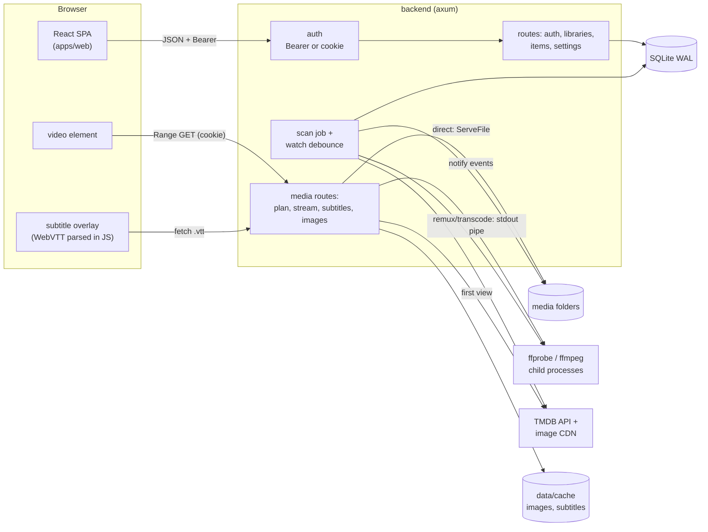
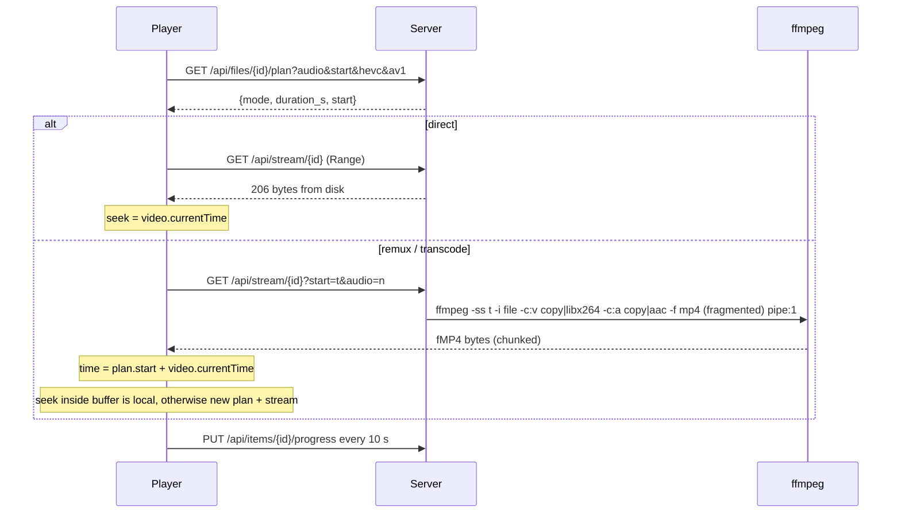
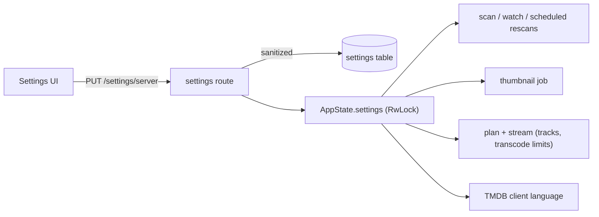

# MVP

What the first working build does, how it is wired, and the shortcuts it takes. Later milestones in `roadmap.md` replace the shortcuts.

## Scope

- First-run setup: the first account becomes the administrator. Afterwards a sign-in screen.
- Libraries: the admin adds any server folder as Movies, TV Shows or Other videos, from a folder browser or by typing a path. Several folders per library.
- Scanning: walk on create and at startup, then filesystem events (no polling), debounced 10 s. Missing files are removed, unless a root is unreachable (an unmounted drive never wipes a library).
- Identification: release-name parser (`kinema-scanner::parse`). Movies and TV Shows libraries both detect episodes (`S01E02`, `1x02`), so a series inside a movies folder groups into Show, Season, Episode. The show name is the longer of the top folder name and the name in the file, since either can be an abbreviation (`DCM` vs `Devil.May.Cry`); a trailing `S01` is dropped. Folders where 3 or more files read `<folder name> <number>` become a one-season show. Files filed by an older parser are moved on the next scan.
- Item actions: movie, episode, show and season pages share one action row. Play (a show or season plays its first unwatched episode, `next_up` in `GET /items/:id`), mark watched or unwatched (`PUT /items/:id/watched`, applies to every episode under a show or season), copy link, and for admins Fix match and, on a show, Audio & subtitles: one audio and subtitle track for every episode, picked from the first episode's tracks and stored as track positions (episodes of one release share the layout).
- Fix match: admins search TMDB from a movie or show page and pick the right result. The old metadata is cleared; for a show, seasons and episodes are looked up again.
- Mixed libraries: a library that holds movies and shows gets Movies and TV Shows sub-entries in the sidebar (`/library/{id}?type=movie|show`).
- Probe: `ffprobe` once per file, 2 at a time, re-run only when size or mtime changes. Sidecar subtitles (`Movie.en.srt`, `.forced`, `.sdh`) are stored as extra subtitle streams.
- Metadata: TMDB (v3 key or v4 token, set in Settings). Movies, shows, seasons and episodes get titles, summaries, ratings, genres and art. A lookup that finds nothing is not repeated; saving a new key retries every unmatched item.
- Artwork: fetched from TMDB on first view, cached under `data/cache/images/<size>/`, served `immutable`.
- Thumbnails: items without TMDB art show a video frame from `GET /api/items/{id}/thumb` (a show uses its first episode). Frames are made by a background job (`backend/src/thumbs.rs`) that runs after every scan, one ffmpeg at a time at low priority: one grab per file version at the configured position (keyframe-only decode, full-decode retry), 640 px JPEG in `data/cache/thumbs/{file}-{mtime}.jpg`. The endpoint only serves the cache and never runs ffmpeg; a miss returns 404 and nudges the job. A failed grab leaves a `.fail` marker. Libraries → Regenerate thumbnails deletes a library's frames and makes them again.
- Home: hero carousel (continue watching, then newest titles), Continue Watching, and per library Recently Added Movies, New Episodes and Recently Added Shows rows.
- Browse: home (Continue Watching, Recently Added per library), library grid with sort, show, season and episode pages, title search.
- Playback: direct play, remux or transcode chosen per file and browser. Audio track switch, subtitle switch, resume, progress every 10 s, watched at 92 %, next episode on end, stop button (Plex-style: pauses, reports progress, exits full screen, navigates back; shortcuts: s, x, Escape).

Not in the MVP: more users and profiles, HLS, hardware encoding, scrub thumbnails, bitmap subtitles (PGS/VobSub are listed but disabled), Safari for remuxed streams (see below).

## Architecture

## Playback flow

Decision rules (`kinema-media::playback::plan`):

| File | Mode |
|---|---|
| mp4/m4v/mov/webm, browser-decodable video and audio, first audio track | Direct play |
| Video decodable (H.264 8-bit, VP9, HEVC/AV1 when the browser says so) but container, audio codec or audio track choice is not | Remux: video copied, audio copied or AAC stereo |
| Anything else | Transcode: libx264 veryfast, max 1920 wide, AAC stereo |
| Not probed (ffprobe missing or failed) | Direct, raw bytes |

Browsers play only the first audio track of a file, so choosing another track switches to remux: cheap, the video is still copied.

### Seek offset

Stream copy can only start at a seek point (a keyframe, or a Matroska cue). The server asks ffprobe to perform the same seek ffmpeg will (including ffmpeg's 3/23 s back-off for B-frame video) and reports the first packet time as `start`. The player adds it to `currentTime`, so the seek bar and subtitles stay exact. When video is copied but audio is re-encoded, ffmpeg runs with `-noaccurate_seek`: otherwise it trims the audio to the exact requested time while video starts at the earlier keyframe, and both begin at 0 out of sync.

### Subtitles

Text tracks (embedded or sidecar) are converted to WebVTT once and cached in `data/cache/subtitles/{file}-{mtime}-{stream}.vtt`. The player draws cues itself rather than through `<track>`, because remuxed streams start at a non-zero source time. Switching a subtitle never touches the video.

### Process lifetime

The response body owns the ffmpeg child (`kill_on_drop`). When the browser seeks, closes the tab or navigates away, the request drops and ffmpeg stops, so nothing encodes for nobody.

## Settings

Admin-only, at `/settings/<section>`, grouped like a server control panel. While Settings is open the app sidebar shows the sections instead of the libraries, with Back to home on top, and the page uses the full content width. Every option is read by the code it names; there are no placeholder switches.

| Section | Options | Used by |
|---|---|---|
| Dashboard | titles, storage, hours, active conversions, background tasks, thumbnail progress per library, ffmpeg paths | `GET /api/server/status` |
| General | server name | sign-in screen, browser title, `/server/info` |
| Library | watch for changes, generate thumbnails, frame position | `scan::watch`, `thumbs.rs` |
| Metadata | TMDB key, metadata language | `TmdbClient::language` |
| Languages | preferred audio, subtitle mode (off / always / when audio is foreign), preferred subtitle | `plan` picks the start tracks; a show's own choice (Audio & subtitles on the show page, admin) wins |
| Transcoder | simultaneous conversions, x264 preset, quality (CRF), max height | `stream` (503 when full), `playback::Encode` |
| Network | listen address, LAN URL (read-only; set in `kinema.toml`) | status |
| Scheduled Tasks | rescan every N hours | `scan::scheduled_rescans` |
| Libraries | add, scan, match missing, regenerate thumbnails, remove | library routes |
| Users | family profiles: colour, admin role, PIN, password, library access | `/api/users`, `access.rs` |
| Troubleshooting | clear thumbnail, subtitle, artwork caches | `/server/cache/{kind}/clear` |

Values live as one JSON row (`settings.key = 'server'`), cached in `AppState`, and are clamped to known values on save (`ServerSettings::sanitized`).

## Auth

- Passwords: Argon2id. Sessions: random 256-bit token, SHA-256 stored, 30 days.
- API calls send `Authorization: Bearer`. Media elements cannot set headers, so sign-in also sets `kinema_session` (HttpOnly, SameSite=Strict, Path=/api).
- First-admin creation is a single conditional INSERT, so two racing setup requests cannot both win.

## Shortcuts

| Shortcut | Limit | Upgrade |
|---|---|---|
| Progressive fMP4 instead of HLS | Safari does not play non-ranged fMP4; each far seek restarts ffmpeg | HLS with keyframe index (M4) |
| Fingerprint = size + mtime | A renamed file is re-added and re-probed | head/tail hash (M1 spec) |
| LIKE search | Slow beyond tens of thousands of items | FTS5 `items_fts` |
| Sidecar subtitles read only at probe time | A new `.srt` next to an unchanged video is not seen until the video changes | include sidecars in the walk |
| Session cookie name is not flavor-specific | Dev and prod on the same host share the media cookie | per-flavor cookie name |
| Watch state of a file moved from a "movie" to an episode is dropped | Progress on wrongly-filed episodes resets once | carry watch state across moves |
| Settings are server-wide | Family profiles share language and transcoder choices | per-profile preferences |
