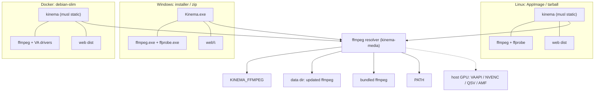

# Packaging and Platforms

End goal: Kinema runs everywhere with one download and no manual dependency installs, with ffmpeg included and updatable.

## Targets

| Target | Artifact | Arch | Backend build | ffmpeg |
|---|---|---|---|---|
| Linux, any distro | `Kinema-<ver>-<arch>.AppImage` | x86_64, aarch64 | `*-unknown-linux-musl`, static | bundled static GPL build |
| Linux, no FUSE or servers | `kinema-<ver>-<arch>-linux.tar.gz` (same binary and layout, no AppImage wrapper) | x86_64, aarch64 | musl static | bundled |
| Windows 10/11 | `Kinema-<ver>-setup.exe` (installer) and `Kinema-<ver>-windows-x64.zip` (portable) | x86_64, aarch64 later | `x86_64-pc-windows-msvc` | bundled `ffmpeg.exe`, `ffprobe.exe` |
| Docker | `ghcr.io/<owner>/kinema:<ver>` | linux/amd64, linux/arm64 | musl static | see Docker section |
| macOS | later, not in scope now | | | |

## Decisions

1. **ffmpeg license: ship the GPL build.** ffmpeg runs as a separate child process and is never linked into Kinema, so Kinema's own license is not affected. GPL gives libx264, libx265 and good software encoders, which matter for the "any file plays everywhere" goal. We ship the ffmpeg license text, the exact build version, and a link to its source in `licenses/` and in Settings, About. If the Kinema license ever requires it, an LGPL build can replace it by changing `ffmpeg.lock` only.
2. **Backend: static musl on Linux, MSVC on Windows.** One static binary runs on every Linux flavor and in a tiny Docker image. musl's allocator is slow, so use `mimalloc` as the global allocator. aarch64 is in the first release for Linux and Docker, since cross-building with `cargo-zigbuild` or `cross` is cheap. Because the backend is static, the AppImage needs no bundled libc and has no glibc-version problem.

## Bundle layout

Linux AppImage / tarball:

```
Kinema.AppDir/
  AppRun                      sets env, execs usr/bin/kinema
  kinema.desktop, kinema.png
  usr/bin/kinema              backend (static musl)
  usr/bin/ffmpeg, ffprobe     pinned GPL builds
  usr/share/kinema/web/       apps/web/dist
  usr/share/kinema/licenses/  Kinema, ffmpeg, third-party notices
```

Windows: `Kinema.exe`, `ffmpeg.exe`, `ffprobe.exe`, `web\`, `licenses\` in one folder. Installer adds Start menu entry, optional "start at login" and an optional Windows service.

## ffmpeg bundling and resolution

- Per-platform pinned builds recorded in `scripts/ffmpeg.lock`: version, URL, SHA-256 for each of linux-x86_64, linux-aarch64, windows-x64. The package script downloads, verifies the hash, copies in.
- Run-time resolution order, same on every platform: `KINEMA_FFMPEG` env, user-updated copy in the data dir (`.../kinema/ffmpeg/<version>/`), bundled copy next to the executable (or `$APPDIR/usr/bin`), then `PATH`. One resolver in `kinema-media`; never call `ffmpeg` by bare name elsewhere.
- Startup runs `ffmpeg -version` plus a hardware-encoder probe and caches the result.

## ffmpeg updates

1. Release path: `scripts/update-ffmpeg.sh` bumps `ffmpeg.lock`; CI rebuilds every artifact; the changelog records the ffmpeg version.
2. In-app path (admin only, Settings, Updates): download from a pinned HTTPS host, verify SHA-256 and a detached signature, extract into a new versioned directory in the data dir, test-run, then switch the resolver to it. "Revert to bundled" deletes it. The installed app files are never modified. In Docker, the data volume holds the update, so it survives container recreation.

## Hardware transcoding per platform

| Platform | Encoders |
|---|---|
| Linux | VAAPI (Intel/AMD), NVENC (NVIDIA), QSV (Intel) |
| Windows | NVENC, QSV, AMF (AMD) |
| Docker | pass devices: `--device /dev/dri` for VAAPI/QSV, `--gpus all` (NVIDIA toolkit) for NVENC |

Host GPU drivers cannot be bundled. Software x264 is always the fallback. Spike in M6: confirm the pinned static ffmpeg can load host VAAPI libraries on common distros. If it cannot, the AppImage switches to a dynamically linked glibc ffmpeg build, which changes nothing else.

## Platform differences handled in code

| Concern | Linux | Windows |
|---|---|---|
| Low priority ffmpeg | `nice 19` + `ionice -c3` | `BELOW_NORMAL_PRIORITY_CLASS` / `IDLE_PRIORITY_CLASS` via creation flags |
| Kill child tree | process group + `SIGTERM` | Job Object with kill-on-close |
| FS watching | inotify via `notify` | ReadDirectoryChangesW via `notify` |
| Paths | bytes allowed, store as `OsString`, display lossy | UTF-16; long paths with `\\?\` prefix; case-insensitive compare |
| Data dir | `$XDG_DATA_HOME/kinema` | `%APPDATA%\Kinema` |
| Config | `$XDG_CONFIG_HOME/kinema/kinema.toml` | `%APPDATA%\Kinema\kinema.toml` |
| Autostart | systemd user unit, desktop file | Startup entry or service |
| Open browser | `xdg-open` | `ShellExecute` |
| Network mounts | NFS/SMB: poll instead of inotify when events are unreliable (per-root option) | UNC paths supported |

Use `directories` for the data dir, `notify` for watching, and `cfg(windows)` modules only inside `kinema-core::platform`.

## Docker

- Base: `debian:stable-slim` (not scratch), so VAAPI and QSV drivers (`intel-media-va-driver`, `mesa-va-drivers`) are installable. Backend copied in as the static musl binary. ffmpeg comes from the pinned static build, with the Debian `ffmpeg` package as a documented fallback if the VAAPI spike fails.
- Runs as non-root (`PUID`/`PGID` env supported), `tini` as init.
- Volumes: `/config` (db, caches, ffmpeg updates), `/media` (read-only by default), optional `/transcode` tmpfs for HLS segments.
- Port 8080, `HEALTHCHECK` on `/api/server/info`.
- Multi-arch build with `docker buildx`. Example `docker-compose.yml` ships in the repo.
- Env: `KINEMA_DATA_DIR=/config`, `KINEMA_BIND=0.0.0.0:8080`, `KINEMA_TMDB_API_KEY`.

## App updates

- AppImage: embedded zsync info, `appimageupdatetool`.
- Windows: installer checks the GitHub release feed and downloads the new installer after the user confirms; portable zip shows a notice only.
- Docker: pull a new tag. The app only shows "update available".
- All signed: release assets carry SHA-256 sums and a minisign signature.

## Build and CI

```
pnpm build                    # web dist + cargo release (host)
scripts/package-appimage.sh   # Linux AppImage + tarball
scripts/package-windows.ps1   # zip + installer (Inno Setup)
scripts/package-docker.sh     # buildx multi-arch image
```

GitHub Actions matrix: `linux-x86_64`, `linux-aarch64` (cross), `windows-x64`, then a Docker job. Release uploads artifacts, `.zsync`, sums and signatures. Each job runs a smoke test: start the binary, hit `/api/server/info`, probe a sample file with the bundled ffprobe.

## Architecture diagram



## Open items

- Spike: static ffmpeg loading host VAAPI libraries.
- Code signing for Windows (Authenticode) and the signing key for releases.
- macOS target, after the three above ship.
