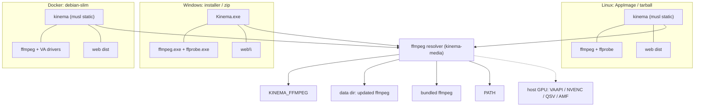

# Packaging and Platforms

End goal: Kinema runs everywhere with one download and no manual dependency installs, with ffmpeg included and updatable.

## Targets

| Target | Artifact | Arch | Backend build | ffmpeg |
|---|---|---|---|---|
| Linux, any distro | `Kinema-<ver>-<arch>.AppImage` | x86_64, aarch64 | `*-unknown-linux-musl`, static | bundled static GPL build |
| Linux, no FUSE or servers | `kinema-<ver>-<arch>-linux.tar.gz` (same binary and layout, no AppImage wrapper) | x86_64, aarch64 | musl static | bundled |
| Windows 10/11 | `Kinema-<ver>-setup.exe` (installer) and `Kinema-<ver>-windows-x64.zip` (portable) | x86_64, aarch64 later | `x86_64-pc-windows-msvc` | bundled `ffmpeg.exe`, `ffprobe.exe` |
| Docker | `ghcr.io/<owner>/kinema:<ver>` | linux/amd64, linux/arm64 | musl static | see Docker section |
| macOS | later, not in scope now | | | |

## Decisions

1. **ffmpeg license: ship the GPL build.** ffmpeg runs as a separate child process and is never linked into Kinema, so Kinema's own license is not affected. GPL gives libx264, libx265 and good software encoders, which matter for the "any file plays everywhere" goal. We ship the ffmpeg license text, the exact build version, and a link to its source in `licenses/` and in Settings, About. If the Kinema license ever requires it, an LGPL build can replace it by changing `ffmpeg.lock` only.
2. **Backend: static musl on Linux, MSVC on Windows.** One static binary runs on every Linux flavor and in a tiny Docker image. musl's allocator is slow, so use `mimalloc` as the global allocator. aarch64 is in the first release for Linux and Docker, since cross-building with `cargo-zigbuild` or `cross` is cheap. Because the backend is static, the AppImage needs no bundled libc and has no glibc-version problem.

## Bundle layout

Linux AppImage / tarball:

```
Kinema.AppDir/
  AppRun                      sets env, execs usr/bin/kinema
  kinema.desktop, kinema.png
  usr/bin/kinema              backend (static musl)
  usr/bin/ffmpeg, ffprobe     pinned GPL builds
  usr/share/kinema/web/       apps/web/dist
  usr/share/kinema/licenses/  Kinema, ffmpeg, third-party notices
```

Windows: `Kinema.exe`, `ffmpeg.exe`, `ffprobe.exe`, `web\`, `licenses\` in one folder. Installer adds Start menu entry, optional "start at login" and an optional Windows service.

## ffmpeg bundling and resolution

- Per-platform pinned builds recorded in `scripts/ffmpeg.lock`: version, URL, SHA-256 for each of linux-x86_64, linux-aarch64, windows-x64. The package script downloads, verifies the hash, copies in.
- Run-time resolution order, same on every platform: `KINEMA_FFMPEG` env, user-updated copy in the data dir (`.../kinema/ffmpeg/<version>/`), bundled copy next to the executable (or `$APPDIR/usr/bin`), then `PATH`. One resolver in `kinema-media`; never call `ffmpeg` by bare name elsewhere.
- Startup runs `ffmpeg -version` plus a hardware-encoder probe and caches the result.

## ffmpeg updates

1. Release path: `scripts/update-ffmpeg.sh` bumps `ffmpeg.lock`; CI rebuilds every artifact; the changelog records the ffmpeg version.
2. In-app path (admin only, Settings, Updates): download from a pinned HTTPS host, verify SHA-256 and a detached signature, extract into a new versioned directory in the data dir, test-run, then switch the resolver to it. "Revert to bundled" deletes it. The installed app files are never modified. In Docker, the data volume holds the update, so it survives container recreation.

## Hardware transcoding per platform

| Platform | Encoders |
|---|---|
| Linux | VAAPI (Intel/AMD), NVENC (NVIDIA), QSV (Intel) |
| Windows | NVENC, QSV, AMF (AMD) |
| Docker | pass devices: `--device /dev/dri` for VAAPI/QSV, `--gpus all` (NVIDIA toolkit) for NVENC |

Host GPU drivers cannot be bundled. Software x264 is always the fallback. Detection and the encoder arguments: `media-pipeline.md` § 4. AMF (AMD on Windows) is not tried yet; AMD on Linux goes through VA-API.

**Raspberry Pi 5 (HEVC decode only).** The Pi 5 has a hardware HEVC decoder (`rpi-hevc-dec`, V4L2 stateless) and no video encoder. The bundled static ffmpeg cannot use it; Raspberry Pi OS's own `ffmpeg` package can, through `-hwaccel drm`. At startup the resolver checks for the kernel decoder (`kinema_core::platform::has_v4l2_hevc_decoder`) and then asks the bundled ffmpeg, then the one on PATH, whether `ffmpeg -h decoder=hevc` lists `drm`. The first that does becomes `MediaBinaries::hevc_drm` and runs HEVC re-encodes only; everything else keeps the bundled build. On a Pi: `sudo apt install ffmpeg` and restart Kinema; the log says `HEVC hardware decode for transcodes: /usr/bin/ffmpeg (drm)`. Measured on F1 (1080p HEVC Main 10): 47.9 to 31.7 CPU-seconds per 20 s of video, 1.4x to 1.8x real time. Spike in M6: confirm the pinned static ffmpeg can load host VAAPI libraries on common distros. If it cannot, the AppImage switches to a dynamically linked glibc ffmpeg build, which changes nothing else.

## Platform differences handled in code

| Concern | Linux | Windows |
|---|---|---|
| Low priority ffmpeg | `nice 19` (background), `nice 10` (live streams) | `BELOW_NORMAL_PRIORITY_CLASS` / `IDLE_PRIORITY_CLASS` via creation flags |
| Kill child tree | process group + `SIGTERM` | Job Object with kill-on-close |
| FS watching | inotify via `notify` | ReadDirectoryChangesW via `notify` |
| Paths | bytes allowed, store as `OsString`, display lossy | UTF-16; long paths with `\\?\` prefix; case-insensitive compare |
| Data dir | `$XDG_DATA_HOME/kinema` | `%APPDATA%\Kinema` |
| Config | `$XDG_CONFIG_HOME/kinema/kinema.toml` | `%APPDATA%\Kinema\kinema.toml` |
| Autostart | systemd user unit, desktop file | Startup entry or service |
| Open browser | `xdg-open` | `ShellExecute` |
| Network mounts | NFS/SMB: poll instead of inotify when events are unreliable (per-root option) | UNC paths supported |

Use `directories` for the data dir, `notify` for watching, and `cfg(windows)` modules only inside `kinema-core::platform`.

## Docker

- Base: `debian:stable-slim` (not scratch), so VAAPI and QSV drivers (`intel-media-va-driver`, `mesa-va-drivers`) are installable. Backend copied in as the static musl binary. ffmpeg comes from the pinned static build, with the Debian `ffmpeg` package as a documented fallback if the VAAPI spike fails.
- Runs as non-root (`PUID`/`PGID` env supported), `tini` as init.
- Volumes: `/config` (db, caches, ffmpeg updates), `/media` (read-only by default), optional `/transcode` tmpfs for HLS segments.
- Port 8080, `HEALTHCHECK` on `/api/server/info`.
- Multi-arch build with `docker buildx`. Example `docker-compose.yml` ships in the repo.
- Env: `KINEMA_DATA_DIR=/config`, `KINEMA_BIND=0.0.0.0:8080`, `KINEMA_TMDB_API_KEY`.

## App updates

Now (manual): re-running the install scripts updates.

- `scripts/install-server.sh`: records the installed version in `/opt/kinema/VERSION` and does nothing when the newest release matches (`--force` reinstalls, `--check` only reports). An update keeps the service's existing `User=` (so the media stays readable whoever runs the update), stops the service, copies `kinema.db` (+ WAL/SHM) to `/var/lib/kinema/backup-<old version>` (only the latest backup is kept), swaps `/opt/kinema` as a whole folder and restarts. If the service is not active about 20 s later, the previous folder and the database backup are put back: a newer build may have migrated the database, which the older binary cannot open. A `--channel` given once is saved in `/var/lib/kinema/.channel`.
- `scripts/install-desktop.sh`: records the version in `~/.local/share/kinema/VERSION`, skips when up to date, saves a chosen channel, and says to restart the app when it is open.

Update checks. Every client asks the GitHub releases API of `aiyu-ayaan/Kinema` itself (unauthenticated, 60 requests an hour per address), so the server never phones home. The channel is the running version's: an alpha takes alphas, betas and stable; a beta takes betas and stable; stable takes stable. Only versions newer than the running one count, compared by version, never by date.

- Server, in the web UI (`apps/web/src/lib/releases.ts`): admins only. A release counts when it ships a `kinema-server-*` bundle. The sidebar shows "Update available · <version>", and Settings › Updates shows the commands to run: the install script (with `--channel` for alpha and beta) and `docker compose pull && docker compose up -d`. The server is never updated from the browser.
- Desktop app (`apps/desktop/src/updates.js`, IPC `update:*` in `main.js`, UI in `apps/web/src/components/UpdatePrompt.tsx`): packaged prod builds only. At start the page asks the app, which asks GitHub; a found version opens a dialog once ("Later" is remembered for that version in the app's config). An AppImage downloads the new AppImage next to itself as `.part`, checks the ELF header, renames it over itself and relaunches. Windows downloads `Kinema-Desktop-<version>-Setup.exe` (a `.deb` install the `.deb`) to Downloads and opens it. Settings › Updates shows the app's version, "Check now" and the download's progress.
- Android (`apps/android/app/.../update/AppUpdates.kt`): checks on launch, downloads `Kinema-<version>.apk` and installs it through a `PackageInstaller` session, so Android asks first. See `android.md`.

Planned (automatic):

- AppImage: embedded zsync info, `appimageupdatetool` (delta downloads instead of the whole file).
- All signed: release assets carry SHA-256 sums and a minisign signature.

## mpv in the desktop app

The desktop app (Electron, `apps/desktop`) bundles mpv for **Play in mpv** (`media-pipeline.md` § 3). mpv is GPL (this build) or LGPL and runs as a separate process, never linked, so Kinema's license is unaffected.

- **Pins:** `scripts/mpv.lock` holds the version and, per platform (`windows-x64`, `linux-x86_64`, `linux-aarch64`), the URL, SHA-256 and archive format (`7z` for Windows, `appimage` for Linux).
- **Fetch:** `scripts/fetch-mpv.mjs` runs first in `build:prod`, `build:dev` and `build:win` of `@kinema/desktop`. It downloads over HTTPS, checks the SHA-256 (a mismatch fails the build), extracts into `apps/desktop/build/mpv/` (git-ignored) and writes `NOTICE-mpv.txt` (license, source link, exact build). Windows archives are extracted with `7zip-bin` (an electron-builder dependency). The Linux AppImage is extracted with `--appimage-extract` on the build machine, so each architecture builds natively, and a small `mpv` wrapper starts its `AppRun`.
- **Bundle:** electron-builder `extraResources` copies that folder to `resources/mpv/` in the AppImage, the .deb and the Windows install.
- **Resolution** (`apps/desktop/src/mpv.js`, `findMpv`): `KINEMA_MPV`, then `$APPDIR/usr/bin/mpv` (AppImage) and `resources/mpv/mpv[.exe]`, plus `mpv.exe` next to the app on Windows, then `PATH`. mpv starts without `APPDIR`/`APPIMAGE`/`ARGV0`/`OWD` so its own AppRun is not confused by the app's.
- **Missing mpv:** the page hides Play in mpv. If a play still fails (binary gone, crash at start), the page shows the message from `apps/desktop/src/locales/en.json` and a **Play in the app instead** button that opens the in-page player at the same position.
- **Pinning or bumping:** `node scripts/fetch-mpv.mjs --pin <platform> <url>` downloads, prints the SHA-256 and writes it to the lock; compare it with the publisher's checksum before committing. `KINEMA_SKIP_MPV=1` builds without mpv. A platform with no pin is skipped with a warning (the app then uses mpv from `PATH`).
- **Status:** the lock is **not pinned yet**. The candidate builds (zhongfly/mpv-winbuild for Windows, pkgforge-dev/mpv-AppImage for Linux) could not be reached when this was written, and no hash was invented. Until it is pinned, installers ship without mpv. The AppRun wrapper and the nested layout are untested with a real mpv build.

## Build and CI

```
pnpm build                    # web dist + cargo release (host)
scripts/package-appimage.sh   # Linux AppImage + tarball
scripts/package-windows.ps1   # zip + installer (Inno Setup)
scripts/package-docker.sh     # buildx multi-arch image
```

GitHub Actions matrix: `linux-x86_64`, `linux-aarch64` (cross), `windows-x64`, then a Docker job. Release uploads artifacts, `.zsync`, sums and signatures. Each job runs a smoke test: start the binary, hit `/api/server/info`, probe a sample file with the bundled ffprobe.

## Architecture diagram



## Open items

- Spike: static ffmpeg loading host VAAPI libraries.
- Pin mpv in `scripts/mpv.lock` (see mpv in the desktop app) and try the bundled copy by hand on Linux and Windows.
- Code signing for Windows (Authenticode) and the signing key for releases.
- macOS target, after the three above ship.
