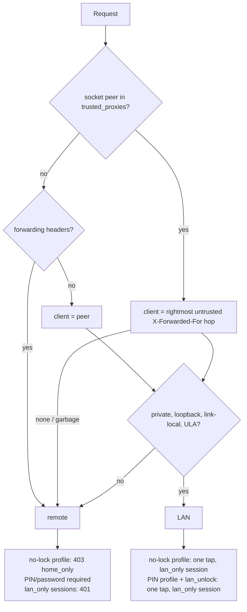
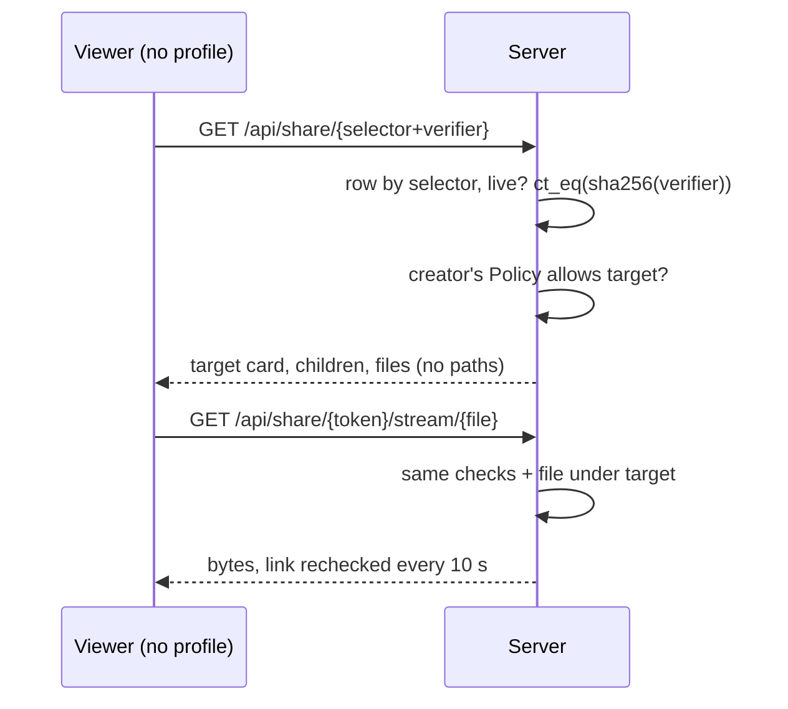

# Users, Profiles and Sharing

## Implemented (MVP)

- Sign-in is a "Who's watching?" picker: `GET /api/auth/profiles` (public) returns names, avatar colours and which lock each profile has. `POST /api/auth/login {user_id, password? | pin?}`.
- Locks: administrators always have a password (8+ chars). Other profiles have an optional 4–8 digit PIN, or none (one tap). Both hashed with argon2id.
- Lockout: 5 wrong tries lock a profile for 60 s (`AppState.login_failures`), so a 4-digit PIN cannot be brute-forced quickly.
- Settings → Manage → Users (`/api/users`, admin): add, edit (name, colour, admin role, PIN, password, libraries), delete. Guards: at least one admin, no self-demote or self-delete; changing a profile's lock signs it out everywhere.
- Library access (`user_library_access`): empty = every library; otherwise only those. Enforced server side in `backend/src/access.rs` on library lists, home, search, item detail, progress, plan, stream, subtitles and thumbnails; anything outside answers 404.
- Watch state is per profile (`watch_state.user_id`). Transcoder settings are server-wide.

## Implemented: profiles and household (2026-10-22)

Preferences live in `profile_prefs` (one row per profile, missing = defaults), `kinema-db::profiles`.

- **Languages per profile**: `audio_language`, `subtitle_language`, `subtitle_mode` (null follows Settings › Languages, `""` is the file's default track). The plan picks the audio as: the request's `audio`, the profile's per-title track choice, the show's admin choice, the profile's language, the server's language, the file's default. Subtitles the same way. A profile edits its own languages (`PUT /profile/preferences`, web `/profile`); admins edit any profile's in Settings › Profiles. Share links use the server's.
- **LAN-only unlocking** (`backend/src/net.rs`, `routes/auth.rs`):
  - A profile with no lock opens with one tap only from a LAN address; from anywhere else login answers 403 `auth.home_only` and the picker shows "Home network only".
  - A non-admin PIN profile with `lan_unlock` opens without the PIN from the LAN; elsewhere the PIN is asked. A typed PIN is always checked. Admins always need their password.
  - Sessions opened without a lock are stored `lan_only`; the same token from a non-LAN address answers 401 `auth.lan_session`, so a phone that leaves home must enter the PIN. Turning `lan_unlock` off ends those sessions.
  - LAN = IPv4 private (10/8, 172.16/12, 192.168/16), loopback, link-local (169.254/16); IPv6 loopback, ULA (fc00::/7), link-local (fe80::/10); v4-mapped IPv6 is classified as its IPv4. Not LAN: CGNAT 100.64/10 (other ISP customers; this includes Tailscale), global IPv6 even on the home network, NAT64. Fails closed: the PIN is asked.
  - Client address = socket peer. `X-Forwarded-For` is read only when the peer is in `[network] trusted_proxies` (kinema.toml, IPs or CIDRs), walking right to left past trusted hops. A request with `X-Forwarded-For`, `Forwarded` or `X-Real-IP` from an untrusted peer counts as remote, so a reverse proxy on the same host (peer 127.0.0.1) cannot make the internet look like the LAN even when it is not configured. A trusted proxy that sends no usable header also counts as remote.
- **Content limits** (`backend/src/access.rs` `Policy`): `max_rating` on a minimum-age scale 0..18 and `allow_unrated`. Certifications come from TMDB (`release_dates` for movies, `content_ratings` for shows, US first, else the first country) into `items.content_rating`; titles matched before this are looked up once per scan, 200 at a time. Admins set one by hand (`PUT /items/{id}/content-rating`, kept over TMDB). Seasons and episodes inherit the show's. Mapping in `kinema-core::content_rating` (G/TV-Y/TV-G 0, TV-Y7 7, PG/TV-PG 10, PG-13 13, TV-14 14, R/TV-MA 17, NC-17 18, UK and plain ages). Unknown certifications and `""` count as unrated. The policy filters library lists, home shelves, Continue Watching, search, children, prev/next, next up, and guards item detail, progress, watched, track choice, plan, stream, subtitles and thumbnails (404). Admins are never limited. Lists with a SQL `LIMIT` (search 50, shelves 24) are filtered after the query, so a limited profile can see fewer rows.
- **Share links** (`routes/shares.rs`, admin only): one movie, show, season, episode or video, expiry 1 h to 90 days, optional label, revocable. Token = 64-bit selector + 256-bit verifier (80 hex chars); the DB keeps the selector and SHA-256 of the verifier, compared in constant time. Viewer routes `/api/share/{token}`, `/items/{id}`, `/files/{id}/plan`, `/stream/{id}`, `/subtitles/{id}`, `/images/{size}/{name}` check on every request: link live, item inside the target (itself, its children or grandchildren), and the creator's own policy still allowing it. They open no session and expose no paths or watch state. A running share stream rechecks the link every 10 s and stops when it is revoked or expired. Deleting the creator deletes their links (trigger). Web page `/s/{token}`; admin list in Settings › Share links, create from a title's Share button.
- **Export / import** (`routes/profile.rs`): `GET /profile/export` (own) or `GET /users/{id}/export` (admin) gives `{format: "kinema.profile", version: 1, profile, preferences, watch: [...]}`; watch rows are keyed by TMDB / TVmaze id, else title + year, plus season / episode numbers. Lock hashes only with admin `?include_lock=true`. Import validates the whole file first (format, version, ≤ 50 000 rows, ranges, languages; 8 MB body) and keeps newer local progress. A profile importing into itself gets watch history and languages only, never limits, LAN unlock or a lock. Admin import applies limits and LAN unlock, and the lock only with `?apply_lock=true` and well-formed argon2 hashes; that signs the profile out everywhere.





```mermaid
sequenceDiagram
  participant P as Picker
  participant S as Server
  P->>S: GET /api/auth/profiles
  S-->>P: [{id, name, avatar, has_password, has_pin}]
  alt no lock
    P->>S: POST /auth/login {user_id}
  else PIN or password
    P->>S: POST /auth/login {user_id, pin | password}
    Note over S: 5 failures in a row: 429 for 60 s
  end
  S-->>P: {token, user} + kinema_session cookie
  P->>S: API calls (Bearer); media (cookie)
  Note over S: access.rs filters by user_library_access
```

## Accounts

- First run creates an admin through a setup screen.
- Admin creates profiles. A profile is a user: name, avatar, optional password, optional 4-digit PIN.
- Passwords hashed with argon2id. PINs are for switching profiles on a trusted LAN device, not for remote login.

## Profile picker

`GET /api/auth/profiles` returns names and avatars, the lock kind, and for this device `opens_without_lock` / `home_only`. Selecting a profile with a PIN or password calls `/auth/login`. Profiles without either are allowed only from LAN addresses (see above; proxies via `[network] trusted_proxies`).

## Per-profile state

Watch progress, watched flags, "Continue Watching", playlists, language and subtitle preferences. Nothing leaks across profiles.

## Permissions

| Role | Can |
|---|---|
| Admin | Everything: libraries, users, server settings, shares for any content |
| User | Browse allowed libraries, play, own playlists, create share links for items they can access |
| Restricted | Like User but with a max content rating and no sharing |

Library access is a whitelist in `user_library_access`. Content rating limits filter queries server side.

## Sessions

Random 256-bit token, stored as a hash. Default lifetime 30 days sliding. Cookie is `HttpOnly`, `Secure`, `SameSite=Lax`. Revocable per session.

## Sharing

Three modes:

1. Invite a user: admin creates a profile for them and grants libraries.
2. Share link: `POST /api/shares` creates a token for an item, playlist or library. URL form `/s/{token}`. Options: expiry, max uses, allow download.
3. Profile export: a profile's playlists and watch history can be exported as JSON and imported on another Kinema server.

Share link rules:

- Token is 128+ random bits, only its hash stored.
- Grants read-only playback of the target, nothing else. No library browsing outside the target.
- Playback goes through the same stream endpoints with a scoped token. Transcode slots are limited per link.
- Revocation takes effect immediately and kills active sessions from that link.
- Rate limited per IP.

## Remote access

Recommended: reverse proxy (Caddy) with TLS. Built-in option: ACME via `rustls-acme`. UPnP port mapping is off by default.
