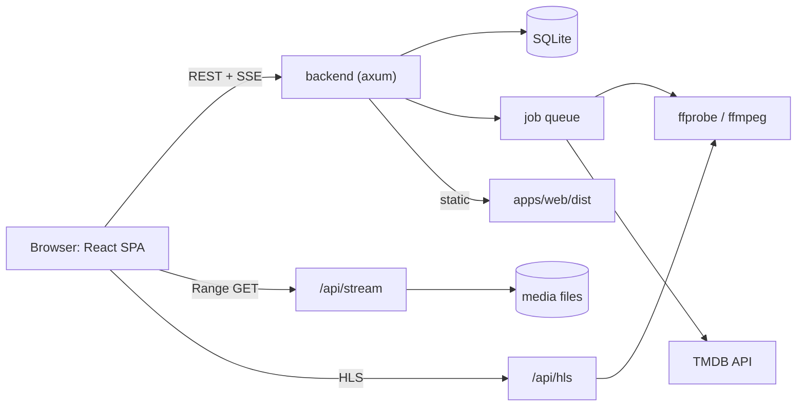

# Web UI

The web UI reuses the stack and commands of the sibling project Domus (`../domus`), so both projects feel and build the same.

## Stack

| Concern | Choice |
|---|---|
| Framework | React 18 + TypeScript (~5.7) |
| Build | Vite 6 |
| Styling | Tailwind CSS 3, `clsx`, `tailwind-merge` |
| Routing | `react-router-dom` 7 |
| Data | `@tanstack/react-query` 5 |
| Icons | `lucide-react`, `@phosphor-icons/react` |
| Font | `@fontsource-variable/inter` |
| Playback | native `<video>` for direct play, `hls.js` for remux/transcode |
| Package manager | pnpm workspace (`apps/*`) |

## Layout

```
apps/web/
  src/
    components/      shared UI: PosterCard, Row, ProgressBar, Player
    features/
      home/          Continue Watching, Recently Added rows
      library/       poster grids, filters, sort
      item/          movie, show, season, episode detail
      player/        video player, track menu, resume
      playlists/
      profiles/      profile picker, settings, sharing
      admin/         libraries, users, jobs
    hooks/
    lib/             api client, auth, flavor helpers
    App.tsx
  package.json      name: @kinema/web
design-system/       tokens and page specs (dark theme first)
```

## Screens

Matches the target reference screen:

- Left sidebar: Home, one entry per library, pinned shows, "More" and Settings (admins) at the bottom. Settings has a "Kinema" group: Updates and About Kinema.
- Top bar: search, profile menu.
- Home: "Continue Watching" row (poster, title, subtitle, progress bar), "Recently Added in <library>" rows, genre shelves.
- Poster cards: 2:3 art, title, year or `S1 · E5`, watched check, partial-progress bar.
- Dark theme default, light theme optional.

## Watch page

`/play/{id}` is a YouTube-style watch page (`features/player/PlayerPage.tsx`, `WatchPanels.tsx`): the video across the window with the title, links and story under it, and the up-next list beside it from 1024 px (under it below that). The list is the season's episodes with pinned season chips, or more titles from the library for a movie. `t` toggles theater mode (video across the full width, details and list under it, kept per browser), `f` full screen. Skip intro, Skip credits and the Up next card follow the markers (media-pipeline.md §7).

## Data flow

```
React components
   | useQuery / useMutation (TanStack Query)
   v
lib/api.ts  --- fetch /api/... (Bearer token) --->  axum backend
   ^                                                  |
   |------ SSE /api/server/events (scan progress) ---|
Player: <video src=/api/stream/{id}>  or  hls.js -> /api/hls/{session}/master.m3u8
```

Query keys follow `['libraries']`, `['items', libraryId, filters]`, `['home']`. Progress is sent every 10 s with `PUT /api/items/{id}/progress`. Posters use `/api/images/{key}?w=400` with `loading="lazy"`.

## MVP screens

Sign-in / first-run setup, Home, Library grid, Item (movie, show, season, episode), Search, Settings (admin: libraries, folder picker, TMDB key), Settings › Updates (`/settings/updates`) and Settings › About Kinema (`/settings/about`: version, developer, link to `/settings/about/acknowledgements`, the credits in `src/lib/credits.ts`), Player (route-split chunk). Strings live in `src/locales/en.json` and go through `t()` in `src/lib/i18n.ts`. UI kit mirrors Domus: `components/ui/{Button,Field,Card,Modal}`.

## Profiles and sharing screens (2026-10-22)

- Picker: profiles that open with one tap from this device go straight in; a profile without a lock seen from outside the home network is dimmed with "Home network only" (server flags `opens_without_lock`, `home_only`).
- `/profile` (`features/profiles/ProfilePage.tsx`, from the avatar pill in the top bar): the profile's own track languages and Export or import.
- Settings › Profiles: the editor has Household rules (content limit, unrated titles, Skip the PIN at home) and Languages; each row has Export or import (admin options: include / restore PIN and password).
- Title page (admin): Share (expiry, label; the link is shown once) and Rating (manual certification).
- Settings › Share links: every link with state and Revoke.
- `/s/{token}` (`features/shares/SharePage.tsx`, lazy): public, rendered before the auth check; title, seasons / episodes of the target, native `<video>` with WebVTT tracks through `/api/share/{token}/...`.

## Flavors

As in Domus, dev and prod instances must not interfere.

- Dev: localStorage keys `kinema.dev.token`, `kinema.dev.theme`; favicon `/favicon-dev.svg`; `DEV` pill in the navigation. Built with `pnpm build:web:dev`.
- Prod: `kinema.token`, `kinema.theme`. Built with `pnpm build:web:prod`.

## Serving

`pnpm build:web` outputs `apps/web/dist`. The axum server serves it with `tower-http::ServeDir`, with an `index.html` fallback for client routes, and `/api` routes taking precedence. In dev, Vite proxies `/api` to the backend.

## Performance

- Route-level code splitting; the player and hls.js load only on the player route.
- Virtualized poster grids for libraries over 500 items.
- Images are WebP, lazy-loaded, sized by `w=` query to avoid downscaling in the browser.

## Architecture diagram


